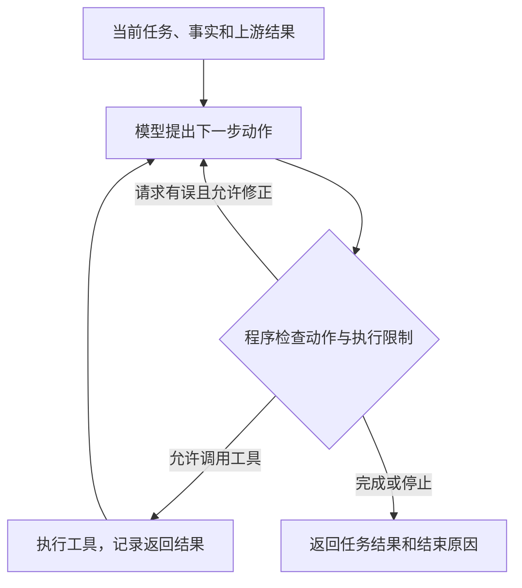

# 案件研判｜任务编排

## 简历条目

> **任务编排：**用 **LangGraph** 编排“规划—补证—集中核验—汇总”，按人员关系与时间窗拆分核查任务，按依赖和并发上限调度；对照串行执行，端到端 **p95 耗时 35→27 min**。

> 本条理解状态：已确认主线，按用户本轮意见修订。文中的例子用于解释机制；标为“后续实现建议”的内容用于指导项目迭代。下文“大模型”指大语言模型。

## 第一阶段：本条理解

这条工作的核心是：**把核查疑点要做的事情拆成具体任务，安排好执行顺序。需要的信息已经准备好、互不依赖的任务，可以一起推进；依赖其他任务输出的，就等所需结果返回后再执行。本轮执行结束后，对证据进行集中核验，再整理报告。**

一次案件研判需要多次查询案件数据，并请求大语言模型分析相关事实、规划核查任务或核验查询结果。

这部分工作的目标是：**在满足任务依赖和资源限制的前提下，通过异步调用和受限并发，在一项核查任务等待数据库或模型响应时，推进其他可以执行的任务，减少串行等待，缩短完整研判流程的耗时。**

### 1. 从疑点和相关事实出发，生成结构化核查计划

[研判策略](研判策略.md)先整理案件事实，再通过**业务规则通道和大模型分析通道**分别发现待核查疑点。随后，汇总两路疑点及相关事实，把它们作为规划输入，生成具体的核查任务。

一个疑点可以对应多项核查任务。按人员关系和时间窗拆分，是为了让每项任务明确查哪些人、查哪段时间的数据，以及查询结果用来回答什么问题。

规划时，后端把疑点、相关事实、可用工具说明和任务输出规范（Schema）交给大模型。Schema 规定任务需要包含哪些字段、字段类型和必填要求。模型按这个结构提出任务，后端再解析和检查输出。

当前任务结构 `InvestigationTask` 中，与执行安排直接相关的字段包括：

| 字段 | 说明什么 |
| --- | --- |
| `task_id` | 这项任务的标识，用来引用任务和查找结果。 |
| `question` | 这项任务要查清什么。 |
| `entity_ids`、`time_range` | 涉及哪些人、哪个时间范围。 |
| `allowed_tools` | 这项任务可使用的工具；范围由后端检查，模型不能自行扩大权限。 |
| `depends_on` | 执行前需要等待哪些任务成功完成。 |

**`depends_on` 是核查任务记录中的字段。** 疑点记录说明“什么问题值得查”，任务记录说明“具体怎样查”，执行依赖属于后者。

例如，围绕甲、乙之间的资金往来，可以形成下面的任务计划。这里仅用于解释机制：

| 任务标识 | 核查目标 | `depends_on` | 执行所需输入 |
| --- | --- | --- | --- |
| T1 | 查询甲的关联账户 | `[]` | 已知的甲的身份信息。 |
| T2 | 查询甲、乙的人员关系 | `[]` | 已知的甲、乙身份信息。 |
| T3 | 根据账户查询交易记录 | `["T1"]` | T1 返回的账户列表。 |

T1 和 T2 不需要对方的结果，可以一起执行。T3 依赖 T1 的输出，要等待 T1 成功完成。

**任务标识不是执行序号。** T3 等待 T1，是因为 `depends_on` 写明了这项依赖，不是因为数字 3 排在数字 1 后面。规划结果可以包含并列任务，不必是一条从头到尾逐项执行的清单。

**业务上有关联，也不代表执行时必须有先后顺序。** T1 和 T2 服务于同一个疑点，但可以独立查询，结果再放在一起核验。

后续实现建议：为任务明确输入输出约定。例如，约定 T1 将账户列表放在 `accounts` 字段中，T3 从这个字段取值。`depends_on` 说明“等谁”，输入输出约定说明“取什么、怎样使用”。当前调度器通过 `dependency_results` 传入上游结果，具体字段仍需由核查执行逻辑读取和检查。

### 2. 模型负责提出计划，后端负责校验、编排与执行

**大模型为疑点核查和定向补证提出任务及依赖；后端校验计划，并按既定执行规则完成编排与执行。**

模型根据疑点和事实提出计划。后端读取计划数据和运行状态，按照开发者实现的判断逻辑，并结合并发、预算等配置参数安排执行。后端执行时仍然会判断条件，但不需要让模型逐个决定该启动哪个协程。

#### 先分清数据、逻辑和配置

下面是任务启动条件的简化示意：

```python
if 任务尚未启动 and 依赖任务全部成功:
    if 进行中的核查任务数 < 每案任务并发上限:
        启动任务()
```

| 内容 | 属于什么 |
| --- | --- |
| T3 依赖 T1，T1 当前是否成功 | 任务计划与运行状态，是程序读取的数据。 |
| 检查依赖任务是否全部成功，满足条件才允许启动 | 程序逻辑，规定怎样判断和处理。 |
| 每案最多允许多少项核查任务进行中 | 配置参数，给判断逻辑提供具体上限。 |
| 上游失败后阻塞依赖它的任务，其他独立任务继续 | 执行策略，由程序逻辑落实。 |

因此，**计划字段是执行规则的输入；判断逻辑与配置参数共同规定怎样处理这些输入。**

这里用“后端的执行控制与可靠性机制”描述相关代码工作，具体包括：

| 后端工作 | 具体做什么 |
| --- | --- |
| 计划解析与校验 | 将模型输出转成统一任务结构，检查任务范围、工具和依赖。 |
| 工作流连接与路由 | 定义规划、执行、集中核验和汇总之间的连接，以及继续补证的条件。 |
| 任务调度 | 根据依赖和状态启动任务，控制进行中的任务数，传递上游结果。 |
| 工具调用控制 | 检查工具名和参数，通过注册的对应关系找到函数并执行。 |
| 整体与局部执行控制 | 整体限制调用总量和并发压力；局部限制循环与重试，及时停止没有进展的尝试。 |
| 结果与失败处理 | 保存任务状态、结果和失败类别，让后续流程识别完成、失败和阻塞。 |

这些处理规则由开发者写进程序。输入和状态变化时，程序会进入不同分支。“规则明确”不意味着每次运行路径相同，也不意味着模型结果和任务完成顺序每次相同。

“领域层统一错误表示”是一种可选的架构安排，不是必须再增加的组件。当前代码已有 `PlanError`、`BudgetLimitExceeded` 等异常，并保存任务状态和错误类别。面试时说明错误怎样被记录、哪些后续任务受到影响即可。

#### 模型输出怎样变成可执行任务

规划器 Planner 的完整职责是：**组织疑点、事实、工具说明和约束，调用模型，解析输出，返回任务计划。**

当前工作流已经提供以下连接位置：

1. `plan_node` 调用传入的 `planner`，取得任务列表。
2. `_serialize_tasks` 将任务字典转换为 `InvestigationTask` 对象。
3. `validate_task_plan` 检查计划，通过后将任务列表写入工作流 State。
4. `dispatch_node` 从 State 中取出任务列表，调用 `CaseTaskScheduler.run` 执行。

模型返回文本或 JSON 时，Planner 的实现需要先解析它。把字典转换成任务对象、检查计划与调用调度器，是后端完成的工作；LangGraph 不会自动理解自然语言计划，再替你建立任务依赖。

入口中的默认 Planner 直接读取 `initial_tasks`，是用预设计划代替模型生成计划的简化实现。它不是另一个“把计划转换成图节点”的组件，也不改变 Planner 应当生成任务计划的职责。预设任务和预设返回结果，与案件数据是否来自快照，是两回事。

#### 策略怎样落实到组件和函数

`planner`、`worker`、`verifier` 是回调函数（把函数或对象方法交给工作流，由工作流在指定阶段调用）。可以分别用 `Planner.plan()`、`Worker.run()`、`Verifier.verify()` 实现；这些类名和方法名是组织代码的示例，不是框架要求的固定名称。

本文统一称为：**规划器 Planner、核查执行器 Worker、集中核验器 Verifier。**

| 设计思路 | 在系统中怎样体现 |
| --- | --- |
| 借鉴 Plan-and-Solve，先规划再执行 | Planner 提出计划，调度器安排任务，Worker 完成核查。整个过程体现先规划后执行。 |
| 借鉴 ReAct，根据工具反馈继续行动 | Worker 根据任务和当前结果选择工具，取得反馈后再提出下一步动作。需要有这个循环，仅调用一次固定查询不足以体现它。 |
| 采用反思核验思路（Reflection） | Verifier 结合证据检查判断和缺口，核验结果再指导定向补证。不能仅凭函数叫 `verifier`，就认为已经实现某种完整的反思算法。 |

这些方法帮助组织设计，组件分工则帮助把设计写成程序。可以先确定业务流程，再划分组件，选择框架和接口，最后实现数据结构、组件逻辑和运行控制。第二阶段 Q02-2 按这个顺序组织完整口述。

### 3. 变化的任务计划，怎样交给固定的 LangGraph 节点执行

#### 主图、任务依赖和子图分别组织什么

| 对象 | 负责什么 |
| --- | --- |
| **案件主图** | 组织整次研判的阶段：规划、执行、集中核验、定向补证和汇总。 |
| **核查任务的依赖关系** | 说明任务之间谁需要谁的结果，例如 T3 依赖 T1，由调度器读取和执行。 |
| **Worker 子图** | 组织一项核查任务内部的处理步骤，例如模型选择动作、调用工具、处理反馈。 |

这里统一用“案件主图”和“Worker 子图”，不把它们解释为“外层固定、内层随意变化”。两张图都可以提前定义并编译；区别在于处理范围。固定的是节点功能和允许的连接方式，运行时的数据、调用次数、分支和循环次数可以变化。

**节点是一个处理步骤，对应一个函数；子图本身是一张有节点和连接关系的图。** 复用一个 Worker 类、或者继承某个父类，都不会自动成为子图。当前 `SupplementWorkerSubgraph` 确实创建并编译了一张图，所以称为子图；类只是封装这张图的一种写法。

#### 主图怎样接收并执行任务计划

当前案件主图的节点分工如下：

| 主图节点 | 负责什么 |
| --- | --- |
| `plan` | 调用 Planner，转换和检查任务计划，将任务列表写入 State。 |
| `dispatch` | 从 State 取出任务列表和执行输入，调用任务调度器。 |
| `candidate_events` | 收集任务返回的结构化候选结果，交给集中核验。 |
| `central_verify` | 调用 Verifier，返回核验结果和证据缺口。 |
| `plan_rechecks` | 根据缺口规划追加任务，加入任务列表。 |
| `summarize` | 根据核验结果整理并保存报告。 |

`candidate_events` 是代码中收集任务输出的节点名称；业务流程仍是先发现待核查疑点，再规划任务。简历中的四个阶段是业务概括，不要求与代码节点一一对应。

**State 是一次工作流运行需要保存和传递的数据，任务列表是其中的 `tasks` 字段。** 因此，调度节点先读取 State，再从中取得任务列表，二者并不冲突。主图状态还保存任务执行结果、核验结果和补证轮次。

完整执行过程是：

1. **规划节点调用 Planner。** 根据疑点、相关事实和执行条件生成任务计划。
2. **后端转换并检查计划。** 将计划转成统一任务对象，检查通过后写入 State 的 `tasks`。
3. **调度节点读取 State。** 取出任务列表、案件事实和执行范围，调用 `CaseTaskScheduler`。
4. **调度器检查各任务的依赖与状态。** 找出可以启动的任务，在每案任务并发上限内分别启动。
5. **分别调用核查执行器。** 为每项任务传入任务内容、案件事实和上游结果，并提供访问工具、配置和共享预算的执行上下文（执行当前任务时需要使用的辅助信息与接口）。
6. **根据任务完成情况继续调度。** 调度器保存结果和状态，再启动满足条件的后续任务。本轮结束后，`dispatch` 将各任务的执行记录返回主图 State。
7. **进入集中核验。** Verifier 综合相关证据和执行情况判断疑点。需要继续补证时，规划追加任务，再交给调度器执行。

执行期间，调度器从任务记录中读取最新状态；主图的 `task_runs` 在 `dispatch` 返回时更新。Worker 不需要反复读取整份计划，猜测“当前执行到第几步”。

并发执行时，T1、T2 可能都在进行中，T3 还在等待，因此需要分别记录各任务的状态，不能只用一个当前步骤序号。

规划出 3 项或 10 项任务，变化的是任务列表和 Worker 的调用次数。**当前方案统一调用同一套 Worker，模型不需要为任务选择新的图节点，后端也不必为每项任务重新建图。**

#### 同一套 Worker 怎样处理不同任务

后端为 T1、T2 分别调用同一张 Worker 子图，传入各自的任务数据。每次调用使用自己的局部状态，保存当前任务的工具反馈和结果；不同任务共同遵守整次研判的资源预算。

主图状态与子图状态不必包含完全相同的字段。后端负责把任务所需信息传入子图，再把子图结果交回调度器。这是数据传递和函数调用，不是类继承。[LangGraph 子图说明](https://docs.langchain.com/oss/python/langgraph/use-subgraphs)

当前 Worker 子图内只有一个 `worker` 节点。**后续实现建议：把一项任务的执行完善为“选择动作—检查并执行工具—处理反馈”的循环。**



图表示建议完善的 Worker 内部流程。“完成”和“因限制或错误停止”需要返回不同状态，不能都当作成功完成。

工具调用的具体连接方式是：

1. 后端从工具注册表中选择已注册、且在案件和任务允许范围内的工具。
2. 将这些工具的名称、用途和参数说明，连同当前任务和已有结果提供给模型。
3. 模型提出工具名称和参数，或提出结束当前任务。
4. 程序检查工具权限、参数、预算和步骤限制，通过工具名称找到已注册的函数并执行。
5. 将工具结果写入当前任务的局部状态，再让模型提出下一步动作。

工具名对应哪个函数由后端注册。是否进入工具节点或结束当前任务，由条件边对应的路由函数按状态判断。**模型输出可以改变实际执行的工具和循环次数，程序仍然按预先定义的处理逻辑运行。** 这种动态选择既可以发生在 Planner，也可以发生在 Worker，并不是“内层图”独有的性质。

仓库的 `agent_loop.py` 已有选择工具、校验请求、执行工具和处理反馈的逻辑。后续可以提取这些逻辑，接入 Worker 子图，同时改造异步调用并使用统一预算；不能把现有同步循环直接当成已经接好的异步 Worker。

### 4. 后端怎样安排任务，框架与自定义调度器怎样分工

这里的“后端安排任务”，具体由 `CaseTaskScheduler` 承担，它是项目自己编写的组件。

| 组件 | 主要职责 |
| --- | --- |
| 调度器 | 管理多项任务何时启动、等待谁、怎样保存和传递结果。 |
| 核查执行器 Worker | 完成当前这一项任务，调用工具并处理反馈。 |
| 集中核验器 Verifier | 综合相关任务的证据，判断疑点是否得到支持、还缺什么。 |

“任务处理函数”只是 Worker 的代码入口，不另设一种需要记忆的组件。工具封装或 Worker 检查返回格式和业务输入，调度器按统一状态推进执行，Verifier 判断证据含义。

例如，正常返回空账户列表，和返回内容缺少约定的账户字段，是两种不同情况。它们怎样影响当前核查，应由工具封装和 Worker 按业务约定处理。调度器负责传入结果，不自动理解各种业务字段。

这种分工是为了让调度器不必了解每种查询的细节。也可以把这些检查写在一起，但那会使调度逻辑与业务查询相互牵连。

#### 任务调度主要做三件事

1. **检查计划并建立任务记录。** 保存任务、依赖和初始状态。
2. **启动可执行任务。** 没有依赖的任务可以先启动；依赖任务全部成功后，再传入上游结果并启动后续任务。进行中的核查任务数不能超过每案上限。
3. **根据完成情况继续调度。** 保存结果、释放名额，检查新的可执行任务。上游任务失败时，阻塞依赖它的任务；其他独立任务仍可继续。

例如，假设每案任务并发上限为 2，可以先启动 T1、T2。T1 完成后，T3 可以取得账户查询结果并开始处理，不必等待 T2 也结束。

这里判断的是“任务现在能不能执行”。集中核验判断的是“取得的证据是否支持疑点”。本轮任务执行结束后，调度节点返回结果与执行状态，主图才进入集中核验。

当前调度器直接管理展开后的核查任务列表。一个疑点可以拆成多项任务，不同疑点的独立任务也可以一起安排，不需要为每个疑点先建立一张独立的图。

#### LangGraph 已有调度能力，为什么还保留任务调度器

Runtime（运行时）负责实际运行工作流、管理状态并推进步骤。LangGraph 的运行时按图结构调度节点，支持条件分支和 `Send` 动态分发。`Send` 可以把不同输入分发给同一个节点的多次执行，任务数量不必提前固定。框架还提供 `max_concurrency` 控制其管理的并发执行。

当前项目额外保留任务调度器，是为了集中管理模型生成的任务依赖、上游结果、任务状态和失败影响，并在某项任务完成后及时启动满足条件的后续任务。

**这是框架节点调度与应用任务调度的分工，也是当前的实现取舍。** LangGraph 也能承载相关逻辑，不能说它没有调度能力，或者这些需求只能自行实现。

如果只是执行一批独立任务，再统一汇总，可以优先考虑原生 `Send`。当前方案用自定义调度器管理动态依赖，但也增加了状态管理和维护成本。框架默认按执行步组织节点运行与状态更新；当前调度器在一次 `dispatch` 调用内部按任务完成情况继续推进。两种方式组织执行的层次不同。

框架的并发配置只控制它管理的执行工作，不会自动接管节点内部任意创建的协程，也不是跨案件的全局限额。当前 `dispatch` 内部由调度器创建异步任务，因此这批任务由 `case_task_limit` 控制。

参见 [LangGraph Graph API](https://docs.langchain.com/oss/python/langgraph/graph-api)、[运行时说明](https://docs.langchain.com/oss/python/langgraph/pregel)和[异步执行器源码](https://github.com/langchain-ai/langgraph/blob/main/libs/langgraph/langgraph/pregel/_executor.py)。

### 5. 异步、并发、并行与并发上限

**一项协程等待尚未完成的数据库或模型请求时，会让出执行机会，事件循环可以推进其他协程。** 这里不需要理解为“把属于自己的线程交出去”；多个协程原本就由同一个事件循环安排执行。

“交替执行”和“时间区间重叠”描述的是不同方面：

| 表达 | 具体含义 |
| --- | --- |
| 交替执行 | 在同一个事件循环线程中，不同协程轮流获得执行机会，某一时刻执行其中一个协程的代码。 |
| 任务时间区间重叠 | T1 尚未结束，T2 已经开始，它们从开始到结束的时间区间有交集。 |
| 并行执行 | 不同执行资源在同一时刻实际处理工作。 |

例如，T1 发出查询后等待响应，程序转去推进 T2。两个任务都没有结束，但并不意味着同一个线程正在同一时刻执行两段 Python 代码。

**并发描述多个任务在同一段时间内共同推进；交替执行是单线程协程实现并发的一种方式。** 并发也可以通过并行执行实现，二者不互斥。“等待时间重叠”只描述时间上的重叠；为了方便口述，全文使用“等待时推进其他任务”。[Python 协程调度说明](https://docs.python.org/3/library/asyncio-task.html)

当前调度器通过 `asyncio.create_task` 启动任务，并使用 `asyncio.wait(..., FIRST_COMPLETED)` 等待任务完成，再继续安排后续任务。模型调用要求异步接口；工具支持异步时直接等待，同步阻塞工具则通过 `asyncio.to_thread` 在线程中执行，避免阻塞事件循环。

这里有两层安排：**任务调度器检查依赖和剩余名额，决定哪些核查任务可以启动；`asyncio` 的事件循环负责推进已经启动、当前可以继续运行的协程。** 一项任务等待响应时，事件循环就可以推进其他任务。

依赖关系是启动任务时要检查的条件，因此使用“根据任务依赖安排执行”更直接。任务调度器与事件循环各有职责：前者管理业务任务的先后顺序和数量，后者安排协程的运行。实际能减少多少耗时，还取决于可独立执行的任务数量，以及数据库、模型服务的处理能力。

#### 多个独立疑点怎样一起核查，是否需要多个线程

**原设计中的“多个独立疑点一起查”应当保留。** 不必等一个疑点全部查完，才开始下一个；不同疑点中已经准备好输入、互不依赖的核查任务，可以在同一轮中共同推进。同一疑点内的独立任务，也可以采用这种安排。

例如，疑点 A 需要核查甲、乙之间的资金往来，疑点 B 需要核查丙、丁之间的通联情况。如果两组查询输入都已经准备好，也不需要使用对方的结果，就可以分别启动。各自查到的结果分别保存，随后用于集中核验。

业务上可以把它称为“独立疑点并行推进”；讲技术实现时，统一使用**“独立核查任务受限并发”**。一起推进不要求每个疑点独占一个线程，当前源码的分工是：

| 执行范围 | 当前怎样实现 |
| --- | --- |
| 同一案件内的核查任务 | 调度器创建多个 `asyncio` 任务，用协程共同推进；其中可以包含不同疑点的任务。 |
| 无法直接异步调用的阻塞工具 | 通过 `asyncio.to_thread` 交给线程执行，避免卡住事件循环。 |
| 多次案件研判请求 | 运行服务使用线程池，每个案件运行自己的事件循环；这部分共享限流仍需按下文完善。 |

因此，不能把当前的线程池解释成“每个疑点一个线程”。对主要等待数据库和模型响应的工作，异步接口已经可以支持独立任务共同推进。确有阻塞接口时再使用受限线程池；不需要仅为了让疑点一起查，就再增加一层线程调度。

多线程也不等于多核计算并行。在默认启用 GIL 的 CPython 中，计算密集的纯 Python 代码通常不能靠多个线程同时使用多个 CPU 核；这类工作才需要另外考虑多进程或计算服务。[Python 线程说明](https://docs.python.org/3/library/threading.html)

#### 统一“进行中的核查任务”的含义

**进行中的核查任务：已经启动、尚未结束的核查任务，包括正在等待数据库或模型响应，以及等待请求名额的任务。** 尚未启动、还在等待上游任务的，不计入这一数量。

**每案任务并发上限，限制一次案件研判中进行中的核查任务数量。** 上限由后端配置，模型提出任务时不能自行提高它。

它主要限制同一时间的执行压力，例如任务占用的内存、连接数，以及数据库和模型服务承受的请求量，并不是直接设置 CPU 使用率。累计调用次数限制“总共调用多少次”，并发上限限制“同一时间允许多少项工作进行中”，两者需要分别控制。

并发上限的范围需要单独说明，不会因为使用了多个线程或并行执行，就自动变成全局限制。

| 限制 | 控制范围 |
| --- | --- |
| 每案任务并发上限 | 一次案件研判中进行中的核查任务数。 |
| 服务整体任务上限（按需增加） | 所有案件合计进行中的核查任务数。 |
| 模型、数据库请求并发上限 | 在共享范围内，已取得请求名额、正在调用服务的操作数；尚在排队等待名额的不计入。 |

例如，两个案件分别允许 3 项任务进行中，合计就可能达到 6 项。如果要限制整个服务最多 4 项，就需要共同使用一个总名额池。

即使允许 6 项核查任务进行中，也可以只允许 2 个模型请求进行中。其余任务等待模型请求名额。核查任务数与模型请求数是不同的计数单位；正在等待模型的任务仍占用自己的核查任务名额。

多个线程或进程分别创建“上限为 4”的计数器，限制的是各自最多 4，不能限制合计最多 4。统一限额需要共同的计数和获取、归还名额机制。

#### 当前限流需要完善的地方

`case_task_limit` 控制每案进行中的核查任务数。`server_task_cap` 当前只检查每案配置不能超过某个值，并没有统计所有案件的任务总数。

运行服务目前使用线程池执行案件，并在各线程中调用 `asyncio.run`，同时共用模型与数据库的 `asyncio.Semaphore`。这些同步对象不支持跨线程安全使用，不能把这段实现解释为已经可靠限制了所有线程的请求总量。[Python 同步对象说明](https://docs.python.org/3/library/asyncio-sync.html)

**后续实现建议：在单个服务进程的同一事件循环中运行多个案件的异步任务，共享模型和数据库请求名额；同步阻塞工具交给线程执行。** 如需服务整体任务上限，再增加共同的任务名额池。以后采用多个服务进程时，通过统一调度服务或跨进程共享计数实施总量限制。

取消或超时时，也要确认外部操作是否真正结束，再处理请求名额。特别是取消等待线程结果的协程，不等于线程中的查询已经停止。[Python 线程任务说明](https://docs.python.org/3/library/concurrent.futures.html)

#### 任务之间并发，不代表任务内部自动并发

一个 Worker 先等待查询 A 返回，再调用查询 B，这两个查询在任务内部仍然顺序执行。只有明确组织两个独立操作共同运行，才形成任务内部的并发。

即使采用模型与工具循环，存在输入依赖的步骤也要顺序推进。不能因为用了异步函数、子图或 ReAct，就认为所有工具调用已经并发执行。

### 6. 怎样继续补证，怎样控制整体消耗和局部循环

**集中核验发现证据不足时，围绕具体缺口规划定向补证任务，再由调度器安排执行，补证后再次核验。整个过程遵守统一的调用预算和停止条件；停止后，保留尚未解决的缺口。**

“证据不足”适用范围更广；“证据链断裂”适合描述某条关联链缺少关键环节。补证的目的在于查清疑点，结果既可能支持疑点，也可能修正或排除疑点。

#### 核心控制分为整体和局部两层

**整体执行控制，管总共能用多少、同一时间能做多少；局部循环控制，防止一项任务反复尝试却没有进展。** 这两层共同组成后端的执行控制，不必把所有限制都叫“资源预算”。

| 层次 | 控制项 | 控制什么 |
| --- | --- | --- |
| 整体执行控制 | 模型调用总次数、工具调用总次数 | 分别限制整次研判累计发起多少次模型请求、多少次工具调用，避免调用不断增加。 |
| 整体执行控制 | Token 用量预算；按需增加费用预算 | 限制模型用量；如果模型或外部工具按量收费，再按相应计费规则控制费用。 |
| 整体执行控制 | 任务与请求并发上限 | 限制进行中的核查任务数，以及共享服务中的模型、数据库请求数，控制同一时间的执行压力。 |
| 局部循环控制 | Agent 循环轮次上限与停止条件 | 限制一项任务持续尝试的轮数，包括动作选择、工具反馈和请求修正；任务完成、达到上限或持续没有有效进展时停止。 |

这里将工具调用次数单独列为**调用总量限制**。它不必等同于费用：内部查询工具即使不按次收费，也会占用数据库和网络资源；收费工具还可能产生费用。调用次数、Token 用量和金额之间有关联，但计量单位不同，不能相互代替。

“整体”的范围也要说清楚：这里的累计用量按**一次完整研判**统计，各任务、规划、核验和后续补证共同使用，不能每启动一个 Worker 就重新给一份完整预算。多个案件共用模型或数据库时，还要共用相应的请求并发限额；第 5 节说明了它与每案任务上限的区别。

整体预算不能代替局部控制。即使全案预算充足，也不应让一项任务持续重复查询，耗尽其他任务可用的额度。局部控制采用通用名称**“Agent 循环控制”**，其中可配置的数量限制叫**“循环轮次上限”**，比“Worker 内部步骤上限”更容易理解，也适用于其他 Agent 任务。

#### 怎样判断局部任务该停下来

后续完善 Worker 循环时，建议同时检查两件事：**是否达到循环或重试上限，以及继续执行是否取得有效进展。** 例如，在数据没有变化的情况下，重复相同查询、返回相同结果，且仍未解决任何证据缺口，就不应持续重试。有效进展包括补充关键证据、解决一个缺口，或者获得足以修正、排除疑点的信息。

“没有进展”需要根据任务目标、已有结果和缺口变化判断，不能只看返回字数，也不能只靠模型自己宣布。程序可以识别重复调用和重复结果，再结合核验结果判断是否需要停止。停止时记录原因、已有结果和未解决的问题。

一项任务停止后，其他独立任务仍可在预算内继续；依赖它的任务要按任务状态和结果是否可用处理。整次研判的预算耗尽时，则停止新增受该预算约束的调用。并发下的预算检查和扣减需要统一处理，避免多个任务各自认为“还有额度”而合计超限。

当前代码已有调用次数、预留 Token 额度和任务并发控制；按金额控制费用、Worker 循环中的无进展判断属于后续完善项。主图已有的补证轮次限制继续保留，用来防止反复补证，不再把它单列为核心概念。

工具能力说明现有工具能取得什么信息，是任务能否完成的条件；调用预算、并发上限和循环控制规定还能执行多少、怎样停止。任务正常结束但证据不足，与工具调用失败也要分别记录，不能把失败写成成功完成核验。

### 7. 35→27 分钟说明什么

端到端耗时衡量一次完整研判流程需要多长时间。仓库现有计时口径是：从后端接收有效请求开始，到必需研判步骤完成、报告保存并可读取为止，包含请求后的事实准备、规划、补证、集中核验和报告生成。

p95 可以理解为约 95% 的统计样本耗时不超过这个值。从 35 分钟降到 27 分钟，减少 8 分钟，降幅约为 22.9%。它说明这组对照中，完整流程的高分位耗时下降，不代表每个案件都快了 8 分钟。

对比两组流程的耗时时，不能只看时间缩短了多少，还要确认必要的核查步骤都已完成、核查内容基本一致，报告质量也符合要求。这样才能说明提速不是靠减少核查工作换来的。

这里检查输出质量，是为了保证耗时对比的可信度，并不代表并发本身提高了精确率或召回率。

“核查内容基本一致”，指两组覆盖的疑点、人员、时间范围和必要检查具有可比性，不要求工具调用顺序或报告文字完全相同。

提速的执行机制是：调度器根据任务依赖和并发上限安排独立任务共同推进，异步调用让事件循环在一个任务等待时继续运行其他任务。多个独立疑点可以因此一起核查，不必另列一项“多线程优化”。

35→27 分钟保留为本条已有对照结果；本轮提出的 Worker 循环和共享限流改进，不归入这组已经记录的收益。如果只做串行与并发的整体对照，也不能分别拆出异步接口与任务调度各贡献多少分钟。

系统性能、结果质量、测试与评测的关系，以及 LangSmith 的定位，统一放在[效果评测的前置学习知识](效果评测.md)中。

## 第二阶段：面试问答

Q01 按 STAR 组织，其他题按具体考察内容安排顺序。“考察重点”“回答顺序”和方括号只用于记忆，不需要念出来。Q02-2 讲从方案到代码的开发过程，Q04-3 讲整体与局部执行控制；涉及后续实现的部分使用“准备”“计划”等措辞。

```text
Q01. 介绍一下你做的案件研判任务编排。

考察重点：面对什么问题、个人负责什么、关键做法怎样带来结果。
回答顺序：S 串行等待 → T 我的任务 → A 规划、校验、异步调度、核验 → R 耗时结果

答：
[S] 一次案件研判需要多次查询案件数据，并请求大模型分析事实、规划核查任务或核验结果。全部串行执行时，互不依赖的任务也要依次等待。

[T] 我负责设计和实现任务编排，在满足任务依赖和资源限制的前提下减少串行等待。

[A] 我用 LangGraph 组织规划、补证、集中核验和汇总。规划环节根据疑点和相关事实提出结构化任务计划，后端检查计划，再根据依赖关系和并发上限安排独立任务共同推进，其中也包括不同疑点的核查任务。通过 asyncio 和异步调用，一项任务等待数据库或模型响应时，可以推进其他任务。本轮执行结束后，对证据进行集中核验，必要时围绕缺口追加补证任务，最后整理报告。

[R] 对照串行执行，端到端 p95 耗时从 35 分钟降到了 27 分钟。


Q02. 大模型、LangGraph 和任务调度器分别负责什么？

考察重点：是否分清模型规划、框架执行和应用控制。
回答顺序：模型提出计划 → 后端检查计划 → 框架运行阶段 → 调度器安排任务

答：大模型根据疑点和相关事实提出核查任务及依赖，后端将输出解析成统一任务结构，检查通过后再执行。

LangGraph 按定义好的节点和条件边运行规划、执行、核验等阶段，并传递状态。项目的任务调度器读取计划和执行状态，安排具体任务何时启动、怎样取得上游结果，以及失败后哪些任务需要停止推进。

任务字段是程序输入；依赖判断、状态更新和并发控制，是后端编写的执行逻辑。协程的运行和切换由 asyncio 提供支持。


Q02-1. 每次任务计划都不同，固定的 LangGraph 图怎样执行？

考察重点：是否分清计划数据、任务依赖和图节点。
回答顺序：计划写入状态 → 调度器读取任务 → 分别调用 Worker → 返回结果并核验

答：变化的计划作为任务列表写入工作流 State，再由固定的调度节点读取，不需要为每项任务重新创建图节点。

调度器根据 depends_on 和任务状态检查依赖，在并发上限内启动可以执行的任务，分别调用核查执行器 Worker，传入各自的任务内容和上游结果。任务标识用来查找任务，执行先后由依赖决定，不是按编号依次执行。

不同任务复用同一套 Worker 子图，但分别保存自己的状态和结果。多项任务之间的先后关系由调度器管理，子图负责一项任务内部的处理。本轮执行结束后，结果返回主图，再进入集中核验。


Q02-2. 你怎样把研判策略，从方案设计落实到程序实现？

考察重点：能否把业务思路、组件分工、技术选择和代码工作连起来。
回答顺序：业务方案 → 组件分工 → 技术选型与接口 → 代码实现与正在完善的部分

答：我按“先明确研判方法，再确定组件和接口，最后编写执行逻辑”的顺序推进。

方案设计时，先确定业务主线：整理案件事实，通过业务规则通道和大模型分析通道发现疑点，再规划核查任务、查询补证并集中核验，证据不足时围绕缺口继续补证。

然后划分组件：Planner 提出任务计划，Worker 完成一项核查任务，Verifier 综合证据核验，调度器管理任务依赖和执行状态。这里确定的是各部分负责什么、需要什么输入、返回什么结果。

技术方案进一步确定用 LangGraph 组织主流程，通过 State 传递计划和结果，用 asyncio 支持异步执行，并约定任务、工具参数和核验结果的结构。

代码实现时，把规划、执行和核验逻辑写成函数或对象方法，交给图节点调用；调度器读取任务依赖，工具注册表连接工具名称与查询函数，后端实现参数检查、并发限制、预算控制和失败处理。

项目仍在迭代。我准备把已有的工具反馈循环接入 Worker 子图，并完善跨案件的共享请求限流。整体采用先规划后执行的思路，Worker 根据工具反馈继续行动，集中核验再指导补证，使这些设计对应到明确的程序职责。


Q03. 为什么按人员关系和时间范围拆分任务？

考察重点：拆分是否服务于实际核查目标。
回答顺序：明确范围 → 围绕疑点安排查询 → 结合相关结果核验

答：这样可以让每项任务明确查哪些人、查哪段时间的数据，以及查询结果用来回答什么问题。

例如，核查甲、乙之间的资金往来，可以分别安排人员关系查询、关联账户查询和交易记录查询。这些任务围绕同一个疑点，各自承担明确的工作。

执行时根据是否需要其他任务的输出安排顺序，完成后再把相关证据放在一起核验。业务上有关联的查询，也可能独立执行。


Q04. 后端怎样根据任务依赖和并发上限安排执行？

考察重点：启动条件、结果传递和失败影响。
回答顺序：检查计划 → 找出可执行任务 → 控制进行中的任务数 → 完成后继续调度

答：调度器先检查任务计划，再找出没有依赖，或者依赖任务已经全部成功的任务，在每案任务并发上限内启动，并传入所需的上游结果。

例如，查询甲的关联账户，与查询甲、乙的人员关系，可以一起开始；根据账户查询交易记录，则要等待账户查询完成。

任务结束后保存结果、释放名额，再检查新的可执行任务。上游任务失败时，依赖它的任务会被阻塞，其他独立任务仍可继续。

这里判断的是任务能不能执行；返回数据的具体使用由 Worker 处理，证据是否支持疑点由后面的集中核验判断。


Q04-1. 多个疑点一起核查，必须用多个线程吗？异步并发为什么能提速？

考察重点：是否分清任务并发、事件循环和线程的作用。
回答顺序：独立任务可以共同推进 → 调度器与事件循环的分工 → 线程用在哪里 → 上限范围

答：不必为每个疑点单独开一个线程。查询数据库和请求模型有较多等待时间，独立核查任务可以用多个协程共同推进。

任务调度器先检查依赖和并发名额，启动可以执行的任务；事件循环再推进这些协程。一项任务等待响应时，就运行其他可以继续的任务，不用等一个疑点全部查完才开始另一个。

同一事件循环中的协程代码可以交替执行，但多个任务从开始到结束的时间区间有重叠，这就是并发。是否在同一时刻实际处理多项工作，还取决于数据库、模型服务等执行资源。

当前同一案件内的任务用协程推进，阻塞工具交给线程执行；运行服务的线程池负责不同案件，不是每个疑点一个线程。每案并发上限限制已经启动、尚未结束的核查任务，包括等待响应的任务；共享模型和数据库还需要共同的请求限额。


Q04-2. LangGraph 已经能调度，为什么还写任务调度器？

考察重点：是否理解框架能力，以及自定义实现的收益和代价。
回答顺序：框架已有能力 → 当前需要管理什么 → 实现取舍与成本

答：LangGraph 能调度图节点，支持 Send 动态分发和并发配置。如果只是执行一批独立任务再汇总，可以优先使用这些能力。

当前实现保留任务调度器，是为了集中管理模型生成的任务依赖、上游结果、任务状态和失败影响，并在某项任务完成后及时启动满足条件的后续任务。

这是一种实现取舍，框架也能承载相应逻辑。自定义调度器增加了状态管理和维护工作，因此阶段运行交给 LangGraph，任务级控制集中在调度器。它在节点内部创建的协程，也由自己的任务并发上限约束。


Q04-3. 怎样控制整个系统的资源消耗，避免 Agent 反复尝试却没有进展？

考察重点：是否分清累计用量、并发压力和局部循环，控制是否由后端落实。
回答顺序：整体控制总量与并发 → 局部控制循环与进展 → 共享预算 → 停止后的处理

答：我把执行控制分为整体和局部两层。

整体上，分别限制一次完整研判的模型调用次数、工具调用次数和 Token 用量，再限制进行中的任务数，以及所有案件共享的模型、数据库请求数。前者管累计消耗，后者管同一时间的执行压力，并发上限并不是 CPU 使用率上限。

局部上，要限制一项 Agent 任务的循环和重试，并检查是否还有有效进展。即使总预算还没用完，如果持续重复相同查询、没有补充有效信息或解决证据缺口，也应停止，保留已有结果和未解决的问题。

所有阶段共同使用整次研判的预算，由后端统一检查和累计，不能每启动一个任务就重新发一份。局部任务停止后，其他独立任务仍可在预算内继续；整体预算耗尽时，停止新增受该预算约束的调用。

当前已有调用额度和任务并发控制，Worker 循环中的无进展判断是接下来要完善的部分。


Q05. 为什么要集中核验？证据不足后怎样处理？

考察重点：是否区分执行完成与疑点成立，补证是否有方向和停止条件。
回答顺序：核验目的 → 检查支持与反驳信息 → 定向补证 → 限制与停止

答：集中核验要结合相关任务查到的证据，判断疑点得到支持、需要修正、可以排除，还是仍然证据不足。任务执行成功，只说明安排的查询和检查已经完成。

核验时既看支持疑点的信息，也看反驳信息和矛盾。发现证据不足后，针对具体缺口规划定向补证任务，交给调度器执行，再次核验。

后端按统一的调用预算和循环停止条件控制执行，各任务和后续补证共同使用整次研判的预算。达到限制，或者现有工具无法取得所需信息时，需要保留未解决的缺口。正常结束但证据不足，与调用失败要分别记录，不能反复查询直到得到支持疑点的结果。


Q06. 端到端 p95 耗时从 35 分钟降到 27 分钟，说明什么？

考察重点：是否理解指标含义和结论范围。
回答顺序：结果含义 → p95 解释 → 变化幅度 → 结论边界

答：它说明这组对照中，完整研判流程的高分位耗时下降了。

p95 可以理解为约 95% 的统计样本耗时不超过这个值。从 35 分钟降到 27 分钟，减少了 8 分钟，降幅约为 22.9%。

这是整套执行方式相对串行执行的对照结果，不代表每个案件都快了 8 分钟，也不能分别量化异步接口和某项调度机制的贡献。


Q06-1. 怎样保证串行与并发的耗时对照可比？

考察重点：是否在可比工作量和运行条件下评价提速。
回答顺序：固定条件 → 统一计时 → 比较耗时 → 核对完成情况与质量

答：应使用同一批案件，固定数据、研判策略、模型与提示词、调用预算、疑点数量上限和部署环境，保持缓存与追踪配置一致，改变要比较的执行方式。如果只验证任务并发的收益，就将每案任务上限设为 1 和目标值进行对照。

两组都从后端接收有效请求开始计时，到必需研判步骤完成、报告保存并可读取为止，包含补证和再次核验。每个案件在两种设置下按相同的计划次数运行。

比较耗时时，还要确认必要核查步骤都已完成、核查内容基本一致，报告质量符合要求，才能说明提速不是靠减少核查工作换来的。比较成功运行的 p95 时，也要一起检查成功比例和失败情况。

这里检查质量是为了保证耗时对比可信，并不代表并发本身提高了精确率或召回率。
```

## 简历表达建议

建议补充 `asyncio`，明确减少等待所采用的异步执行方式，同时保留任务拆分、依赖检查和并发限制：

> **任务编排：**用 **LangGraph** 编排“规划—补证—集中核验—汇总”，按人员关系与时间窗拆分核查任务，基于 **asyncio** 按依赖和并发上限异步调度；对照串行执行，端到端 **p95 耗时 35→27 min**。

相对当前条目，主要增加“基于 asyncio”和“异步”，按可见文本计算增加 13 个字符，控制在本轮约 20 字的增量要求内。实际排版宽度仍取决于字体。

独立疑点一起核查的设计已经包含在“按依赖和并发上限异步调度”中，面试时可以用第 5 节和 Q04-1 展开。这里不再增加“多线程并行”，理由是它没有补充当前实现的核心信息，还可能让人误以为每个疑点都使用独立线程；不是因为并行“太简单”而不值得讲。

这条简历突出三个层次：LangGraph 组织研判阶段，任务调度器安排可以执行的任务，asyncio 配合异步接口减少串行等待。后续实现建议不写成这组耗时结果的既有原因。本节先保留措辞建议，简历正文仍以当前版本为准。

## 实现与原理查阅入口

| 入口 | 用于查阅什么 |
| --- | --- |
| [研判策略](研判策略.md) | 两路疑点发现、规划输入、补证与集中核验的业务主线。 |
| [效果评测](效果评测.md) | 功能正确性、系统性能、结果质量，以及 LangSmith 的评测流程。 |
| [工作流](../../项目源码/案件研判/src/case_workflow_graph.py) | 计划转换与检查、State、节点连接和补证分支。 |
| [任务调度器](../../项目源码/案件研判/src/case_task_scheduler.py) | 任务结构、依赖判断、并发控制、结果传递与预算。 |
| [Worker 子图](../../项目源码/案件研判/src/case_worker_subgraph.py) | 子图定义、多次调用和各任务的局部状态。 |
| [运行服务](../../项目源码/案件研判/src/case_run_service.py)、[服务入口](../../项目源码/案件研判/src/case_api.py) | 组件装配、默认回调和当前线程运行方式。 |
| [工具反馈循环](../../项目源码/案件研判/src/agent_loop.py) | 可用于完善 Worker 的动作选择、工具检查和反馈处理逻辑。 |
| [Plan-and-Solve 原论文](https://aclanthology.org/2023.acl-long.147/)、[ReAct 作者说明](https://react-lm.github.io/) | 先规划后执行、根据工具反馈继续行动的方法来源。 |

本文更新学习内容与后续实现方案；Worker 循环及无进展判断、输入输出约定和共享限流改造仍需落实到代码。

