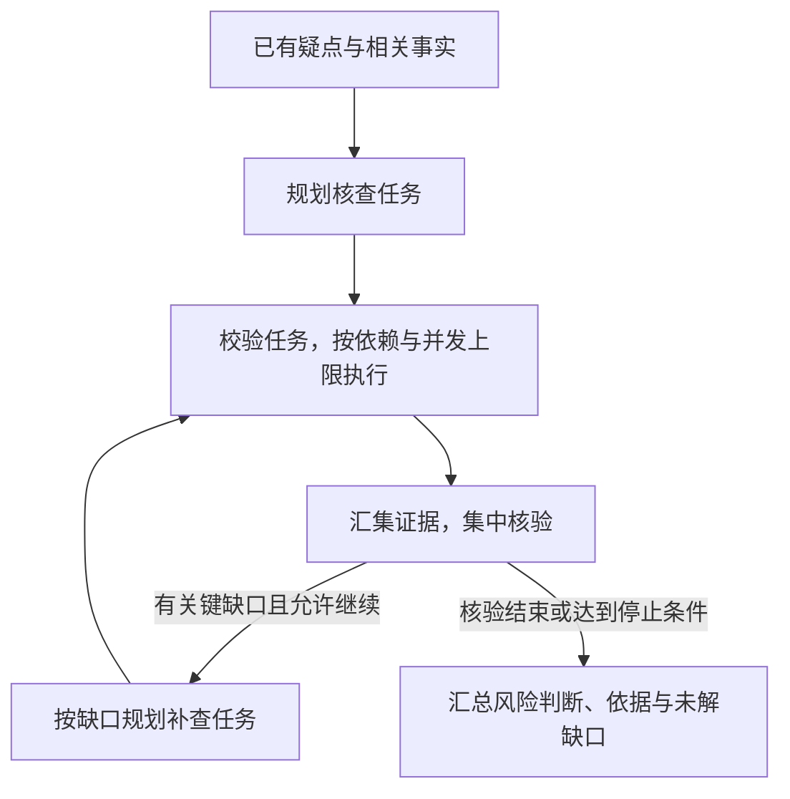

# 案件研判｜任务编排

## 简历条目

> **任务编排：**用 **LangGraph** 编排“规划—补证—集中核验—汇总”，按人员关系与时间窗拆分核查任务，按依赖和并发上限调度；对照串行执行，端到端 **p95 耗时 35→27 min**。

> 本条理解状态：用户已确认原稿主线；本次审计修订待确认。两阶段内容已按本轮要求同步整理。设计意图以已确认的[研判策略](研判策略.md)和本轮材料为依据，公开源码用于核对具体机制；简历指标按用户已确认的事实保留。

## 本次审计结论

**原理解的主线与已确认的研判策略一致：围绕疑点安排核查任务，执行后集中核验，再由缺口驱动定向补证。** 这条主要解释这些工作怎样组织、何时执行，以及怎样减少等待；“研判策略”侧重怎样发现和检验疑点。

原稿没有明显的主线错误，但有几处需要补清，才能从合理概述变成能经得起追问的表达。

| 审计点 | 原稿判断与本次修订 |
| --- | --- |
| 规划承接什么 | 原稿写了“围绕疑点”，方向正确。补清输入是已有疑点、相关事实、可用工具与执行约束；大模型提出核查安排，后端校验并执行，与研判策略衔接。 |
| 人员关系、时间窗与依赖 | 原稿正确说明了任务范围和保留关联的必要性。进一步区分：人员关系与时间窗限定查谁、查哪段数据；执行依赖取决于后续任务是否需要前序输出。涉及不同人员或时段，不足以证明任务可以并发。 |
| LangGraph 的职责 | 节点、边、State 的解释正确，但偏通用。当前实现是 LangGraph 串联阶段和条件分支，调度节点调用后端异步调度器，由调度器检查依赖、限制活动任务数。不能据框架支持并发，就推断本项目直接使用原生并行分支完成调度。 |
| 集中核验与补证 | 原稿正确强调了汇集局部证据。补清任务执行成功与疑点得到支持的区别，以及补证的预算、轮次和停止条件；证据不足时保留缺口，同时检查支持和反驳疑点的信息。 |
| 耗时结果 | 减少 8 分钟、降幅约 22.9% 的计算正确。补清这是运行耗时的高分位变化，不能推成每次运行都快 8 分钟，也不能单凭该指标证明识别质量提高。统计样本、失败口径与对照条件仍影响解释。 |

源码能够支持上述编排机制，但不能独立证明当时的业务拆分细节：公开服务的默认规划器读取显式传入的任务，真实业务规划与核验通过回调接入。因此，“模型怎样结合实际人员关系生成一组任务”仍需真实计划样例支撑，不能用合成测试代替。

原 Q01 已有 STAR 的雏形：有串行耗时的背景、编排行动和量化结果，个人任务主要是隐含的。本版明确 T，并让 A 按“规划 → 调度 → 核验与反馈”展开。原 Q02—Q05 主要是机制和理由题，原 Q06 是指标解释题，**不必全部套 STAR**；强行补背景和结果，会增加重复，还容易把整条的性能收益归给某个局部环节。

第二阶段沿用 Q01—Q06，另补 Q06-1，专门回答原稿缺少的“对照是否可比”。每题写明考察重点和回答顺序，正文保持自然口述。回答可以按固定顺序展开，实际工作流仍然包含分支和补证循环。

## 第一阶段：本条理解

这条工作的核心是：**把核查疑点所需的工作拆成范围明确的任务，让输入已齐备的独立任务并发推进，让需要前序结果的任务依次执行，再汇集证据核验，从而减少整体等待。**

一次案件研判可能涉及多组人员关系、多个时间段，需要反复查询数据和调用模型。如果所有核查任务都串行执行，即使彼此不需要对方的结果，也要依次等待。这部分要解决的是：在不漏掉必要核查、满足任务依赖和资源限制的前提下，安排好执行顺序，缩短完整流程耗时。

### 从研判策略承接到任务编排

“研判策略”先通过查询分析工具整理结构化事实，结合规则和大模型发现待核查疑点。任务编排承接这些疑点和相关事实，决定接下来具体查什么、怎样组织执行。

| 阶段 | 输入与关键动作 | 产出及去向 |
| --- | --- | --- |
| **规划** | 根据疑点、已有事实和缺口，结合可用工具与预算提出核查任务；明确人员、时间范围、查询目标和前置依赖，再由后端校验。 | 形成可执行的任务计划。一个疑点可以对应多个任务。 |
| **补证** | 调度输入已齐备的任务，在并发上限内调用查询分析工具；需要前序输出的任务等待依赖完成。 | 得到查询结果、事实引用和任务执行状态，供集中核验使用。 |
| **集中核验** | 汇集相关任务的结果，检查证据是否支持疑点、是否存在反驳信息或矛盾，以及是否仍有关键缺口。 | 形成支持、修正、排除或证据不足的判断；必要时提出定向补证需求。 |
| **汇总** | 按核验结果整理风险判断及其依据。 | 输出报告，并明确仍未解决的缺口；证据不足事项不混作已有依据支持的风险事件。 |

规划时仍要看相关事实：疑点说明要检验什么问题，事实说明已经知道什么、还缺什么。规划输出的是查询与检查安排，执行后才获得新的信息。**核查任务完成，只说明规定的工作已经执行，不等于疑点成立。**

集中核验发现关键缺口后，只有在工具能力、预算和重查轮次等条件允许时，才围绕缺口追加补查任务。补查后再次核验；达到停止条件而证据仍不足时，保留缺口。这使补证围绕尚未解决的问题推进，避免反复查询直到得到支持结论。



### 拆分决定范围，依赖与并发决定何时执行

**按人员关系与时间窗拆分，是为了让任务有明确的核查范围。** 人员关系帮助确定需要一起分析的主体，时间窗限定相关记录的范围；每个任务围绕具体疑点，说明查谁、查什么、依据哪些已有事实。

例如，仅作机制说明：核查“A 经 C 向 B 的资金往来是否缺乏正常业务依据”，可以安排交易明细查询和相关人员关系查询。即使分成不同任务，也要保留 A、C、B 之间的联系，并把相关结果放在一起核验。如果判断需要跨时间段追踪，就应保留相应查询范围或关联信息，不能机械地按人员、月份切断资金链。

**业务关联与执行依赖承担不同职责。** 上面两项查询存在业务关联，但如果输入都已具备，就可能并发；如果交易查询需要先取得账户列表，才构成必须等待前一步的执行依赖。

当前调度机制可以按以下顺序理解：

1. **检查计划。** 后端校验任务的人员、事实引用、时间与工具范围，并检查依赖是否缺失或成环。
2. **找出可执行任务。** 只有前置任务已经成功、所需结果已经返回，后续任务才具备执行条件。
3. **按空余名额启动。** 同时运行的任务数不能超过配置上限；任务完成并保存结果后，重新检查依赖，继续启动可执行任务。
4. **分别保留结果和失败状态。** 各任务使用各自的局部状态，结果按任务标识保存；前置任务失败时阻塞依赖它的任务，其他独立任务可以继续。

并发上限由配置给出并由后端校验，大模型只提出任务和依赖，不能自行提高上限。任务并发数也不等于数据库或模型请求数；当前代码另外提供进程内的模型、数据库调用限流，部署时还要结合实际资源配置。

这些安排让可以重叠的查询和模型调用交叠进行，减少串行等待。提速仍受任务依赖、服务容量以及集中核验、汇总等阶段影响，不会随着并发数成比例增加。

### LangGraph 怎样承载这条流程

LangGraph 用节点承载处理逻辑，用边连接执行顺序和分支，通过 State 传递任务计划、执行结果、核验缺口等状态。节点读取当前状态并返回更新，条件边根据状态决定下一步。这些是框架的基本机制。[LangGraph 官方文档](https://docs.langchain.com/oss/python/langgraph/graph-api)

在当前实现中，外层图连接规划、调度、候选结果收集、集中核验、补查规划和汇总。简历中的四个阶段是业务概括，不要求每个阶段恰好对应一个代码节点。调度节点调用后端调度器，具体任务再通过独立的补证子图执行。因此，流程衔接、业务计划和任务调度是相互配合的几部分，不能把拆分与依赖判断都归为框架自动完成。

### 35→27 分钟说明什么

端到端耗时衡量一次完整研判流程的总时间。p95 是把纳入统计的单次运行耗时从短到长排列后，第 95 百分位对应的值，可以理解为约 95% 的统计样本耗时不超过该值。

这组对照中，p95 从 35 分钟降到 27 分钟，减少 8 分钟，降幅为 `(35 - 27) / 35 ≈ 22.9%`。它说明这组运行的高分位耗时下降；不能推成平均耗时下降 8 分钟、每个案件都快 8 分钟，或仅靠此指标证明研判质量提高。

仓库现有评测口径规定：从后端接收有效请求开始，到必需研判步骤完成、报告持久化可读结束，覆盖事实准备、规划、补证、集中核验、定向补证和报告生成。请求前的数据抽取、转换与加载，以及人工审核、评分和 LangSmith 上传不计入。串行与并发对照应固定核查策略、数据、模型、预算、缓存和部署条件，只改变任务并发设置。

当前统计实现分别计算两组**成功运行**的 p95，并同时保留失败、超时、取消和未完成状态。解释结果时要一起看完成率，不能删除失败后只展示成功子集的提速。以上能说明现有代码和测量规范的口径，是否就是当次 35→27 分钟的完整执行口径，仍需原始记录核实。

## 第二阶段：面试问答

“考察重点”和“回答顺序”用于回忆，不需要念出来；“答”后的内容可直接口述。Q01 用 STAR，S、T 可以自然衔接，重点放在 A；后续题按提问选择步骤、理由或评测顺序。示例只解释机制，不作为真实案件经历。

Q06-1 目前回答的是可比评测应遵循的方法。它不补造当次测试经历；实际并发值、样本与计时记录仍见文末待补事实。

```text
Q01. 介绍一下你做的案件研判任务编排。

考察重点：是否讲清问题、个人职责、关键做法和结果。
回答顺序：S 多疑点核查、串行等待 → T 我负责受限并发的任务编排 → A 规划、调度、核验反馈 → R 耗时对照结果

答：这部分主要解决多个核查任务串行等待、整体耗时较长的问题。一次研判需要围绕多个疑点查询数据、调用模型，全部串行时，互不依赖的任务也要排队。

我负责设计和实现任务编排，目标是在满足依赖和资源限制的前提下缩短整体耗时。

我用 LangGraph 组织规划、补证、集中核验和汇总。规划时，结合已有疑点和相关事实，按人员关系与时间窗明确每个任务查谁、查什么，再由后端校验任务，按依赖和并发上限执行。查回的信息统一核验；如果仍有关键缺口，而且预算和补查轮次允许，就安排定向补证，最后整理报告。

对照串行执行，端到端 p95 耗时从 35 分钟降到 27 分钟，减少了 8 分钟，降幅约为 22.9%。


Q02. LangGraph 在这套流程中具体负责什么？

考察重点：是否理解框架怎样连接业务步骤，以及任务调度由谁实现。
回答顺序：框架职责 → 节点与状态怎样配合 → 条件跳转 → 与调度器的分工

答：LangGraph 负责阶段衔接、状态传递和条件跳转，具体核查任务的依赖判断与并发限制由后端调度器执行。

我把规划、调度、集中核验和汇总等处理写成节点，用 State 记录任务计划、执行结果和核验缺口。节点读取状态，完成处理后返回更新；条件边再决定下一步。例如，有关键缺口且允许继续时，就转到补查规划，再调度执行；否则进入汇总。

当前实现中，调度节点调用异步调度器，每项任务再通过独立的补证子图执行。任务如何拆分、有哪些依赖、同时允许执行多少项，都需要在应用中明确。


Q03. 为什么按人员关系和时间窗拆任务？会不会把关联拆断？

考察重点：任务范围是否有业务依据，是否保留完整判断所需的关联。
回答顺序：拆分目的 → 如何限定范围 → 怎样保留关联 → 并发还要看输入依赖

答：这样拆分是为了让每个任务围绕具体疑点，明确核查对象和数据范围，同时保留判断所需的关联。

例如，核查 A 经 C 向 B 的资金往来，可以分别安排交易明细和人员关系查询，但仍围绕同一个疑点，保留相关人员和事实引用，再把结果放在一起核验。需要跨时间段追踪时，也要保留相应范围，避免机械切分后遗漏资金链上的联系。

这些维度限定的是查什么，是否能并发还要看输入依赖：两项查询都已具备输入时可以并发；后一个查询需要前一步产出的账户列表时，就必须等待。


Q04. 任务依赖和并发上限怎样共同控制执行？

考察重点：任务何时可以启动，怎样限制负载，以及失败如何影响后续任务。
回答顺序：检查依赖 → 找出可执行任务 → 按空余名额启动 → 完成或失败后的处理

答：后端先检查任务依赖是否有效，再从前置任务已成功、所需结果已齐备的任务中，按并发上限安排执行。

例如，查询交易需要先取得账户列表，就等待账户查询完成；另一项已经具备输入的关系查询可以同时执行。任务完成后保存结果，重新检查哪些后续任务能够启动，再利用空余名额继续执行。

并发上限由配置给出并由后端校验，模型不能自行提高。前置任务失败时，依赖它的任务会被阻塞，其他独立任务仍可继续。

这样减少的是可以重叠部分的等待；任务依赖和后续集中核验仍会限制整体提速。


Q05. 为什么要集中核验？发现缺口后怎么办？

考察重点：是否区分任务完成与疑点成立，补证是否围绕缺口且能够停止。
回答顺序：集中核验的目的 → 怎样判断证据 → 缺口转成补查任务 → 继续与停止条件

答：集中核验是把各任务取得的相关证据放到一起，判断疑点是否得到支持、需要修正、能够排除，还是仍然证据不足。单个任务执行成功，只表示相应查询和检查完成。

例如，查到资金往来后，还要结合双方关系、交易明细和能够取得的业务背景，同时看支持和反驳疑点的信息。存在关键缺口时，就把缺什么转成范围明确的补查任务，再执行并核验。

只有工具能力、预算和重查轮次等条件允许才继续。达到停止条件后，仍未解决的缺口需要保留，并在报告中与已有依据支持的风险判断分别说明。


Q06. 端到端 p95 耗时从 35 分钟降到 27 分钟，说明什么？

考察重点：是否理解指标的统计对象、变化幅度和结论范围。
回答顺序：衡量什么 → p95 的含义 → 数字变化 → 结论范围

答：它说明这组对照中，完整研判流程的高分位耗时下降了。

p95 是把纳入统计的单次完整运行耗时从短到长排列，取第 95 百分位，可以理解为约 95% 的统计样本耗时不超过这个值。35 分钟降到 27 分钟，减少了 8 分钟，降幅约为 22.9%。

它不代表平均耗时下降了 8 分钟，也不代表每个案件都快了 8 分钟。研判质量是否保持，还需要另外检查输出和质量评测结果。


Q06-1. 怎样判断串行与并发的耗时对照是否可比？

考察重点：能否排除少做核查、改变资源或遗漏失败造成的虚假提速。
回答顺序：固定核查工作与条件 → 统一计时边界 → 重复运行并分别统计 → 检查完成情况与质量

答：关键是固定核查工作和运行条件，只改变任务并发设置。

对同一批案件，应固定数据、研判策略、模型与提示词、调用预算、疑点数量上限、缓存策略和部署环境，再比较串行与选定的并发上限，并按相同次数重复运行。

计时边界也要一致。仓库现有口径是从后端接收有效请求开始，到必需研判步骤完成、报告落盘可读结束，包含补证和再次核验。两组分别统计单次完整运行的耗时，不能混在一起，也不能先求每案平均值再当作运行级 p95。

还要保留失败、超时和完成率，检查核查范围与输出质量。如果漏做任务或只保留成功样本，就不能只凭较低的 p95 宣布编排优化有效。
```

## 待补事实与已有依据

原稿列出的三个事实缺口已有部分材料可以对照，但仍不能直接补成当次实测经历。

| 事项 | 当前已经知道什么 | 仍需核实什么 |
| --- | --- | --- |
| **实际并发上限** | 当前代码默认每案活动任务上限为 2，后端校验上限为 4，配置可调整。 | 测出 35→27 分钟时实际采用的并发值，以及选择该值的依据。代码默认值不等于实测配置。 |
| **端到端计时边界** | 现有验收说明规定“接收有效请求 → 必需步骤完成且报告持久化可读”，并列明包含、排除的阶段。 | 当次运行日志是否按这一边界计时，是否完整计入补证、等待和重试。 |
| **对照条件与样本** | 现有规范要求固定非并发条件、配对重复运行，统计实现保留失败状态，并对成功运行计算 p95。 | 当次案件数、重复次数、实际版本与资源配置、失败情况及原始耗时记录；不能把规范规定的次数当作已经完成的次数。 |
| **真实拆分样例** | 已确认的策略明确“疑点与事实 → 任务规划”；代码能表达人员、时间、事实引用、工具范围和依赖。 | 一组实际的疑点、任务计划及执行结果，用于说明人员关系与时间窗怎样影响拆分，哪些任务确实有输入依赖。 |

## 核对依据

| 依据 | 本次用于核对什么 |
| --- | --- |
| [生成规范](../../简历条目面试讲解与问答生成规范.md)、[研判策略](研判策略.md) | 事实层级、两阶段衔接、STAR 与题型选择，以及已确认的业务设计主线。 |
| [工作流](../../项目源码/案件研判/src/case_workflow_graph.py) | 阶段连接、State、集中核验后的条件分支、有限补查和报告保存。 |
| [任务调度器](../../项目源码/案件研判/src/case_task_scheduler.py)、[补证子图](../../项目源码/案件研判/src/case_worker_subgraph.py) | 任务范围与依赖校验、并发限制、任务状态隔离、结果保存及失败阻塞。 |
| [公开服务入口](../../项目源码/案件研判/src/case_api.py)、[运行服务](../../项目源码/案件研判/src/case_run_service.py) | 当前默认规划器和合成核验的边界，以及调度器与补证子图怎样接入。 |
| [性能统计](../../项目源码/案件研判/src/performance_evaluation.py)、[对齐验收说明](../../项目源码/案件研判/docs/execution/resume_alignment_acceptance.md) | p95、成功与失败统计、对照条件、计时边界，以及用户确认指标与公开源码证明能力的区别。 |

2026-10-16 核对时，运行已有的任务调度、工作流、补证子图和性能统计测试，共 **25 项通过**。这些测试验证对应机制，不复算简历中的生产耗时。
