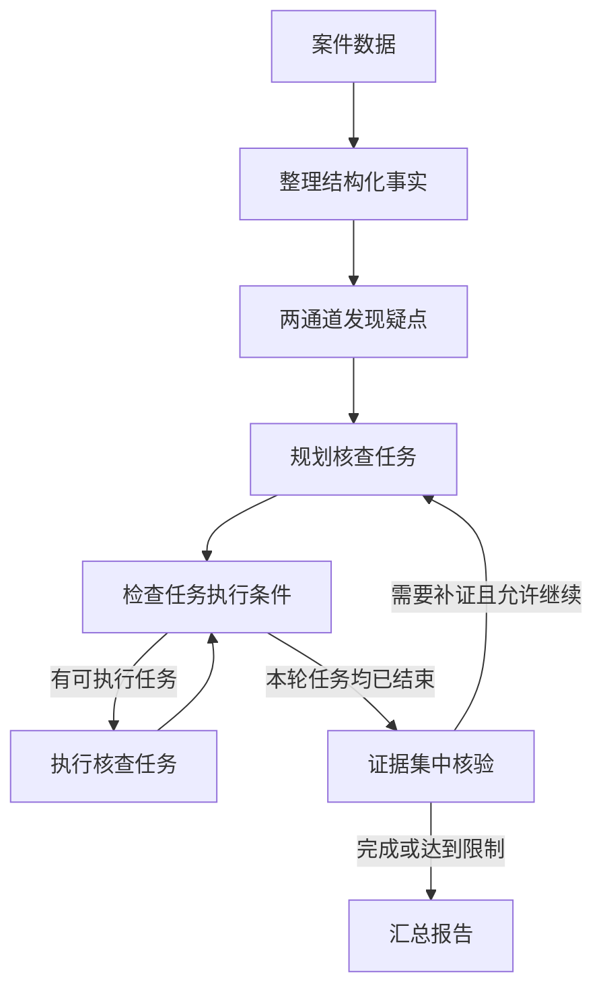

# 案件研判｜任务编排

## 前置学习知识

### 1. LangGraph 怎样组织和运行工作流

LangGraph 用一张图描述处理流程，并负责运行这张图。开发者定义每一步做什么、数据怎样传递、什么条件下进入下一步。

开发者是设计和编写程序的人；后端是服务端程序；LangGraph 是后端使用的框架。**使用框架也属于后端开发，需要分清哪些机制可以直接复用，哪些业务逻辑需要自己实现。**

| 核心概念 | 怎样理解 |
| --- | --- |
| 图构建器 `StateGraph` | 按 State 的结构定义初始化，再添加节点和连接关系，编译后得到可运行的工作流。 |
| 工作流状态 `State` | 保存和传递流程需要的数据，例如结构化事实、疑点、任务计划和核验结果。 |
| 节点 | 一个处理步骤，由函数或对象方法实现。它读取输入，完成处理，再返回需要更新的数据。 |
| 边 | 连接处理步骤，规定固定的执行顺序。 |
| 条件路由 | 程序读取 State，判断接下来执行哪一步，例如继续补证还是汇总报告。 |
| 运行时（Runtime） | 真正执行工作流的程序。它按图和路由结果安排节点运行，接收节点返回的数据，并继续推进流程。 |
| 检查点与 Checkpointer | 检查点保存某个执行位置的状态和进度；Checkpointer 负责保存和读取这些信息，支持中断后恢复。 |

可以沿着这个顺序理解：**节点读取数据并处理 → 返回更新 → 框架更新 State → 按边或条件路由继续执行。** 多个节点可以并发运行，不必始终一个接一个。

主图组织整次研判；子图组织某项任务内部的多个步骤。子图也有自己的节点和连接关系，可以采用独立的 State，完成后返回主图需要的结果。

### 2. 模型、项目代码和框架怎样配合

| 组件或机制 | 在本项目中的职责 |
| --- | --- |
| Planner（规划器） | 根据疑点和相关事实，提出需要完成的核查任务。 |
| Worker（核查执行器） | 完成单项核查，调用工具获取信息并整理结果。 |
| Verifier（集中核验器） | 综合证据判断疑点是否得到支持、还有哪些缺口。 |
| 后端业务代码 | 校验计划，按输入输出要求准备数据，检查执行条件、权限和预算。 |
| LangGraph | 分发和执行任务，管理状态更新、并发和检查点。 |

前三项是项目按职责划分的组件，可以由函数或对象方法实现，再接入图节点；不要求分别创建三个类。模型参与规划、工具反馈分析和核验，不输出任务依赖。

例如，“取得甲的账户列表后才能查询交易”是一条**执行规则**。程序读取结果、检查账户列表，再决定是否分发交易查询，就是落实这条规则的**执行逻辑**。

任务计划说明要做什么，输入输出约定说明任务需要和返回哪些数据，执行记录说明各任务的状态和结果。后端据此判断哪些任务可以执行，再交给框架运行。

### 3. State 与任务状态不是同一个概念

State 是一份工作流数据结构；“待执行、执行中、成功、失败”等任务状态，只是其中可以保存的信息。整次研判的状态又是另一层进展：某项核查成功后，整次研判可能还在核验或生成报告。

任务标识用于唯一区分和查找核查任务，并将任务目标、执行状态和执行结果对应起来。

### 4. 并发、异步与事件循环

| 概念 | 定义与主要作用 | 类别 |
| --- | --- | --- |
| 并发（Concurrency） | 多个任务在同一段时间内共同推进，可以交替执行，也可以同时执行。 | 执行方式 |
| 并行（Parallelism） | 多个任务在同一时刻实际执行，例如多核 CPU 同时计算。 | 执行方式 |
| 同步（Synchronous） | 操作完成并返回结果后，调用方才继续；阻塞调用会让当前线程等待。 | 调用方式 |
| 异步（Asynchronous） | 等待结果时不必阻塞线程；asyncio 可暂停当前协程，让事件循环推进其他任务。 | 调用方式 |
| 进程（Process） | 拥有相对独立的地址空间和资源，是系统进行资源隔离的重要单位。 | 执行单位 |
| 线程（Thread） | 操作系统调度执行的单位；同一进程内的线程共享内存，访问共享数据时需要协调。 | 执行单位 |
| 协程（Coroutine） | 可以暂停和恢复的执行过程；Python 用 `async def` 定义协程函数。 | 执行单位 |
| 任务（`asyncio.Task`） | 封装协程，交给事件循环调度，并管理结果、异常和取消。 | 执行单位 |
| 事件循环（Event Loop） | 调度就绪的 Task、处理 I/O 事件和回调，安排等待结束的任务恢复。 | 调度机制 |

“调度”是安排任务运行的动作，“调度器”是承担这项职责的程序组件；在 asyncio 中，这项职责由事件循环承担。案件研判中，后端判断业务执行条件，LangGraph 分发节点任务，事件循环调度相应协程。这里的 `asyncio.Task` 与业务中的“核查任务”属于不同层次。

## 简历条目

> **任务编排：**用 **LangGraph** 编排“规划—补证—集中核验—汇总”，按人员关系与时间窗拆分核查任务，基于 **asyncio** 按依赖和并发上限异步调度；对照串行执行，端到端 **p95 耗时 35→27 min**。

> 业务主线已确认。本稿聚焦框架机制和使用方法，按“模型提出任务、后端检查执行条件、LangGraph 原生执行”的目标方案整理，供后续源码对齐。35→27 分钟保留为已有对照结果，不作为尚未落地改造的验证结果。

## 第一阶段：本条理解

一次案件研判需要多次查询数据，并请求大模型规划任务、分析事实和核验证据。如果全部串行执行，互不依赖的核查也要依次等待。

**这部分工作是把核查拆成目标明确的任务，安排好执行顺序，再用异步并发减少等待。** 按人员关系和时间窗拆分，是为了明确查哪些人、查哪段时间，以及结果要回答什么问题。

### 1. 一次研判怎样在图中推进

完整研判图先整理案件数据，通过业务规则与大模型分析两条通道发现候选风险疑点，再组织核查与报告生成。本条重点说明任务怎样编排和执行。



模型提出核查任务后，后端解析并校验任务计划，检查各项任务是否满足执行条件。对于满足条件的任务，通过 LangGraph 的条件路由和 `Send` 分发给 Worker，按并发配置执行。同批任务的结果合并到 State 后，后端继续检查剩余任务，决定下一步执行哪些任务。

本轮核查结束后，集中核验判断疑点得到支持、需要修正、可以排除，还是证据不足。有缺口且允许继续时，围绕缺口规划补证任务；否则整理报告，保留尚未解决的问题。

### 2. 怎样把这条流程写成 LangGraph 工作流

使用框架时，主要完成四步：

1. **定义 State。** 把流程中需要保存和传递的结构化事实、疑点、任务计划、核查结果和核验结果定义为 State 的字段。节点从中读取所需数据，完成处理后返回更新，由框架更新 State。
2. **编写节点和路由函数。** 将事实整理、疑点发现、任务规划、核查执行、集中核验和汇总等环节编写为处理函数；用路由函数根据当前 State 判断下一步，例如继续补证还是汇总。节点可以调用模型、工具或子图。
3. **构建工作流图。** 用 State 的结构定义（Schema）初始化 `StateGraph` 图构建器，通过 `add_node` 注册节点、`add_edge` 连接固定步骤、`add_conditional_edges` 接入路由函数。
4. **编译并运行。** 按需配置 Checkpointer 及持久化存储，再用 `compile()` 得到可运行的工作流；调用 `ainvoke()` 时传入初始案件数据、运行标识和并发配置，异步启动研判。

开发者根据业务需求，设计业务特有的处理策略和执行规则，再通过自定义代码实现相应的处理逻辑；同时复用现成库或框架的通用能力，将设计方案落实为可运行的系统。

例如，在案件研判中，自定义代码实现结构化事实整理、疑点发现、核查任务规划、定向补证和集中核验，以及相应的执行控制逻辑。工作流编排通过 LangGraph 的接口定义节点、边和条件路由，复用其任务分发、异步并发、状态管理和检查点等机制。

### 3. 变化的任务计划，怎样保证执行顺序并支持并发

规划时，后端提供待核查疑点、相关事实和任务约束，模型按预定义的**任务计划输出 Schema**生成核查任务，包含任务类型、核查目标、人员和时间范围。**任务类型采用后端预定义的枚举值**，枚举范围结合业务核查需求、案件数据类型和已有工具能力设计。后端根据任务类型筛选可用工具。

校验通过的任务计划保存到 State。执行时，后端检查各任务所需的数据是否准备好：已有数据满足要求的任务可以执行；依赖其他核查任务提供数据的，则等待对应结果。

对于满足执行条件的任务，后端将核查目标、相关事实和筛选出的可用工具说明提供给 Worker。任务标识、权限和依赖判断由后端管理，模型不填写任务依赖。

例如，交易查询需要账户列表和时间范围，可以作出下面的安排：

| 任务 | 需要什么 | 怎样执行 |
| --- | --- | --- |
| T1：查询甲的关联账户 | 甲的身份信息 | 身份信息已知，可以执行。 |
| T2：查询甲、乙的人员关系 | 双方身份信息 | 可以与 T1 同批执行。 |
| T3：查询甲的交易记录 | 甲的账户列表、时间范围 | 账户列表需要由 T1 提供，取得结果后再执行。 |

如果已经有符合要求的甲的账户列表，T3 就可以直接使用。这里检查的是**对应人员和范围的数据是否准备好**，不是看某个同名字段有没有值。

执行时主要注意三点：输入准备好再执行；仅对可安全重试的临时异常有限重试，其余异常按规则终止或修正任务，不能将异常结果作为有效数据；调用前检查模型与工具预算，避免超出限制。

规划节点完成后，通过普通边进入执行条件检查节点。随后，条件路由函数读取更新后的 State，为每项可执行任务生成 `Send`，指定同一个 Worker 节点及各自的任务输入；LangGraph 根据这些分发结果和并发配置执行任务。

这里复用的是节点定义，不会自动创建 Worker 类的新实例。Worker 可以通过子图组织 ReAct 工具调用循环：**分析任务 → 选择并调用工具 → 观察返回结果**，再决定是否继续调用，直到任务完成或达到执行限制。不同核查任务复用同一子图，各自接收输入并产生独立结果。

多个 Worker 返回结果后，LangGraph 按结果字段配置的 **Reducer（状态合并函数）** 合并更新，避免同一字段的并发更新冲突。结果写入 State 后供集中核验使用，每项保留任务标识，便于区分和查找。

### 4. 异步并发为什么能减少耗时，怎样控制执行压力

数据库查询和模型请求通常有较多 I/O 等待。Worker 使用异步接口时，协程通过 `await` 等待尚未完成的操作，就会暂停并让出执行权；事件循环转而运行其他就绪任务，结果准备好后再安排原协程恢复。因此，不同疑点之间，以及同一疑点中满足执行条件的独立任务，都可以在等待期间并发推进。

异步接口要贯穿 Worker、模型客户端和数据库驱动；只把函数写成 `async def`，不会使内部的同步阻塞调用自动变成异步。阻塞式 I/O 可通过 `asyncio.to_thread()` 等方式交给线程池；较重的纯 Python CPU 计算通常考虑进程池，避免阻塞事件循环。这些扩展方式按实际负载选用。

**并发控制分为任务和共享资源两个层次。** 在 LangGraph 原生方案中，`max_concurrency` 限制当前图执行层级内的并发节点任务数，包括已启动但仍在等待响应的 Worker。它不能替代跨子图、跨案件的共享资源限流。

| 控制对象 | 需要限制什么 |
| --- | --- |
| 案件与核查任务 | 同时运行的案件数和每案的核查任务数；子图内部额外发起的并发按需配置限制。 |
| 模型服务 | 按模型服务或共享配额限制请求并发，多模型使用同一服务额度时合并控制。 |
| 数据库 | 控制连接池容量和并发查询数，避免连接与查询压力过大。 |
| 其他工具与本地计算 | 控制外部工具请求数，以及线程池、进程池的规模。 |

多个 Worker 或案件访问同一资源时，共享对应的限额；不能只给每项任务各设一份上限。

执行控制还要区分整体预算和局部限制：

- **整体预算：**整次研判统一统计模型调用、工具调用和 Token 消耗，各阶段共享额度。
- **局部限制：**为请求设置超时，限制单项 Agent 的工具循环和允许的重试次数；任务完成、没有新增有效信息或达到上限时停止，并保留已有结果和未解决的问题。

预算限制累计资源消耗，并发上限限制同时运行的任务或请求数量，两者分别控制。

### 5. State、检查点和中断恢复怎样配合

节点返回的结果由框架更新到 State，供后续节点读取。配置 Checkpointer 和持久化存储后，可在中断后用同一运行标识恢复状态并继续执行；若是故障导致流程停止，先处理阻断原因。检查点是已保存的快照，实时进度可通过流式事件获取。

**检查点不保存节点内部每一行代码的进度，因此恢复时某些未完成的节点可能重新执行。** 如果外部写入已成功，但对应的完成结果尚未持久化，再次执行就可能重复生效。通过幂等键、唯一约束等机制，可以让重复执行不产生重复的业务效果。

### 6. 35→27 分钟说明什么

端到端耗时从后端接收有效请求开始，到必需研判步骤完成、报告保存并可读取为止，包括规划、核查补证、集中核验和汇总。

p95 可以理解为约 95% 的统计样本耗时不超过这个值。35 分钟降到 27 分钟，减少 8 分钟，约下降 22.9%，说明这组对照中的高分位耗时降低，不代表每个案件都快了 8 分钟。

比较时，要使用可比的案件、数据、模型、预算和运行条件，还要确认必要核查步骤完成、核查内容基本一致、报告质量符合要求。这样才能说明提速不是靠减少核查工作换来的。

这项结果说明执行效率变化，不能据此认定并发提高了风险识别的精确率或召回率，也不能把 8 分钟拆成各个组件的独立贡献。

## 第二阶段：面试问答

重复问题已合并，保留原题号方便对照。Q01 用 STAR，其他题按“回答顺序”回忆，不必把提示念出来。机制答案按上述目标方案组织，实际经历应以已经完成的实现和验证为准。

```text
Q01. 介绍一下你做的案件研判任务编排。

回答顺序：S 串行等待 → T 我的任务 → A 怎样组织执行 → R 耗时结果

答：
[S] 一次研判需要多次查询数据和请求模型。如果全部串行执行，互不依赖的核查也要依次等待。

[T] 我负责组织研判流程，在满足执行条件和资源限制的前提下减少等待。

[A] 现有实现用 LangGraph 串联规划、补证、集中核验和汇总，按人员关系和时间范围拆分核查任务。具体任务由后端按依赖和并发上限安排异步执行，本轮结束后集中核验，证据不足再定向补证。

[R] 已有串行与并发对照中，端到端 p95 耗时从 35 分钟降到了 27 分钟，对应的是原有执行方式。

下一步准备把任务分发和并发控制改用 LangGraph 原生机制。这部分尚待实现，其收益需要改造后重新对照验证。


Q02. 你怎样把研判需求转成 LangGraph 工作流？

回答顺序：明确业务流程 → 划分职责 → 选择框架机制 → 实现与验证

答：我先明确从事实整理、两通道发现疑点到报告汇总的完整流程，再按各阶段的输入输出划分职责，其中规划、单项核查和集中核验分别交给 Planner、Worker 和 Verifier。

现有主流程用节点和边连接，通过 State 传递数据，由条件路由决定补证还是汇总。当前改造准备使用 Send 和并发配置执行具体核查任务，复用框架的分发、状态合并和检查点机制，减少重复实现通用调度功能。

自定义代码实现具体研判策略和执行控制逻辑，框架提供通用运行机制。改造后先检查任务顺序、异常处理和补证循环，再在可比条件下验证耗时与报告质量。


Q02-1. 每次规划的任务不同，固定的图怎样执行？

回答顺序：计划作为数据 → Send 分发 → 复用 Worker → 返回结果

答：变化的任务列表保存在 State 中，不需要每次重建图。后端选出满足执行条件的任务，通过 Send 把各自的输入交给同一个 Worker 节点，由 LangGraph 分别执行。

Worker 复用处理代码，每次使用自己的任务数据；如果内部调用同一张子图，也就复用了那套处理流程。结果返回后由框架按 Reducer 合并到 State，再检查后续任务。


Q02-3. State、任务状态和检查点有什么关系？

回答顺序：State 保存数据 → 任务状态描述进展 → 检查点支持恢复

答：State 保存工作流需要的数据，任务计划、执行结果和核验结果都可以放在里面。某项核查是执行中、成功还是失败，只是其中一类信息；整次研判的状态则描述全案进展。

Checkpointer 保存状态和执行进度，让工作流中断后能够恢复；实时进度可以通过流式事件获取。它不记录节点内部每一行代码的进度，恢复时可能重做未完成的节点。如果外部写入已成功、完成结果却尚未持久化，就可能重复生效，因此要通过幂等键等机制防止重复的业务效果。


Q04. 不让模型输出依赖，怎样判断任务的执行顺序？

回答顺序：约定输入输出 → 判断数据是否准备好 → 交给框架执行

答：后端为每类任务规定需要什么输入、返回什么结果，再按本次任务的人员和范围匹配数据，模型只需要提出要查什么。

例如，账户查询和人员关系查询可以一起执行；交易查询需要账户列表，就等对应结果准备好。后端选出可执行任务，通过 Send 分发，LangGraph 按并发配置运行。

结果合并到 State 后，再检查剩余任务。本轮核查结束后进入集中核验；输入无法取得或查询异常时，按规则处理并记录原因。


Q04-1. 异步并发为什么能提速，必须使用多线程吗？

回答顺序：await 让出执行权 → 异步接口与阻塞处理 → 任务和资源限流

答：这里主要用异步协程推进核查。数据库查询和模型请求存在 I/O 等待，await 等待尚未完成的操作时，当前协程暂停，事件循环推进其他就绪任务，从而减少串行等待。

模型客户端和数据库驱动也要支持异步，只写 async def 不够。阻塞式 I/O 可交给线程池；较重的纯 Python 计算可按需使用进程池，避免阻塞事件循环。

max_concurrency 限制当前图执行层级内的并发节点任务数。模型服务、数据库连接与查询、其他工具请求还要按共享资源设置限额，多个案件共同遵守这些限制。


Q04-3. 怎样控制资源消耗，避免 Agent 一直执行？

回答顺序：整体限额 → 局部停止 → 保存已有结果

答：整体上，统一统计一次研判的模型调用、工具调用和 Token 消耗，各阶段共享预算；任务并发和共享资源并发另外设置上限。

局部上，为请求设置超时，限制工具循环和允许的重试次数。任务完成、没有新增有效信息或达到限制时停止，保留已有结果和未解决的问题。


Q05. 为什么要集中核验，证据不足时怎样继续？

回答顺序：任务完成不等于疑点成立 → 综合判断 → 按条件补证

答：查询执行成功，只说明取得了结果，还要结合相关证据判断疑点是否得到支持。核验既看支持信息，也看反驳信息和矛盾。

证据不足时，针对具体缺口规划补证任务，再经过输入检查和框架执行。条件路由根据核验结果和执行限制决定继续补证还是汇总；达到限制时保留缺口。


Q06. p95 从 35 分钟降到 27 分钟，怎样说明提速有效？

回答顺序：指标含义 → 对照条件 → 工作量与质量

答：它说明这组对照中，完整研判流程的高分位耗时降低了。p95 大致表示 95% 的统计样本耗时不超过这个值，35 到 27 分钟减少了 8 分钟。

要使用可比的案件、数据、模型、预算和环境，统一计时起止点，再比较串行与并发。还要核对完成情况、必要核查内容和报告质量，并一起检查失败情况，确认不是靠少做工作换来提速。

这个结果反映执行效率，不能据此说明并发提高了识别质量，也不代表每个案件都节省 8 分钟。
```

## 进一步查阅

- [研判策略](研判策略.md)：疑点怎样发现、为什么补证、证据怎样核验。
- [效果评测](效果评测.md)：性能与结果质量的区别，以及评测对照方法。
- [LangGraph Graph API](https://docs.langchain.com/oss/python/langgraph/graph-api)、[运行时](https://docs.langchain.com/oss/python/langgraph/pregel)、[检查点与恢复](https://docs.langchain.com/oss/python/langgraph/checkpointers)：需要具体 API 或恢复配置时再查阅。
- [Python 协程与任务](https://docs.python.org/3/library/asyncio-task.html)、[事件循环与执行器](https://docs.python.org/3/library/asyncio-eventloop.html#executing-code-in-thread-or-process-pools)：核对异步等待、Task 调度及线程池、进程池的用法。
