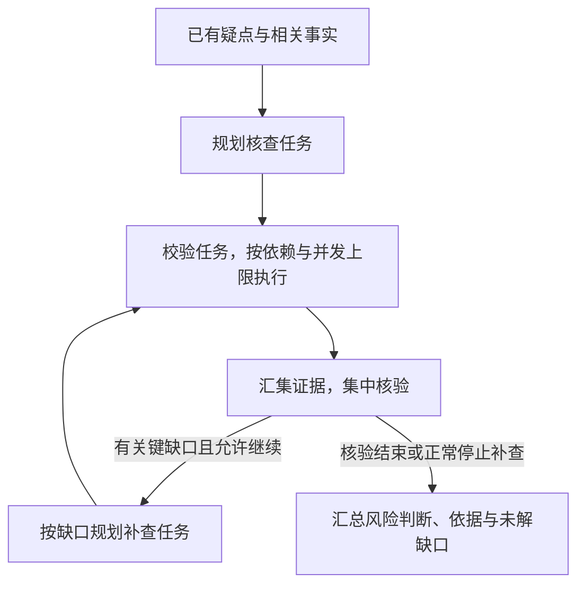

# 案件研判｜任务编排

## 简历条目

> **任务编排：**用 **LangGraph** 编排“规划—补证—集中核验—汇总”，按人员关系与时间窗拆分核查任务，按依赖和并发上限调度；对照串行执行，端到端 **p95 耗时 35→27 min**。

> 本条理解状态：用户已确认原稿主线；本次审计修订待确认。两阶段内容已按本轮要求同步整理。设计意图以已确认的[研判策略](研判策略.md)和本轮材料为依据，公开源码用于核对具体机制；简历指标按用户已确认的事实保留。

## 本次审计结论

**两阶段的主线符合已确认的研判策略，也符合按问题选择回答结构的要求。** 研判策略说明怎样发现和检验疑点；任务编排说明怎样把核查工作组织起来、安排执行并减少等待。本轮保留这条主线和现有题号，主要校正实现边界、减少口述重复。

| 审计点 | 结论与本轮修订 |
| --- | --- |
| 规划承接什么 | 承接已有疑点、相关事实、可用工具与执行约束；按已确认设计，由大模型提出核查安排，后端校验并执行。 |
| 拆分与依赖 | 人员关系与时间窗限定核查范围；执行依赖说明后一步需要哪些前序输出。业务上有关联的查询，也可能并发执行。 |
| 框架与调度器 | LangGraph 连接阶段、传递状态和选择分支；后端调度器判断任务是否可以启动、限制活动任务数。补证复用同一套子图定义，每次调用维护独立状态。 |
| 任务成功与结果可用 | 源码按前置任务的成功状态放行，并传入已保存结果；不会自动判断账户列表等业务字段是否齐全。相关检查由任务处理逻辑负责，集中核验再判断证据是否支持疑点。 |
| 补查与停止 | 保留缺口驱动补查及轮次、预算限制；区分正常停止补查与执行失败，不能把所有预算拒绝或异常都写成成功汇总。 |
| 指标与口述结构 | 保留用户确认的 35→27 分钟。Q01 用 STAR，其余按机制、理由或评测逻辑回答；压缩重复，并让“回答顺序”与正文实际顺序对应。 |

**已确认的业务设计、当前公开实现与当次实测记录需要分清。** 公开服务的默认规划器读取传入的任务，Worker 和核验器使用合成输入；真实业务逻辑可通过回调接口接入。它能展示调度、结果汇集和补查循环，但不能独立证明真实模型怎样发现疑点、规划任务和核验。特别是，公开图在任务执行后收集 `candidate_events`，不能据此把已确认设计中的“发现疑点”改到任务规划之后。

Q01 用 **S 场景 → T 个人任务 → A 关键做法 → R 对照结果**组织，背景与职责简短说明，重点放在做法。Q02—Q05 回答机制或理由，Q06 解释指标，Q06-1 说明对照方法；这些题先直接回答，再依照各自的“回答顺序”展开即可，无需补齐 STAR。

这些顺序是口述时的记忆提示；实际工作流仍有并发、条件分支和补查循环。源码默认值、合成测试和测量规范，均不替代当次实测配置与日志。

## 第一阶段：本条理解

这条工作的核心是：**把核查疑点所需的工作拆成范围明确的任务，让输入已齐备的独立任务并发推进，让需要前序结果的任务依次执行，再汇集证据核验，从而减少整体等待。**

一次案件研判可能涉及多组人员关系、多个时间段，需要反复查询数据和调用模型。如果所有核查任务都串行执行，即使彼此不需要对方的结果，也要依次等待。这部分要解决的是：在不漏掉必要核查、满足任务依赖和资源限制的前提下，安排好执行顺序，缩短完整流程耗时。

### 从研判策略承接到任务编排

“研判策略”先通过查询分析工具整理结构化事实，结合规则和大模型发现待核查疑点。任务编排承接这些疑点和相关事实，决定接下来具体查什么、怎样组织执行。下表说明已确认的业务设计，当前源码能直接核实的执行机制见后文。

| 阶段 | 输入与关键动作 | 产出及去向 |
| --- | --- | --- |
| **规划** | 大模型根据疑点、已有事实和缺口，结合可用工具与预算提出核查任务；明确人员、时间范围、查询目标和前置依赖，再由后端校验。 | 形成可执行的任务计划。一个疑点可以对应多个任务。 |
| **补证** | 调度输入已齐备的任务，在并发上限内调用查询分析工具；需要前序输出的任务等待依赖完成。 | 得到查询结果、事实引用和任务执行状态，供集中核验使用。 |
| **集中核验** | 汇集相关任务的结果，检查证据是否支持疑点、是否存在反驳信息或矛盾，以及是否仍有关键缺口。 | 形成支持、修正、排除或证据不足的判断；必要时提出定向补证需求。 |
| **汇总** | 按核验结果整理风险判断及其依据。 | 输出报告，并明确仍未解决的缺口；证据不足事项不混作已有依据支持的风险事件。 |

规划时仍要看相关事实：疑点说明要检验什么问题，事实说明已经知道什么、还缺什么。规划输出的是查询与检查安排，执行后才获得新的信息。**核查任务完成，只说明规定的工作已经执行，不等于疑点成立。**

集中核验发现关键缺口后，围绕缺口追加补查任务，并受工具范围、调用预算和补查轮次限制。补查后再次核验；正常停止补查时，仍未解决的缺口需要保留，避免反复查询直到得到支持结论。

这里要区分两种情况：当前图在没有缺口、达到补查轮次上限或不允许继续补查时转入汇总；调用预算被拒绝或节点执行异常，则可能造成任务或整次运行失败，不能承诺所有停止情况都能成功生成报告。下图表示正常的核验与补查分支。



### 拆分决定范围，依赖与并发决定何时执行

**按人员关系与时间窗拆分，是为了让任务有明确的核查范围。** 人员关系帮助确定需要一起分析的主体，时间窗限定相关记录的范围；每个任务围绕具体疑点，说明查谁、查什么、依据哪些已有事实。

例如，仅作机制说明：核查“A 经 C 向 B 的资金往来是否缺乏正常业务依据”，可以安排交易明细查询和相关人员关系查询。即使分成不同任务，也要保留 A、C、B 之间的联系，并把相关结果放在一起核验。如果判断需要跨时间段追踪，就应保留相应查询范围或关联信息，不能机械地按人员、月份切断资金链。

**业务关联与执行依赖承担不同职责。** 上面两项查询存在业务关联，但如果输入都已具备，就可能并发；如果交易查询需要先取得账户列表，才构成必须等待前一步的执行依赖。

当前调度机制可以按以下顺序理解：

1. **检查计划。** 后端校验任务的人员、事实引用、时间与工具范围，并检查依赖是否缺失或成环。
2. **检查前置状态并传递结果。** 调度器从待执行任务中找出前置任务全部成功的任务，并把这些前置任务的已保存结果作为输入传给它；没有前置依赖的任务也可进入待启动列表。
3. **按空余名额启动。** 同时运行的任务数不能超过配置上限；任务完成并保存结果后，重新检查依赖，继续启动可执行任务。
4. **分别保留结果和失败状态。** 各任务使用各自的局部状态，结果按任务标识保存；前置任务失败时阻塞依赖它的任务，其他独立任务可以继续。

**前置任务成功，不自动等于业务输入完整。** 当前调度器检查成功状态并传递结果，不会检查结果中是否有下一步必需的账户列表等字段。任务处理函数仍需校验这些输入，并区分“查无记录”和“缺少必要字段”；执行成功与否，也不能替代对疑点的核验。

并发上限由配置给出并由后端校验，大模型只提出任务和依赖，不能自行提高上限。任务并发数也不等于数据库或模型请求数；当前代码另外提供进程内的模型、数据库调用限流，部署时还要结合实际资源配置。

这些安排让可以重叠的查询和模型调用交叠进行，减少串行等待。提速仍受任务依赖、服务容量以及集中核验、汇总等阶段影响，不会随着并发数成比例增加。

### LangGraph 怎样承载这条流程

LangGraph 用节点承载处理逻辑，用边连接执行顺序和分支，通过 State 传递任务计划、执行结果、核验缺口等状态。节点读取当前状态并返回更新，条件边根据状态决定下一步。这些是框架的基本机制。[LangGraph 官方文档](https://docs.langchain.com/oss/python/langgraph/graph-api)

在当前实现中，外层图连接规划、调度、候选结果收集、集中核验、补查规划和汇总。简历中的四个阶段是业务概括，不要求每个阶段恰好对应一个代码节点。调度节点调用后端调度器，具体任务复用同一套补证子图定义，每次调用传入各自的任务数据和局部状态。因此，流程衔接、业务计划和任务调度是相互配合的几部分，不能把拆分与依赖判断都归为框架自动完成。

### 35→27 分钟说明什么

端到端耗时衡量一次完整研判流程的总时间。p95 是把纳入统计的单次运行耗时从短到长排列后，第 95 百分位对应的值，可以理解为约 95% 的统计样本耗时不超过该值。

这组对照中，p95 从 35 分钟降到 27 分钟，减少 8 分钟，降幅为 `(35 - 27) / 35 ≈ 22.9%`。它说明这组运行的高分位耗时下降；不代表平均耗时下降 8 分钟或每个案件都快 8 分钟。研判质量需要结合输出与质量评测另行判断。

仓库现有评测口径规定：从后端接收有效请求开始，到必需研判步骤完成、报告持久化可读结束，覆盖事实准备、规划、补证、集中核验、定向补证和报告生成。请求前的数据抽取、转换与加载，以及人工审核、评分和 LangSmith 上传不计入。串行与并发对照应固定核查策略、数据、模型、预算、缓存和部署条件，只改变任务并发设置。

当前统计实现分别对两组**成功运行**使用 nearest-rank 方法计算 p95：对 n 个成功运行耗时排序，取第 `ceil(0.95 × n)` 个值；同时保留失败、超时、取消和未完成状态。成功运行的 p95 可以单独报告，但必须同时披露成功次数、计划次数和失败情况；若配对运行未完整成功，不能仅凭成功子集的较低 p95 宣布整体提速。以上能说明现有代码和测量规范的口径，是否就是当次 35→27 分钟的完整执行口径，仍需原始记录核实。

## 第二阶段：面试问答

“考察重点”和“回答顺序”只用于回忆，不需要念出来；“答”后的正文可直接口述。Q01 的四段分别对应 S、T、A、R；其他题按自身考察重点展开。示例只解释机制，不作为真实案件经历。

Q06-1 说明可比评测应遵循的方法与仓库现有口径，不补造当次测试经历；实际并发值、样本与原始计时记录仍见文末待补事实。

```text
Q01. 介绍一下你做的案件研判任务编排。

考察重点：问题与个人职责是否清楚，做法能否对应到结果。
回答顺序：S 串行等待 → T 我的编排任务 → A 规划、调度、核验反馈 → R 耗时结果

答：一次案件研判需要围绕多个疑点查询数据、调用模型，全部串行时，互不依赖的任务也要依次等待。

我负责设计和实现任务编排，在满足任务依赖和资源限制的前提下，缩短整体耗时。

我用 LangGraph 连接规划、补证、集中核验和汇总。先让模型结合疑点和相关事实，按人员关系与时间窗提出核查任务；后端校验后，让互不依赖的任务在并发上限内同时推进，有依赖的按顺序执行；再汇集证据核验，在预算和补查轮次允许时针对缺口补查，最后整理报告。

对照串行执行，端到端 p95 耗时从 35 分钟降到了 27 分钟。


Q02. LangGraph 在这套流程中具体负责什么？

考察重点：是否清楚框架、调度器和补证子图的分工。
回答顺序：职责分工 → 状态与路由 → 子图复用

答：LangGraph 负责连接处理阶段、传递状态和选择分支，具体任务的依赖判断与并发限制由后端调度器执行。

节点从 State 读取任务计划和执行结果，完成处理后返回更新；路由再根据核验缺口和补查条件，决定继续补查还是进入汇总。

调度节点调用异步调度器，各项任务复用同一套补证子图定义，每次调用维护各自的局部状态和结果。


Q03. 为什么按人员关系和时间窗拆任务？会不会把关联拆断？

考察重点：拆分是否有业务依据，是否保留判断所需的关联。
回答顺序：拆分目的 → 范围示例 → 保留跨任务、跨时段关联

答：这样拆分可以让每个任务明确查哪些人、查哪段时间的数据，同时把需要一起分析的关系保留下来。

例如，围绕“A 经 C 向 B 的资金往来是否缺乏正常业务依据”这个疑点，可以安排相关时段的交易明细和人员关系查询。各任务仍关联同一疑点和相关事实，结果汇集后一起核验。

需要跨时间段追踪时，也要保留相应范围和联系，不能机械地按人员或月份切断资金链。


Q04. 任务依赖和并发上限怎样共同控制执行？

考察重点：任务何时启动、结果怎样传递，以及完成或失败后怎样推进。
回答顺序：检查计划 → 判断前置状态并传参 → 限制同时运行的数量 → 完成与失败处理

答：调度器先检查依赖是否缺失或成环，再找出前置任务全部成功的待执行任务，并把前置任务的结果传给它们。结果是否包含下一步必需的业务字段，还要由任务处理函数检查。

例如，交易查询需要前一步产出的账户列表，就要等待前一步成功并检查返回内容；输入已具备的独立查询则可以并发推进。并发上限由配置给出、后端校验，模型不能自行提高。

任务完成后保存结果、释放名额，再检查后续任务。前置任务失败时，依赖它的任务会被阻塞，其他独立任务仍可继续。


Q05. 为什么要集中核验？发现缺口后怎么办？

考察重点：能否区分任务执行与业务判断，补查是否有方向、有停止条件。
回答顺序：核验目的 → 结合证据判断 → 按缺口补查 → 正常停止与执行失败

答：集中核验要把各任务的相关证据放在一起，判断疑点是否得到支持、需要修正、可以排除，还是仍然证据不足。任务执行成功只说明相应工作完成。

例如，发现资金往来后，还要结合双方关系、交易明细和可获取的业务背景，同时检查支持和反驳疑点的信息。有关键缺口时，再安排范围明确的补查任务，执行后重新核验。

补查受工具范围、预算和轮次限制。正常停止补查后，报告保留未解决的缺口；如果因预算拒绝或执行异常失败，则保留失败状态，不能当作成功完成核验。


Q06. 端到端 p95 耗时从 35 分钟降到 27 分钟，说明什么？

考察重点：是否理解指标含义、变化幅度与结论范围。
回答顺序：直接解释结果 → p95 含义 → 变化幅度 → 结论范围

答：它说明这组对照中，完整研判流程的高分位耗时下降了。

p95 是运行耗时的第 95 百分位，可以理解为约 95% 的统计样本耗时不超过这个值。从 35 分钟降到 27 分钟，减少了 8 分钟，降幅约为 22.9%。

这是 p95 的变化，不代表平均耗时或每个案件都减少了 8 分钟。还需要结合完成率和输出质量判断优化效果。


Q06-1. 怎样判断串行与并发的耗时对照是否可比？

考察重点：是否排除了少做核查、改变资源或遗漏失败造成的表面提速。
回答顺序：固定对照条件 → 统一计时边界 → 分组统计与保留失败 → 核对工作量和质量

答：应对同一批案件固定研判策略、数据、模型与提示词、疑点数量上限、调用预算、缓存和部署环境，只改变任务并发设置，并按相同的计划次数配对运行。

两组计时边界也要一致。仓库现有口径是从后端接收有效请求开始，到必需研判步骤完成、报告持久化可读结束，包含事实准备、补证和再次核验。

串行与并发分别计算成功运行的 p95，同时披露计划次数、成功次数以及失败、超时等情况。还要核对实际核查范围、调用量和输出质量，不能靠少做任务或隐去失败来解释提速。
```

## 待补事实与已有依据

原稿列出的三个事实缺口已有部分材料可以对照，但仍不能直接补成当次实测经历。

| 事项 | 当前已经知道什么 | 仍需核实什么 |
| --- | --- | --- |
| **实际并发上限** | 当前代码默认每案活动任务上限为 2，后端校验上限为 4，配置可调整。 | 测出 35→27 分钟时实际采用的并发值，以及选择该值的依据。代码默认值不等于实测配置。 |
| **端到端计时边界** | 现有验收说明规定“接收有效请求 → 必需步骤完成且报告持久化可读”，并列明包含、排除的阶段。 | 当次运行日志是否按这一边界计时，是否完整计入补证、等待和重试。 |
| **对照条件与样本** | 现有规范要求固定非并发条件、配对重复运行，统计实现保留失败状态，并对成功运行计算 p95。 | 当次案件数、重复次数、实际版本与资源配置、失败情况及原始耗时记录；不能把规范规定的次数当作已经完成的次数。 |
| **真实拆分样例** | 已确认的策略明确“疑点与事实 → 任务规划”；代码能表达人员、时间、事实引用、工具范围和依赖。 | 一组实际的疑点、任务计划及执行结果，用于说明人员关系与时间窗怎样影响拆分，哪些任务确实有输入依赖。 |

## 核对依据

| 依据 | 本次用于核对什么 |
| --- | --- |
| [生成规范](../../简历条目面试讲解与问答生成规范.md)、[研判策略](研判策略.md) | 事实层级、两阶段衔接、STAR 与题型选择，以及已确认的业务设计主线。 |
| [工作流](../../项目源码/案件研判/src/case_workflow_graph.py) | 阶段连接、State、集中核验后的条件分支、有限补查和报告保存。 |
| [任务调度器](../../项目源码/案件研判/src/case_task_scheduler.py)、[补证子图](../../项目源码/案件研判/src/case_worker_subgraph.py) | 任务范围与依赖校验、并发限制、任务状态隔离、结果保存及失败阻塞。 |
| [公开服务入口](../../项目源码/案件研判/src/case_api.py)、[运行服务](../../项目源码/案件研判/src/case_run_service.py) | 当前默认规划器和合成核验的边界，以及调度器与补证子图怎样接入。 |
| [性能统计](../../项目源码/案件研判/src/performance_evaluation.py)、[对齐验收说明](../../项目源码/案件研判/docs/execution/resume_alignment_acceptance.md) | p95、成功与失败统计、对照条件、计时边界，以及用户确认指标与公开源码证明能力的区别。 |

上一轮审计记录（2026-10-16）记载：已有任务调度、工作流、补证子图和性能统计测试共 **25 项通过**。本轮修改仅涉及本文，核对了相关源码、口述顺序与指标计算，未重新运行该测试集；上述测试记录也不代表复算了简历中的生产耗时。
