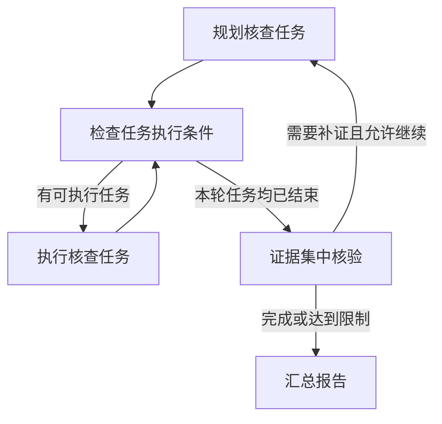

# 案件研判｜任务编排

## 前置学习知识

### 1. LangGraph 怎样组织和运行工作流

LangGraph 用一张图描述处理流程，并负责运行这张图。开发者定义每一步做什么、数据怎样传递、什么条件下进入下一步。

开发者是设计和编写程序的人；后端是服务端程序；LangGraph 是后端使用的框架。**使用框架也属于后端开发，需要分清哪些机制可以直接复用，哪些业务逻辑需要自己实现。**

| 核心概念 | 怎样理解 |
| --- | --- |
| 工作流图 `StateGraph` | 描述流程包含哪些步骤，以及这些步骤怎样连接。 |
| 工作流状态 `State` | 保存和传递流程需要的数据，例如任务计划、核查结果和核验结果。 |
| 节点 | 一个处理步骤，由函数或对象方法实现。它读取输入，完成处理，再返回需要更新的数据。 |
| 边 | 连接处理步骤，规定固定的执行顺序。 |
| 条件路由 | 程序读取 State，判断接下来执行哪一步，例如继续补证还是汇总报告。 |
| 运行时（Runtime） | 真正执行工作流的程序。它按图和路由结果安排节点运行，接收节点返回的数据，并继续推进流程。 |
| 检查点与 Checkpointer | 检查点保存某个执行位置的状态和进度；Checkpointer 负责保存和读取这些信息，支持中断后恢复。 |

可以沿着这个顺序理解：**节点读取数据并处理 → 返回更新 → 框架更新 State → 按边或条件路由继续执行。** 多个节点可以并发运行，不必始终一个接一个。

主图组织整次研判；子图组织某项任务内部的多个步骤。子图也有自己的节点和连接关系，可以采用独立的 State，完成后返回主图需要的结果。

### 2. 模型、项目代码和框架怎样配合

| 组件或机制 | 在本项目中的职责 |
| --- | --- |
| Planner（规划器） | 根据疑点和相关事实，提出需要完成的核查任务。 |
| Worker（核查执行器） | 完成单项核查，调用工具获取信息并整理结果。 |
| Verifier（集中核验器） | 综合证据判断疑点是否得到支持、还有哪些缺口。 |
| 后端业务代码 | 校验计划，按输入输出要求准备数据，检查执行条件、权限和预算。 |
| LangGraph | 分发和执行任务，管理状态更新、并发和检查点。 |

前三项是项目按职责划分的组件，可以由函数或对象方法实现，再接入图节点；不要求分别创建三个类。模型参与规划、工具反馈分析和核验，不输出任务依赖。

例如，“取得甲的账户列表后才能查询交易”是一条**执行规则**。程序读取结果、检查账户列表，再决定是否分发交易查询，就是落实这条规则的**执行逻辑**。

任务计划说明要做什么，输入输出约定说明任务需要和返回哪些数据，执行记录说明各任务的状态和结果。后端据此判断哪些任务可以执行，再交给框架运行。

### 3. State 与任务状态不是同一个概念

State 是一份工作流数据结构；“待执行、执行中、成功、失败”等任务状态，只是其中可以保存的信息。整次研判的状态又是另一层进展：某项核查成功后，整次研判可能还在核验或生成报告。

任务标识用于唯一区分和查找核查任务，并将任务目标、执行状态和执行结果对应起来。

## 简历条目

> **任务编排：**用 **LangGraph** 编排“规划—补证—集中核验—汇总”，按人员关系与时间窗拆分核查任务，基于 **asyncio** 按依赖和并发上限异步调度；对照串行执行，端到端 **p95 耗时 35→27 min**。

> 业务主线已确认。本稿聚焦框架机制和使用方法，按“模型提出任务、后端检查执行条件、LangGraph 原生执行”的目标方案整理，供后续源码对齐。35→27 分钟保留为已有对照结果，不作为尚未落地改造的验证结果。

## 第一阶段：本条理解

一次案件研判需要多次查询数据，并请求大模型规划任务、分析事实和核验证据。如果全部串行执行，互不依赖的核查也要依次等待。

**这部分工作是把核查拆成目标明确的任务，安排好执行顺序，再用异步并发减少等待。** 按人员关系和时间窗拆分，是为了明确查哪些人、查哪段时间，以及结果要回答什么问题。

### 1. 一次研判怎样在图中推进

疑点发现环节通过业务规则和大模型分析两条通道提出候选风险疑点。任务编排把这些疑点和相关事实作为输入，组织后续核查。



模型先提出需要完成的核查任务。后端检查计划，再根据数据是否准备好选出可执行任务，由 LangGraph 分发和运行；取得结果后，继续检查还有哪些任务可以执行。

本轮核查结束后，集中核验判断疑点得到支持、需要修正、可以排除，还是证据不足。有缺口且允许继续时，围绕缺口规划补证任务；否则整理报告，保留尚未解决的问题。

**任务执行成功，只说明查询或检查已完成，不等于疑点成立。** 核验既要看支持疑点的证据，也要看反驳信息和矛盾。

### 2. 怎样把这条流程写成 LangGraph 工作流

使用框架时，主要完成四步：

1. **定义 State 并创建图。** 明确要保存的疑点、任务计划、执行结果和核验结果，再用这份状态结构创建 `StateGraph`。
2. **编写节点。** 把规划、核查、集中核验和汇总写成处理函数，通过 `add_node` 注册到图中。节点可以调用模型、查询工具或子图。
3. **连接流程。** 固定顺序用 `add_edge` 连接；需要分支或循环时，用 `add_conditional_edges` 接入判断函数。例如，核验后根据证据缺口和剩余预算决定是否继续补证。
4. **配置并运行。** 设置并发上限，按需配置检查点、持久化存储和运行标识；通过 `compile()` 得到可运行的工作流，再用 `ainvoke()` 异步启动。

**LangGraph 已经提供节点分发、异步并发、状态合并和检查点，因此不必再为这些通用能力编写独立调度器。** 项目代码负责解释业务要求、检查执行条件，再利用框架运行；框架不会自动理解案件数据和核查要求。

### 3. 变化的任务计划，怎样保证执行顺序并支持并发

模型按统一结构给出任务类型、核查目标、人员和时间范围，任务类型来自后端支持的范围。后端根据类型确定需要哪些输入、可以使用哪些工具，再结合已有数据和其他任务的结果准备输入。任务标识和权限范围由后端统一管理，模型不填写任务依赖。

校验通过的任务计划保存在 State，后续节点从中读取。后端知道每类任务需要哪些数据，就能结合当前结果判断它是否可以执行。

例如，交易查询需要账户列表和时间范围，可以作出下面的安排：

| 任务 | 需要什么 | 怎样执行 |
| --- | --- | --- |
| T1：查询甲的关联账户 | 甲的身份信息 | 身份信息已知，可以执行。 |
| T2：查询甲、乙的人员关系 | 双方身份信息 | 可以与 T1 同批执行。 |
| T3：查询甲的交易记录 | 甲的账户列表、时间范围 | 账户列表需要由 T1 提供，取得结果后再执行。 |

如果已经有符合要求的甲的账户列表，T3 就可以直接使用。这里检查的是**对应人员和范围的数据是否准备好**，不是看某个同名字段有没有值。

所需查询尚未结束时，就等待结果；查询失败、结果不符合要求或没有明确的数据来源时，要记录原因，按规则终止任务或在限制内重新规划。查询成功但没有记录，也是已返回的结果，不能当作查询还没结束。

**没有可执行任务，不等于本轮已经结束。** 后端要确认每项任务都已完成、失败或按规则终止，才能进入集中核验；任务相互等待等计划问题，应先处理，不能直接当作正常完成。

任务输入准备好后，条件路由通过 **`Send`** 把不同任务输入交给同一个 Worker（核查执行器）节点。LangGraph 分别执行这些调用，因此任务数量可以变化，图中不必为每项任务新建一个节点。

这里复用的是节点定义，不是自动创建 Worker 类的新实例。Worker 可以调用子图，组织“分析任务 → 选择并调用工具 → 处理反馈”：信息不足时在限制内继续，任务完成或达到停止条件后返回结果。各任务可以复用同一张子图，但分别使用自己的输入和结果。

现有 Worker 子图只有一个执行节点，完整工具反馈循环仍是后续完善项。

多个 Worker 返回结果后，由框架按配置的合并方式更新 State。这个合并方式称为 **reducer**，例如把各项任务结果按任务标识保留下来，供后续步骤使用。

**本文采用按批次推进的方案。** T1、T2 同批执行时，要等这一批结束并合并结果，才会再次检查并分发 T3。它支持受限并发，但不承诺 T1 一结束就立即启动 T3。

### 4. 异步并发为什么能减少耗时，怎样控制执行压力

数据库查询和模型请求有较多等待时间。Worker 使用异步接口时，一项任务等待响应，事件循环就能推进其他任务，因此不用等它全部结束才开始下一项。不同疑点中的独立核查，也可以这样共同推进。

这叫**并发**：多个任务在同一段时间内共同推进。它不要求同一时刻执行多段 Python 代码，也不要求为每个疑点单独创建线程。确有阻塞接口时，再把这些操作交给线程处理。

通过 **`max_concurrency`** 限制一次图运行中由框架管理的并发任务数。在本方案中，它用于限制同时运行的核查 Worker，包括正在等待响应的 Worker。多个案件共用模型或数据库时，还要另外控制共享服务的并发请求数。

执行控制保留两个层次即可：

- **整体控制：**限制整次研判的模型调用次数、工具调用次数和 Token 用量，同时限制任务及请求并发数。各阶段共同使用额度。
- **局部控制：**限制单项 Agent 任务的循环和重试；如果持续重复查询、没有补充有效信息，就停止并记录未解决的问题。

累计用量限制“总共能用多少”，并发上限限制“同一时间能做多少”，两者分别控制。

### 5. State、检查点和失败处理怎样配合

节点返回的结果由框架更新到 State，后续节点再读取这些数据。配置 Checkpointer 和持久化存储后，框架保存检查点，中断时可以根据已保存的状态和执行进度恢复。

检查点是某个执行位置的快照，不一定反映此刻的实时进度；实时进度可以通过流式事件获取。**恢复也不等于任意一行代码都能原地续跑，某些处理可能重新执行。**

临时错误可以通过 `RetryPolicy` 配置有限重试。上游失败导致所需输入不可用时，后端记录原因，并处理受影响的任务；不能把失败结果当作正常数据继续使用。

外部写入等操作还要考虑幂等，防止恢复或重试造成重复生效。这里掌握“保存进度、按进度恢复、处理可能重复的操作”这条主线即可。

### 6. 35→27 分钟说明什么

端到端耗时从后端接收有效请求开始，到必需研判步骤完成、报告保存并可读取为止，包括规划、核查补证、集中核验和汇总。

p95 可以理解为约 95% 的统计样本耗时不超过这个值。35 分钟降到 27 分钟，减少 8 分钟，约下降 22.9%，说明这组对照中的高分位耗时降低，不代表每个案件都快了 8 分钟。

比较时，要使用可比的案件、数据、模型、预算和运行条件，还要确认必要核查步骤完成、核查内容基本一致、报告质量符合要求。这样才能说明提速不是靠减少核查工作换来的。

这项结果说明执行效率变化，不能据此认定并发提高了风险识别的精确率或召回率，也不能把 8 分钟拆成各个组件的独立贡献。

## 第二阶段：面试问答

重复问题已合并，保留原题号方便对照。Q01 用 STAR，其他题按“回答顺序”回忆，不必把提示念出来。机制答案按上述目标方案组织，实际经历应以已经完成的实现和验证为准。

```text
Q01. 介绍一下你做的案件研判任务编排。

回答顺序：S 串行等待 → T 我的任务 → A 怎样组织执行 → R 耗时结果

答：
[S] 一次研判需要多次查询数据和请求模型。如果全部串行执行，互不依赖的核查也要依次等待。

[T] 我负责组织研判流程，在满足执行条件和资源限制的前提下减少等待。

[A] 现有实现用 LangGraph 串联规划、补证、集中核验和汇总，按人员关系和时间范围拆分核查任务。具体任务由后端按依赖和并发上限安排异步执行，本轮结束后集中核验，证据不足再定向补证。

[R] 已有串行与并发对照中，端到端 p95 耗时从 35 分钟降到了 27 分钟，对应的是原有执行方式。

下一步准备把任务分发和并发控制改用 LangGraph 原生机制。这部分尚待实现，其收益需要改造后重新对照验证。


Q02. 你怎样把研判需求转成 LangGraph 工作流？

回答顺序：明确业务流程 → 划分职责 → 选择框架机制 → 实现与验证

答：我先明确研判目标和流程，再确定各阶段的输入输出，将规划、核查和集中核验分别交给 Planner、Worker 和 Verifier。

现有主流程用节点和边连接，通过 State 传递数据，由条件路由决定补证还是汇总。当前改造准备使用 Send 和并发配置执行具体核查任务，复用框架的分发、状态合并和检查点机制，减少重复实现通用调度功能。

项目代码负责输入检查、权限和预算。改造后先检查任务顺序、异常处理和补证循环，再在可比条件下验证耗时与报告质量。


Q02-1. 每次规划的任务不同，固定的图怎样执行？

回答顺序：计划作为数据 → Send 分发 → 复用 Worker → 返回结果

答：变化的任务列表保存在 State 中，不需要每次重建图。后端选出满足执行条件的任务，通过 Send 把各自的输入交给同一个 Worker 节点，由 LangGraph 分别执行。

Worker 复用处理代码，每次使用自己的任务数据；如果内部调用同一张子图，也就复用了那套处理流程。结果返回后由框架合并到 State，再判断下一批任务。


Q02-3. State、任务状态和检查点有什么关系？

回答顺序：State 保存数据 → 任务状态描述进展 → 检查点支持恢复

答：State 保存工作流需要的数据，任务计划、执行结果和核验结果都可以放在里面。某项核查是执行中、成功还是失败，只是其中一类信息；整次研判的状态则描述全案进展。

Checkpointer 保存某个执行位置的状态和进度，让工作流中断后能够恢复。它保存的是快照，实时进度可以通过流式事件获取。恢复时可能重新执行部分处理，因此外部操作还需要防止重复生效。


Q04. 不让模型输出依赖，怎样判断任务的执行顺序？

回答顺序：约定输入输出 → 判断数据是否准备好 → 交给框架执行

答：后端为每类任务规定需要什么输入、返回什么结果，再按本次任务的人员和范围匹配数据，模型只需要提出要查什么。

例如，账户查询和人员关系查询可以一起执行；交易查询需要账户列表，就等对应结果准备好。后端选出可执行任务，通过 Send 分发，LangGraph 按并发配置运行。

本方案按批次更新结果，再检查下一批。没有可执行任务时，还要区分是在等待结果，还是输入已无法取得；后者要记录原因并终止任务或修正计划。只有本轮任务都已结束，才进入集中核验。


Q04-1. 异步并发为什么能提速，必须使用多线程吗？

回答顺序：等待在哪里 → 其他任务怎样推进 → 并发限制

答：查询数据库和请求模型时，程序有较多时间在等待响应。使用异步接口后，一项任务等待时，事件循环可以推进其他任务，减少串行等待。

这不要求为每个疑点开一个线程。LangGraph 负责运行异步 Worker，通过 max_concurrency 限制并发数量；阻塞接口再按需交给线程。是否能明显提速，还取决于任务之间的先后要求和外部服务容量。


Q04-3. 怎样控制资源消耗，避免 Agent 一直执行？

回答顺序：整体限额 → 局部停止 → 保存已有结果

答：整体上，限制一次研判的模型调用次数、工具调用次数和 Token 用量，再限制同一时间运行的任务及请求数量，各阶段共同使用额度。

局部上，限制单项任务的循环和重试。如果反复进行相同查询，没有补充有效信息，就应停止。后端负责落实这些检查，停止时保留已有结果和未解决的问题，而不是继续消耗直到得到支持疑点的结果。


Q05. 为什么要集中核验，证据不足时怎样继续？

回答顺序：任务完成不等于疑点成立 → 综合判断 → 按条件补证

答：查询执行成功，只说明取得了结果，还要结合相关证据判断疑点是否得到支持。核验既看支持信息，也看反驳信息和矛盾。

证据不足时，针对具体缺口规划补证任务，再经过输入检查和框架执行。条件路由根据核验结果和执行限制决定继续补证还是汇总；达到限制时保留缺口。


Q06. p95 从 35 分钟降到 27 分钟，怎样说明提速有效？

回答顺序：指标含义 → 对照条件 → 工作量与质量

答：它说明这组对照中，完整研判流程的高分位耗时降低了。p95 大致表示 95% 的统计样本耗时不超过这个值，35 到 27 分钟减少了 8 分钟。

要使用可比的案件、数据、模型、预算和环境，统一计时起止点，再比较串行与并发。还要核对完成情况、必要核查内容和报告质量，并一起检查失败情况，确认不是靠少做工作换来提速。

这个结果反映执行效率，不能据此说明并发提高了识别质量，也不代表每个案件都节省 8 分钟。
```

## 进一步查阅

- [研判策略](研判策略.md)：疑点怎样发现、为什么补证、证据怎样核验。
- [效果评测](效果评测.md)：性能与结果质量的区别，以及评测对照方法。
- [LangGraph Graph API](https://docs.langchain.com/oss/python/langgraph/graph-api)、[运行时](https://docs.langchain.com/oss/python/langgraph/pregel)、[持久化](https://docs.langchain.com/oss/python/langgraph/persistence)：需要具体 API 或恢复配置时再查阅。
