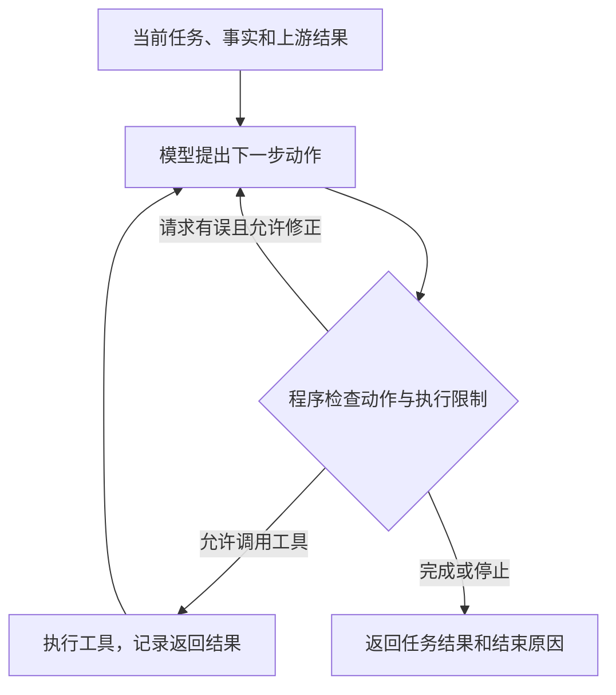

# 案件研判｜任务编排

## 前置学习知识

### 1. 开发者、后端与 LangGraph

| 概念 | 具体含义 |
| --- | --- |
| 开发者 | 设计方案、选择和配置框架、编写代码的人。 |
| 后端 | 承载业务处理、任务执行和系统控制的服务端程序。 |
| LangGraph | 后端使用的工作流编排框架，提供图执行、状态传递、条件路由、并发执行等机制。 |

使用 LangGraph 仍然属于后端开发。开发者编写的项目代码与框架提供的运行机制，共同组成后端系统。**需要分清哪些框架机制可以直接复用，哪些业务逻辑和功能需要自行实现。**

### 2. 框架能力与项目代码怎样分工

| 工作 | LangGraph 提供什么 | 开发者负责什么 |
| --- | --- | --- |
| 工作流阶段编排 | 用 `StateGraph` 的节点、边和条件路由运行流程。 | 定义规划、补证、核验、汇总等阶段及其连接和分支。 |
| 动态任务分发 | 用 `Send` 向同一个 Worker 节点分发不同任务输入，分别执行。 | 校验任务计划；检查执行条件，选出可执行任务并准备输入。 |
| 异步并发 | 支持异步执行，让独立核查任务并发运行。 | 使用异步模型和数据库接口；阻塞操作按需交给线程。 |
| 并发上限 | `max_concurrency` 限制一次图运行中由框架管理的并发任务数。 | 配置每案上限；另外限制跨案件共享资源的并发请求数。 |
| 输入与结果传递 | State 保存数据，`Send` 传递输入，合并函数（reducer）处理任务结果。 | 约定任务的输入输出，检查所需数据是否准备好，提供对应结果。 |
| 任务恢复 | Checkpointer 保存检查点，支持中断后恢复。 | 配置存储与运行标识，防止外部操作重复生效，并提供整体任务状态。 |
| 失败与重试 | `RetryPolicy` 按配置重试节点异常。 | 确定重试条件和次数，以及失败或查询无结果时的处理。 |
| 调用预算与工具权限 | 可以在节点中接入项目需要的检查。 | 用 Schema 校验参数，检查权限和范围，统一预留并限制调用及 Token 额度。 |

**`Send` 复用的是同一个节点定义。** LangGraph 用不同任务输入分别调用它，配合异步 Worker 可以并发运行；这不表示框架自动创建 Worker 类的不同实例。只有 Worker 节点内部调用了同一张子图，才涉及子图复用。[Send 说明](https://docs.langchain.com/oss/python/langgraph/graph-api#send)

这里有两个处理环节：**计划校验**检查任务的字段、类型和业务范围；**执行条件检查**判断任务是否尚待执行、所需数据是否已经准备好。前者通过后，后者还要在运行过程中根据最新结果继续判断。

本文采用 **Graph API 的 `Send + 条件路由 + 异步 Worker + max_concurrency`**。项目代码说明任务需要什么输入、输入从哪里取得；框架负责实际分发、并发执行、状态合并和检查点，不再另建管理协程队列的独立调度器。框架不会从自然语言任务名称中自动推断业务输入。[Graph API](https://docs.langchain.com/oss/python/langgraph/graph-api)、[并发与重试配置](https://docs.langchain.com/oss/python/langgraph/use-graph-api)

### 3. 执行规则、执行逻辑和任务数据

| 概念 | 含义 | 举例 |
| --- | --- | --- |
| 执行规则 | 规定任务何时可以执行，以及不同情况下应该怎样处理。 | 取得甲的有效账户列表后才能查询交易；上游任务失败时，不再启动需要它结果的任务。 |
| 执行逻辑 | 程序检查条件并完成对应处理，是规则的具体实现。 | 读取任务状态和结果，检查账户数据；满足条件就交给框架执行，否则等待或按失败情况处理。 |

**规则规定应该怎样做，逻辑负责用程序实现这些规则。** LangGraph 提供通用的工作流执行机制；项目代码定义任务执行规则和配置参数，并利用框架机制落实这些规则。

| 内容 | 属于什么 |
| --- | --- |
| 查询甲在某段时间的交易 | 模型提出的任务数据，说明要查什么、范围是什么。 |
| 交易查询需要账户列表 | 后端预先定义的输入要求。 |
| 这项查询所需的账户列表由哪项任务提供 | 后端根据输入输出约定生成的输入来源记录，不由模型填写。 |
| 账户查询是否成功、返回结果是否有效 | 任务执行记录，以及后端需要检查的数据。 |
| 分发 Worker、限制并发、合并结果 | LangGraph 提供的运行机制。 |
| 每案任务并发上限、调用额度 | 配置参数，给执行逻辑提供具体限制。 |

**任务计划说明要做什么，输入输出约定说明任务需要和返回哪些数据，执行记录说明各任务的执行状态和结果。后端据此判断哪些任务满足执行条件，LangGraph 再按照路由结果和并发配置执行。**

### 4. 工作流 State 与两层任务状态

**工作流 State 是保存和传递工作流数据的结构。** 它可以包含任务计划、输入来源、执行记录和核验结果，并非只保存“当前运行到哪里”。[LangGraph State 说明](https://docs.langchain.com/oss/python/langgraph/graph-api#state)

本文把用户提交的一次案件研判称为“研判任务”，其中拆出的 T1、T2 等称为“核查任务”。按目标方案，数据分别是：

| 名称 | 说明什么 | 目标方案中的位置 |
| --- | --- | --- |
| 主图 State | 保存和传递案件研判主流程需要的数据，包括任务计划、核查结果、执行状态和核验结果等。 | `CaseWorkflowState` 包含 `tasks`、`input_sources`、`ready_tasks`、`task_inputs`、`task_runs`、`verification` 等字段。 |
| 任务计划 | 每项核查的类型、目标、人员和时间范围。 | State 的 `tasks`；模型提出任务，后端校验并补充任务标识、工具范围等执行信息。 |
| 输入来源记录 | 每项任务需要哪些输入，使用已有事实还是某项任务的输出。 | State 的 `input_sources`，由后端根据任务类型及输入输出约定生成。 |
| 核查任务执行状态 | 单项任务当前待执行、执行中、成功、失败或阻塞等情况。 | 框架运行信息提供实时进展；Worker 返回结束记录，分发节点补充阻塞等记录，统一合并到 `task_runs`。 |
| 研判任务生命周期状态 | 整次研判运行中、成功、失败或已取消。 | 现有 SQLite 的 `case_runs.status`，由 `CaseRunService.status()` 读取并提供给接口。 |

**子图 State** 保存和传递子图内部处理任务所需的数据。它可以采用独立的状态结构，执行完成后将主图需要的结果返回。

任务标识用于唯一区分和查找核查任务，并将任务目标、执行状态和执行结果对应起来。整次研判运行中，不代表每项核查都在执行；一项任务成功，也不代表整次研判已经完成。

Worker 返回的执行记录由 LangGraph 在当前执行步结束后合并到 State，配置 Checkpointer 后随检查点持久化。实时进度可通过流式事件获取；持久化的 State 是检查点快照，不一定反映任务此刻的进度。

**任务执行状态只是执行记录中的一个字段，执行记录又只是 State 可以保存的一类数据。** 整次研判还需完成集中核验和报告保存，才能发布成功状态；汇总核查结果得到的 `task_run_status` 不等于对外的研判任务生命周期状态。

## 简历条目

> **任务编排：**用 **LangGraph** 编排“规划—补证—集中核验—汇总”，按人员关系与时间窗拆分核查任务，基于 **asyncio** 按依赖和并发上限异步调度；对照串行执行，端到端 **p95 耗时 35→27 min**。

> 本条理解状态：已确认业务主线。本版按用户要求，采用“大模型提出任务、后端根据输入输出约定确定依赖、LangGraph 原生分发与并发执行”的目标方案，供后续源码对齐。模型输出不包含任务依赖。文中字段和代码用于解释目标实现；下文“大模型”指大语言模型，“疑点”指候选风险疑点。

## 第一阶段：本条理解

这条工作的核心是：**把核查疑点要做的事情拆成具体任务，安排好执行顺序。需要的信息已经准备好、互不依赖的任务，可以一起推进；依赖其他任务输出的，就等所需结果返回后再执行。本轮执行结束后，对证据进行集中核验，再整理报告。**

一次案件研判需要多次查询案件数据，并请求大语言模型分析相关事实、规划核查任务或核验查询结果。

这部分工作的目标是：**在满足任务依赖和资源限制的前提下，通过异步调用和受限并发，在一项核查任务等待数据库或模型响应时，推进其他可以执行的任务，减少串行等待，缩短完整研判流程的耗时。**

### 1. 从疑点和相关事实出发，生成结构化核查任务

[研判策略](研判策略.md)先整理案件事实，再通过**业务规则通道和大模型分析通道**分别发现候选风险疑点。随后，汇总两路疑点及相关事实，作为规划输入，生成具体的核查任务。

一个疑点可以对应多项核查任务。按人员关系和时间窗拆分，是为了让每项任务明确查哪些人、查哪段时间的数据，以及查询结果用来回答什么问题。

规划时，后端提供疑点、相关事实、支持的任务类型、工具说明和任务输出规范（Schema）。**模型负责提出要查什么，不填写任务依赖，也不指定上游任务或结果字段。**

目标方案把模型输出与后端补充的信息分开：

| 信息 | 由谁提供 | 说明什么 |
| --- | --- | --- |
| `task_type` | 模型从后端支持的类型中选择 | 采用哪类核查，例如关联账户查询、人员关系查询、交易记录查询。 |
| `question` | 模型提出 | 当前任务要查清什么。 |
| `entity_ids`、`time_range` | 模型提出，后端检查 | 涉及哪些人、哪个时间范围。 |
| `task_id` | 后端生成 | 唯一标识任务，用来关联输入和结果。 |
| `allowed_tools` | 后端确定 | 根据任务类型、案件范围和权限选择可用工具。 |
| 输入输出约定、输入来源 | 后端定义并匹配 | 当前任务需要什么数据，已有数据能否提供，否则由哪项任务提供。 |

这些是目标字段，后续需要调整现有 `InvestigationTask`。模型的任务类型必须来自明确的允许范围；后端不靠阅读自然语言任务名称来猜输入要求。

**依赖由后端根据任务类型和输入输出约定确定。** 例如，后端预先规定：关联账户查询接收人员身份、返回账户列表；交易查询接收账户列表和时间范围、返回交易明细。围绕甲、乙的资金往来，可以形成下面的任务：

| 任务 | 核查目标 | 所需输入 | 后端判断 |
| --- | --- | --- | --- |
| T1 | 查询甲的关联账户 | 甲的身份信息 | 已有身份信息，可以执行。 |
| T2 | 查询甲、乙的人员关系 | 甲、乙的身份信息 | 已有双方身份信息，可以与 T1 同批执行。 |
| T3 | 查询甲在指定时间内的交易 | 甲的账户列表、时间范围 | 时间范围已知，账户列表要等 T1 查询返回。 |

T3 等待 T1，是因为它缺少甲的账户列表，由后端约定确定；与任务编号或列表排列无关。如果已有符合要求的甲的账户列表，就可以直接用于 T3。

**检查输入不是只看某个字段有没有值。** 后端要按人员、账户、时间范围等条件匹配数据，并确认来源已成功返回、结果符合约定。乙的账户列表不能用于查询甲的交易。匹配不到来源、存在无法消除的歧义或形成循环依赖时，计划检查不通过，记录问题并按有限修正规则处理，不能把缺少输入当成“无依赖”。

每批结果更新后，后端重新检查所有尚待执行的任务，不是按列表从头到尾只走一遍。查询成功但没有记录，与请求尚未完成也要区分；空结果按业务约定结束相应查询或保留缺口，不能一直等到出现非空结果。

**业务上有关联，也不代表执行时必须有先后顺序。** T1 和 T2 服务于同一个疑点，但输入已经准备好，可以独立查询，结果再放在一起核验。

### 2. 后端准备执行条件，LangGraph 组织运行

**大模型根据疑点和相关事实，提出结构化核查任务；后端校验任务，根据预先定义的输入输出约定确定输入来源，检查哪些任务可以执行，再利用 LangGraph 的动态分发和并发配置推进核查。**

任务间的依赖不再交给模型判断。开发者预先定义各类任务需要什么输入、会返回什么结果；具体运行时，程序根据本案人员、时间范围、已有事实和任务结果自动匹配，而不是人工逐项指定谁等待谁。

从模型输出到框架执行，只保留下面这条链：

1. **Planner 提出任务。** 根据疑点和事实，返回任务类型、目标、人员和时间范围等结构化内容。
2. **后端校验并准备输入来源。** 检查类型和范围，生成任务标识，确定工具范围，再根据输入输出约定关联已有数据或结果提供任务；来源无法确定时先处理计划问题。
3. **`dispatch` 检查当前输入。** 结合输入来源和执行记录，选出尚待执行、输入已经准备好且符合业务要求的任务，组装 Worker 输入。
4. **LangGraph 执行。** 路由函数返回 `Send`，框架按 `max_concurrency` 运行异步 Worker，合并结果后再检查下一批。

这里可以把输入匹配和校验写在规划节点的普通函数中，不需要新增一个独立调度组件。项目代码处理业务条件，框架处理实际的分发、并发运行、状态合并和恢复。真正发起模型或工具请求前，再通过公共调用接口检查权限并预留预算，避免并发任务合计超限。

如果需要先分析本轮证据，才能决定下一步查什么，就在集中核验后规划下一轮任务。**业务分析仍可以使用模型，明确的输入依赖由程序处理。**

#### 策略怎样落实到组件和函数

`planner`、`worker`、`verifier` 是回调函数（把函数或对象方法交给工作流，由工作流在指定阶段调用）。可以分别用 `Planner.plan()`、`Worker.run()`、`Verifier.verify()` 实现；这些名称是组织代码的示例，不是框架要求的固定名称。

本文统一称为：**规划器 Planner、核查执行器 Worker、集中核验器 Verifier。**

| 设计思路 | 在系统中怎样体现 |
| --- | --- |
| 借鉴 Plan-and-Solve，先规划再执行 | Planner 提出核查任务，后端根据输入输出约定准备执行条件，LangGraph 分发 Worker 完成核查。 |
| 借鉴 ReAct，根据工具反馈继续行动 | Worker 根据任务和当前结果选择工具，取得反馈后再提出下一步动作；工具输入和调用限制由程序检查。仅调用一次固定查询不足以体现这个循环。 |
| 采用反思核验思路（Reflection） | Verifier 结合证据检查判断和缺口，核验结果再指导定向补证。不能仅凭函数叫 `verifier`，就认为已经实现某种完整的反思算法。 |

这些方法帮助组织设计，组件分工帮助把设计写成程序。可以先确定业务流程，再划分组件，选择框架和接口，最后实现数据结构、业务处理和运行控制。第二阶段 Q02-2 按这个顺序组织口述。

### 3. 变化的任务计划，怎样交给固定的 LangGraph 节点执行

#### 主图、任务依赖和子图分别组织什么

| 对象 | 负责什么 |
| --- | --- |
| **案件主图** | 组织整次研判的阶段：规划、执行、集中核验、定向补证和汇总。 |
| **核查任务的输入依赖** | 后端根据输入输出约定，确定当前任务需要已有数据还是其他任务的结果；输入可用后交给框架执行。 |
| **Worker 子图** | 组织一项核查任务内部的处理步骤，例如模型选择动作、调用工具、处理反馈。 |

这里统一用“案件主图”和“Worker 子图”，不把它们解释为“外层固定、内层随意变化”。两张图都可以提前定义并编译；区别在于处理范围。固定的是节点功能和允许的连接方式，运行时的数据、调用次数、分支和循环次数可以变化。

**节点对应一个处理步骤，可以由函数或对象方法实现；子图本身是一张包含节点和连接关系的图。** 当前 `SupplementWorkerSubgraph` 创建并编译了一张图，所以称为子图；类只是封装这张图的一种写法。

#### 主图怎样接收并执行任务计划

目标方案中的节点及职责如下；名称用于说明通用实现：

| 主图节点 | 负责什么 |
| --- | --- |
| `plan` | 调用 Planner，校验模型提出的任务；后端确定输入来源和工具范围，将任务和来源记录写入 State。 |
| `dispatch` | 读取输入来源和 `task_runs`，选出尚待执行、输入符合要求的任务，写入 `ready_tasks` 和 `task_inputs`；上游失败等情况按规则记录。 |
| `worker` | 接收 `Send` 提供的任务与已准备好的输入，执行核查并返回结果与结束状态。 |
| `candidate_events` | 汇总候选风险疑点及其依据，交给集中核验。 |
| `central_verify` | 返回核验结果和证据缺口。 |
| `plan_rechecks` | 根据缺口提出追加任务，经相同校验和输入匹配后加入 State，再次进入分发。 |
| `summarize` | 根据核验结果整理并保存报告。 |

`dispatch` 是普通节点函数，只检查业务输入和任务状态，不维护协程队列或执行名额。成功、失败、已阻塞或无需执行的任务不会重新入选；临时异常的有限重试交给节点的 `RetryPolicy`。

输入来源保存在 `input_sources` 中。例如，后端已确定 T3 的 `accounts` 输入来自 T1 返回的同名字段。T1 成功后，`dispatch` 读取并检查该结果，准备 `task_inputs[T3]`；Worker 收到的是直接可用的业务输入，不再自行寻找上游任务。

下面只展示核心分发。前提是后端已完成输入来源校验，并在 `dispatch` 中处理缺少数据、失败和阻塞；没有可分发任务时，需要确认本轮任务均已结束或无法继续，不能遗漏仍需处理的任务。

```python
from langgraph.types import Send

def route_tasks(state):
    if not state["ready_tasks"]:
        return "candidate_events"
    return [
        Send("worker", {
            "task": task,
            "case_facts": state["case_facts"],
            "inputs": state["task_inputs"][task["task_id"]],
        })
        for task in state["ready_tasks"]
    ]

builder.add_conditional_edges("dispatch", route_tasks)
builder.add_edge("worker", "dispatch")
```

**后端按照预设约定准备任务输入，LangGraph 按 `Send` 分发和运行节点。** `worker` 可以调用同一张核查子图，每次使用自己的任务和输入，不需要为每项任务新建图节点。

例如，T3 的 Worker 只需要读取已准备好的账户列表：

```python
# 目标实现示例：上游结果已由后端匹配并组装
accounts = task_input["inputs"]["accounts"]
if not isinstance(accounts, list):
    raise ValueError("账户列表不符合输入约定")
# 再结合当前任务的时间范围，使用 accounts 查询交易记录
```

Worker 按任务类型的输出规范整理并校验结果，再返回自己的任务记录，例如 `{"task_runs": {task_id: record}}`；不能把自由文本直接当作约定字段使用。为 `task_runs` 配置按任务标识合并字典的 reducer（规定怎样合并更新的函数），可复用 `operator.or_` 等现成函数；任务标识由后端保证唯一。LangGraph 合并多个 Worker 的返回值，再进入下一次 `dispatch`，不需要另写协程调度循环。

图运行入口可以这样配置，`C` 是每案并发上限；`max_concurrency` 放在配置顶层，由框架限制同时执行的 Worker 数：

```python
await graph.ainvoke(
    initial_state,
    {"max_concurrency": C, "configurable": {"thread_id": run_id}},
)
```

本轮任务均已结束或无法继续后，再汇总疑点并集中核验。有缺口时，追加任务同样经过输入匹配和检查，再复用这套执行流程。

**本方案按批次推进。** T1、T2 同批执行，T3 需要 T1 的账户结果：这一批完成并合并结果后，下一次分发才启动 T3。即使 T1 提前结束、T2 尚未结束，也不能声称 T3 已立即启动。[LangGraph 运行时](https://docs.langchain.com/oss/python/langgraph/pregel)

若以后要求“一项任务完成就立即启动其下游，不等待同批独立任务”，可进一步评估 Functional API 的 `@task` 与 future 结果依赖。本版先采用上述按批次推进的原生方案。[Functional API](https://docs.langchain.com/oss/python/langgraph/functional-api)

#### 同一套 Worker 怎样处理不同任务

LangGraph 为 T1、T2 分别执行同一个 Worker 节点，由该节点调用同一张 Worker 子图，传入各自的任务输入。这就是复用子图，不需要为每项任务新建 Worker 类实例。每次子图调用分别保存任务输入和结果；后续接入工具反馈循环时，再保存各自的中间反馈。不同任务共同使用整次研判的资源预算。

主图状态与子图状态不必包含完全相同的字段。`Send` 提供单项任务输入，Worker 节点可以调用子图，再把结果作为节点更新返回主图，由 LangGraph 合并。这是数据传递和函数调用，不是类继承。[LangGraph 子图说明](https://docs.langchain.com/oss/python/langgraph/use-subgraphs)

当前 Worker 子图内只有一个 `worker` 节点。**后续实现建议：把一项任务的执行完善为“选择动作—检查并执行工具—处理反馈”的循环。**



图表示建议完善的 Worker 内部流程。“完成”和“因限制或错误停止”需要返回不同状态，不能都当作成功完成。

工具调用的具体连接方式是：

1. 后端从工具注册表中选择已注册、且在案件和任务允许范围内的工具。
2. 将这些工具的名称、用途和参数说明，连同当前任务和已有结果提供给模型。
3. 模型提出工具名称和参数，或提出结束当前任务。
4. 程序检查工具权限、参数、预算和步骤限制，通过工具名称找到已注册的函数并执行。
5. 将工具结果写入当前任务的局部状态，再让模型提出下一步动作。

工具名对应哪个函数由后端注册。是否进入工具节点或结束当前任务，由条件边对应的路由函数读取子图 State 中的动作和结果后判断。**模型输出可以改变实际执行的工具和循环次数，程序仍然按预先定义的执行逻辑运行。** 这种动态选择既可以发生在 Planner，也可以发生在 Worker，并不是“内层图”独有的性质。

仓库的 `agent_loop.py` 已有选择工具、校验请求、执行工具和处理反馈的逻辑。后续可以提取这些逻辑，接入 Worker 子图，同时改造异步调用并使用统一预算；不能把现有同步循环直接当成已经接好的异步 Worker。

### 4. 原生执行方案中，哪些地方需要自行实现

框架负责通用运行机制，项目代码只补充业务条件和处理。这里不再自行实现完整调度器，也不让模型填写执行依赖：

| 项目配置或代码 | 具体处理 |
| --- | --- |
| 任务类型与输入输出约定 | 定义每类核查需要什么数据、返回什么字段，以及可使用哪些工具。 |
| 计划解析与校验 | 复用结构化输出和 Schema 校验，检查类型、人员、时间和权限；按约定确定输入来源，检查来源缺失、歧义和循环。 |
| `dispatch` 节点及路由函数 | 读取来源记录和执行结果，准备符合要求的输入；用 `Send` 交给框架，失败或无数据时记录相应原因。 |
| Worker 与工具封装 | 使用传入的业务字段完成核查；按约定返回结果，不负责管理其他任务的执行顺序。 |
| 结果合并配置 | 为 `task_runs` 配置合适的 reducer，优先复用现成函数；由 LangGraph 合并返回值。 |
| 公共调用封装 | 在请求发出前检查业务权限和范围，统一预留调用与 Token 额度；重试、补证共用全案预算。 |
| 任务管理与外部操作 | 按需记录研判任务生命周期状态，实现外部操作幂等和跨案件共享服务限流。 |

例如，“交易查询需要甲的账户列表”写在后端的任务类型约定中。后端把账户结果匹配到 T3 的输入，再通过 `Send` 交给 Worker；LangGraph 负责运行 Worker 和合并结果。这里没有新增一个负责调度协程的组件。

临时调用异常可以配置 `RetryPolicy`。对于项目允许保留的业务失败，Worker 返回带原因的失败记录，由框架合并到 State，后端据此处理后续任务；未处理异常可能中断当前执行步。上游失败导致输入不可用时，可以阻塞相关任务，其他独立任务仍可按流程执行。

**输入能否支持任务启动，由后端按约定检查；证据能否支持疑点，由集中核验器分析。** 前者控制执行，后者形成风险判断，不能用任务执行成功代替疑点核验。

### 5. 异步、并发、并行与并发上限

**一项协程等待数据库或模型响应时，会让出执行机会，事件循环可以推进其他协程。** 这里不需要理解为“把属于自己的线程交出去”；多个协程原本就由同一个事件循环安排执行。

“交替执行”和“时间区间重叠”描述的是不同方面：

| 表达 | 具体含义 |
| --- | --- |
| 交替执行 | 在同一个事件循环线程中，不同协程轮流获得执行机会，某一时刻执行其中一个协程的代码。 |
| 任务时间区间重叠 | T1 尚未结束，T2 已经开始，它们从开始到结束的时间区间有交集。 |
| 并行执行 | 不同执行资源在同一时刻实际处理工作。 |

例如，T1 发出查询后等待响应，程序转去推进 T2。两个任务都没有结束，但并不意味着同一个线程正在同一时刻执行两段 Python 代码。

**并发描述多个任务在同一段时间内共同推进；交替执行是单线程协程实现并发的一种方式。** 并发也可以通过并行执行实现，二者不互斥。“等待时间重叠”只描述时间上的重叠；为了方便口述，全文使用“等待时推进其他任务”。[Python 协程调度说明](https://docs.python.org/3/library/asyncio-task.html)

目标方案通过 `Send` 分发异步 Worker，由 LangGraph 运行时管理并发执行；应用不再使用 `asyncio.create_task` 和 `FIRST_COMPLETED` 自建任务调度循环。Worker 仍需使用异步模型、数据库接口；同步阻塞工具可通过 `asyncio.to_thread` 在线程中执行。

这里的分工是：**后端选出输入符合要求的任务，LangGraph 按 `max_concurrency` 安排 Worker 执行，底层事件循环推进异步调用。** 一项任务等待响应时，其他正在运行的 Worker 可以继续推进。

任务需要哪些输入由后端约定，当前输入是否可用由程序检查；节点并发和执行步推进使用框架能力。简历中的“基于 asyncio”说明异步调用的运行基础，不代表必须自己编写协程调度器。实际提速仍取决于任务依赖、批次等待和外部服务容量。

#### 多个独立疑点怎样一起核查，是否需要多个线程

**原设计中的“多个独立疑点一起查”应当保留。** 不必等一个疑点全部查完，才开始下一个；不同疑点中已经准备好输入、互不依赖的核查任务，可以在同一轮中共同推进。同一疑点内的独立任务，也可以采用这种安排。

例如，疑点 A 需要核查甲、乙之间的资金往来，疑点 B 需要核查丙、丁之间的通联情况。如果两组查询输入都已经准备好，也不需要使用对方的结果，就可以分别启动。各自查到的结果分别保存，随后用于集中核验。

业务上可以把它称为“独立疑点并行推进”；讲技术实现时，统一使用**“独立核查任务受限并发”**。一起推进不要求每个疑点独占一个线程，目标方案的分工是：

| 执行范围 | 目标怎样实现 |
| --- | --- |
| 同一案件内的核查任务 | LangGraph 通过 `Send` 分发异步 Worker；其中可以包含不同疑点的独立任务。 |
| 无法直接异步调用的阻塞工具 | 通过 `asyncio.to_thread` 交给线程执行，避免卡住事件循环。 |
| 多次案件研判请求 | 通过异步图调用运行各案件，按服务部署范围管理共享请求限额。 |

对主要等待数据库和模型响应的工作，异步 Worker 已能共同推进独立任务；确有阻塞接口时再使用线程池，不为每个疑点单独创建线程。

多线程也不等于多核计算并行。在默认启用 GIL 的 CPython 中，计算密集的纯 Python 代码通常不能靠多个线程同时使用多个 CPU 核；这类工作才需要另外考虑多进程或计算服务。[Python 线程说明](https://docs.python.org/3/library/threading.html)

#### 统一“进行中的核查任务”的含义

**进行中的核查任务：已经启动、尚未结束的核查任务，包括正在等待数据库或模型响应，以及等待请求名额的任务。** 尚未启动、还在等待上游任务的，不计入这一数量。

**每案任务并发上限通过图调用的 `max_concurrency` 配置，由 LangGraph 限制同时执行的 Worker 数。** 已通过 `Send` 分发、但尚在等待框架执行名额的任务不计为已经开始的 Worker。上限由开发者配置，模型不能自行提高。

它主要限制同一时间的执行压力，例如任务占用的内存、连接数，以及数据库和模型服务承受的请求量，并不是直接设置 CPU 使用率。累计调用次数限制“总共调用多少次”，并发上限限制“同一时间允许多少项工作进行中”，两者需要分别控制。

并发上限的范围需要单独说明，不会因为使用了多个线程或并行执行，就自动变成全局限制。

| 限制 | 控制范围 |
| --- | --- |
| 每案任务并发上限 | 一次案件研判中进行中的核查任务数。 |
| 服务整体任务上限（按需增加） | 所有案件合计进行中的核查任务数。 |
| 模型、数据库请求并发上限 | 在共享范围内，已取得请求名额、正在调用服务的操作数；尚在排队等待名额的不计入。 |

例如，两个案件分别允许 3 项任务进行中，合计就可能达到 6 项。如果要限制整个服务最多 4 项，就需要共同使用一个总名额池。

即使允许 6 项核查任务进行中，也可以只允许 2 个模型请求进行中。其余任务等待模型请求名额。核查任务数与模型请求数是不同的计数单位；正在等待模型的任务仍占用自己的核查任务名额。

多个线程或进程分别创建“上限为 4”的计数器，限制的是各自最多 4，不能限制合计最多 4。统一限额需要共同的计数和获取、归还名额机制。

#### 当前限流需要完善的地方

目标方案把每案并发值传给图调用的 `max_concurrency`。这一配置限制框架管理的并发执行，不会自动成为跨案件、跨进程的共享模型或数据库限流器。

现有服务源码还使用线程池运行不同案件，并跨事件循环共用 `asyncio.Semaphore`；对齐目标方案时，这部分共享限流也需调整，因为这些对象不支持跨线程安全使用。[Python 同步对象说明](https://docs.python.org/3/library/asyncio-sync.html)

**后续实现建议：在单个服务进程的同一事件循环中运行多个案件的异步任务，共享模型和数据库请求名额；同步阻塞工具交给线程执行。** 如需服务整体任务上限，再增加共同的任务名额池。以后采用多个服务进程时，通过统一调度服务或跨进程共享计数实施总量限制。

取消或超时时，也要确认外部操作是否真正结束，再处理请求名额。特别是取消等待线程结果的协程，不等于线程中的查询已经停止。[Python 线程任务说明](https://docs.python.org/3/library/concurrent.futures.html)

#### 任务之间并发，不代表任务内部自动并发

一个 Worker 先等待查询 A 返回，再调用查询 B，这两个查询在任务内部仍然顺序执行。只有明确组织两个独立操作共同运行，才形成任务内部的并发。

即使采用模型与工具循环，存在输入依赖的步骤也要顺序推进。不能因为用了异步函数、子图或 ReAct，就认为所有工具调用已经并发执行。

### 6. 怎样继续补证，怎样控制整体消耗和局部循环

**集中核验发现证据不足时，围绕具体缺口提出定向补证任务，经后端校验并确定输入来源后追加到 State，再由 LangGraph 分发执行，补证后重新核验。整个过程遵守统一的调用预算和停止条件；停止后，保留尚未解决的缺口。**

“证据不足”适用范围更广；“证据链断裂”适合描述某条关联链缺少关键环节。补证的目的在于查清疑点，结果既可能支持疑点，也可能修正或排除疑点。

#### 核心控制分为整体和局部两层

**整体执行控制，管总共能用多少、同一时间能做多少；局部循环控制，防止一项任务反复尝试却没有进展。** 这两层共同组成后端的执行控制，不必把所有限制都叫“资源预算”。

| 层次 | 控制项 | 控制什么 |
| --- | --- | --- |
| 整体执行控制 | 模型调用总次数、工具调用总次数 | 分别限制整次研判累计发起多少次模型请求、多少次工具调用，避免调用不断增加。 |
| 整体执行控制 | Token 用量预算；按需增加费用预算 | 限制模型用量；如果模型或外部工具按量收费，再按相应计费规则控制费用。 |
| 整体执行控制 | 任务与请求并发上限 | 限制进行中的核查任务数，以及共享服务中的模型、数据库请求数，控制同一时间的执行压力。 |
| 局部循环控制 | Agent 循环轮次上限与停止条件 | 限制一项任务持续尝试的轮数，包括动作选择、工具反馈和请求修正；任务完成、达到上限或持续没有有效进展时停止。 |

预算不只表示金额，也可以用调用次数或 Token 表示可用额度。把工具调用次数纳入资源预算本身没有错；本表分别列出这些限制，是为了讲清计量单位，避免总类与子项重复并列。

这里将工具调用次数单独列为**调用总量限制**。它不必等同于费用：内部查询工具即使不按次收费，也会占用数据库和网络资源；收费工具还可能产生费用。调用次数、Token 用量和金额之间有关联，但计量单位不同，不能相互代替。

“整体”的范围也要说清楚：这里的累计用量按**一次完整研判**统计，各任务、规划、核验和后续补证共同使用，不能每启动一个 Worker 就重新给一份完整预算。多个案件共用模型或数据库时，还要共用相应的请求并发限额；第 5 节说明了它与每案任务上限的区别。

整体预算不能代替局部控制。即使全案预算充足，也不应让一项任务持续重复查询，耗尽其他任务可用的额度。局部控制采用通用名称**“Agent 循环控制”**，其中可配置的数量限制叫**“循环轮次上限”**，比“Worker 内部步骤上限”更容易理解，也适用于其他 Agent 任务。

#### 怎样判断局部任务该停下来

后续完善 Worker 循环时，建议同时检查两件事：**是否达到循环或重试上限，以及继续执行是否取得有效进展。** 例如，在数据没有变化的情况下，重复相同查询、返回相同结果，且仍未解决任何证据缺口，就不应持续重试。有效进展包括补充关键证据、解决一个缺口，或者获得足以修正、排除疑点的信息。

“没有进展”需要根据任务目标、已有结果和缺口变化判断，不能只看返回字数，也不能只靠模型自己宣布。程序可以识别重复调用和重复结果，再结合核验结果判断是否需要停止。停止时记录原因、已有结果和未解决的问题。

一项任务停止后，其他独立任务仍可在预算内继续；依赖它的任务要按任务状态和结果是否可用处理。整次研判的预算耗尽时，则停止新增受该预算约束的调用。并发下的预算检查和扣减需要统一处理，避免多个任务各自认为“还有额度”而合计超限。

当前代码已有模型与工具调用次数、输出 Token 预留额度和每案任务并发控制；跨案件共享请求限流、按金额控制费用，以及 Worker 循环中的无进展判断属于后续完善项。主图已有的补证轮次限制继续保留，用来防止反复补证，不再把它单列为核心概念。

工具能力说明现有工具能取得什么信息，是任务能否完成的条件；调用预算、并发上限和循环控制规定还能执行多少、怎样停止。任务正常结束但证据不足，与工具调用失败也要分别记录，不能把失败写成成功完成核验。

### 7. 35→27 分钟说明什么

端到端耗时衡量一次完整研判流程需要多长时间。仓库现有计时口径是：从后端接收有效请求开始，到必需研判步骤完成、报告保存并可读取为止，包含请求后的事实准备、规划、补证、集中核验和报告生成。

p95 可以理解为约 95% 的统计样本耗时不超过这个值。从 35 分钟降到 27 分钟，减少 8 分钟，降幅约为 22.9%。它说明这组对照中，完整流程的高分位耗时下降，不代表每个案件都快了 8 分钟。

对比两组流程的耗时时，不能只看时间缩短了多少，还要确认必要的核查步骤都已完成、核查内容基本一致，报告质量也符合要求。这样才能说明提速不是靠减少核查工作换来的。

这里检查输出质量，是为了保证耗时对比的可信度，并不代表并发本身提高了精确率或召回率。

“核查内容基本一致”，指两组覆盖的疑点、人员、时间范围和必要检查具有可比性，不要求工具调用顺序或报告文字完全相同。

目标方案由后端选出输入已经准备好的任务，使用 LangGraph 原生分发和并发配置共同推进；异步调用让一个任务等待时，其他 Worker 继续运行。多个独立疑点可以因此一起核查，不必另列一项“多线程优化”。

35→27 分钟保留为本条已有对照结果；本轮原生执行方案、Worker 循环和共享限流改进，不归入这组已经记录的收益。如果只做串行与并发的整体对照，也不能分别拆出异步接口与任务调度各贡献多少分钟。

系统性能、结果质量、测试与评测的关系，以及 LangSmith 的定位，统一放在[效果评测的前置学习知识](效果评测.md)中。

## 第二阶段：面试问答

Q01 按 STAR 组织，其他题按具体考察内容安排顺序。“考察重点”“回答顺序”和方括号只用于记忆，不需要念出来。Q02-2 讲从方案到代码的开发过程，Q02-3 区分 State 与两层任务状态，Q04-3 讲整体与局部执行控制；涉及后续实现的部分使用“准备”“计划”等措辞。

```text
Q01. 介绍一下你做的案件研判任务编排。

考察重点：面对什么问题、个人负责什么、关键做法怎样带来结果。
回答顺序：S 串行等待 → T 我的任务 → A 规划、校验、异步调度、核验 → R 耗时结果

答：
[S] 一次案件研判需要多次查询案件数据，并请求大模型分析事实、规划核查任务或核验结果。全部串行执行时，互不依赖的任务也要依次等待。

[T] 我负责设计和实现任务编排，在满足任务依赖和资源限制的前提下减少串行等待。

[A] 我用 LangGraph 组织规划、补证、集中核验和汇总。按这次确定的目标方案，大模型提出核查任务，后端根据任务类型和输入输出约定确定依赖，准备好输入，再通过 Send、异步 Worker 和 max_concurrency 交给框架并发执行。一项任务等待数据库或模型响应时，其他 Worker 可以继续运行。各批任务完成后集中核验，必要时追加补证任务，最后整理报告。

[R] 对照串行执行，端到端 p95 耗时从 35 分钟降到了 27 分钟。


Q02. 大模型、LangGraph 和你编写的后端代码怎样分工？

考察重点：模型规划、后端业务判断和框架执行是否分清。
回答顺序：模型提出任务 → 后端确定输入和条件 → 框架执行 → 都属于后端开发

答：大模型根据疑点和事实提出核查任务，说明任务类型、目标、人员和时间范围，不输出任务依赖。

后端按预先定义的输入输出约定确定数据来源，检查哪些任务已经具备执行条件。LangGraph 通过条件路由、Send 和 max_concurrency 分发异步 Worker，合并结果并保存检查点。

开发者负责定义这些业务约定、节点和配置，以及权限、预算等检查；实际的并发运行使用框架，不再另写协程调度器。复用框架仍属于后端开发。

Q02-1. 每次任务计划都不同，固定的 LangGraph 图怎样执行？

考察重点：任务数据、输入准备和原生分发怎样配合。
回答顺序：任务与输入来源进入 State → 检查输入 → Send 分发 Worker → 合并结果后继续

答：变化的是任务数据，不必为每项任务重新创建图节点。模型提出任务后，后端校验类型和范围，按输入输出约定确定输入来源，一起保存到 State。

分发节点结合执行记录选出输入已经准备好的任务，组装各自的输入。条件路由返回 Send，由 LangGraph 在并发上限内调用同一套异步 Worker，再按配置的合并方式更新 State。

本方案按批次推进，结果合并后再检查尚待执行的任务。本轮任务结束或无法继续时进入集中核验；追加补证任务也经过相同的校验和输入准备。

Q02-2. 你怎样把研判策略，从方案设计落实到程序实现？

考察重点：能否把业务思路、组件分工、技术选择和代码工作连起来。
回答顺序：业务方案 → 组件分工 → 技术选型与接口 → 代码实现与正在完善的部分

答：我按“先明确研判方法，再确定组件和接口，最后编写执行逻辑”的顺序推进。

方案设计时，先确定业务主线：整理案件事实，通过业务规则通道和大模型分析通道发现疑点，再规划核查任务、查询补证并集中核验，证据不足时围绕缺口继续补证。

然后划分组件：Planner 提出核查任务，Worker 完成单项核查，Verifier 综合证据核验。后端按任务类型约定输入输出，确定数据来源和执行条件，任务的分发与并发运行使用 LangGraph。

技术方案进一步确定用 LangGraph 组织主流程，通过 State 保存任务、输入来源和结果，用 asyncio 支持异步调用；模型输出规范只包含核查任务，不要求填写依赖。

代码实现时，把规划、核查和核验函数接入节点，在规划环节校验任务并匹配输入来源，在分发环节准备可用输入并返回 Send。配置 max_concurrency 和 Checkpointer，由框架运行和保存状态。项目另外实现权限、预算和业务结果检查。

项目仍在迭代。我会把现有独立调度器对齐到这套原生执行方案，并继续接入 Worker 工具反馈循环和跨案件共享请求限流。整体采用先规划后执行的思路，Worker 根据工具反馈继续行动，集中核验再指导补证，使这些设计对应到明确的程序职责。


Q02-3. 工作流 State、核查任务执行状态和研判任务生命周期状态有什么区别？

考察重点：能否分清工作流数据结构、内部任务进展和对外任务状态。
回答顺序：State 保存什么 → 内部核查任务状态 → 整次研判的状态 → 当前怎样更新

答：工作流 State 是节点之间保存和传递数据的结构，可以包含核查任务、后端确定的输入来源、执行记录和核验结果。

核查任务执行状态只描述一项内部任务当前待执行、执行中、成功、失败，或因依赖失败而阻塞。研判任务生命周期状态则描述用户提交的整次研判是否还在运行、已经成功、失败或取消；整次研判运行中，不代表所有内部任务都在执行。

目标方案由 Worker 返回任务记录，LangGraph 在执行步结束后合并到 State，并通过 Checkpointer 保存。实时进展可从框架事件获取；对外整体任务状态由任务管理接口提供。核查任务执行成功后，还要继续核验和生成报告。


Q03. 为什么按人员关系和时间范围拆分任务？

考察重点：拆分是否服务于实际核查目标。
回答顺序：明确范围 → 围绕疑点安排查询 → 结合相关结果核验

答：这样可以让每项任务明确查哪些人、查哪段时间的数据，以及查询结果用来回答什么问题。

例如，核查甲、乙之间的资金往来，可以分别安排人员关系查询、关联账户查询和交易记录查询。这些任务围绕同一个疑点，各自承担明确的工作。

执行时根据是否需要其他任务的输出安排顺序，完成后再把相关证据放在一起核验。业务上有关联的查询，也可能独立执行。


Q04. 不让模型输出依赖，怎样保证任务顺序并支持并发？

考察重点：后端怎样确定输入依赖，以及怎样利用框架执行。
回答顺序：约定每类任务的输入输出 → 匹配输入来源 → 筛选可执行任务 → 原生并发与继续推进

答：我在后端为每类核查任务定义输入输出。模型只提出任务类型和核查范围，后端据此匹配已有数据或其他任务的输出，确定哪些信息需要等待。

例如，交易查询需要甲的账户列表和时间范围。账户查询与人员关系查询可以同批执行；交易查询要等账户结果符合要求后，再交给框架。已有符合要求的账户信息时，也可以直接使用。

分发节点为输入已经准备好的任务组装数据，路由返回 Send，LangGraph 按 max_concurrency 运行异步 Worker。结果合并后，后端重新检查尚待执行的任务；上游失败或没有数据时，按约定记录阻塞或结束原因。

输入来源无法确定的计划不能直接执行。请求发出前还要检查权限并预留预算；这部分是业务控制，协程运行和并发限制交给框架。

Q04-1. 多个疑点一起核查，必须用多个线程吗？异步并发为什么能提速？

考察重点：是否分清任务并发、事件循环和线程的作用。
回答顺序：独立任务可以共同推进 → 框架与异步接口配合 → 线程用在哪里 → 上限范围

答：不必为每个疑点单独开一个线程。查询数据库和请求模型有较多等待时间，独立核查任务可以用多个协程共同推进。

后端选出输入符合要求的任务，LangGraph 原生分发并限制并发；异步 Worker 等待响应时，事件循环可以推进其他 Worker，不用等一个疑点全部查完才开始另一个。

同一事件循环中的协程代码可以交替执行，但多个任务从开始到结束的时间区间有重叠，这就是并发。是否在同一时刻实际处理多项工作，还取决于数据库、模型服务等执行资源。

本方案由框架运行异步 Worker，阻塞工具按需交给线程池。每案 max_concurrency 限制同时执行的 Worker，包括等待响应的 Worker；多个案件共享模型和数据库时，还需共同的请求限额。


Q04-2. LangGraph 原生能力能满足需求吗，为什么不再单独写调度器？

考察重点：框架选型、必要的业务代码和执行边界。
回答顺序：原生方案能做什么 → 还需定义什么 → 批次等待边界

答：对于本版方案需要的动态任务数量、依赖顺序和受限异步并发，Send、条件路由和 max_concurrency 可以完成执行机制，因此优先复用框架。

我仍需定义每类任务的输入输出，校验计划、匹配来源、检查输入，并处理权限、预算和业务失败。框架无法自行推断这些业务含义，但不需要模型额外输出依赖，也不需要再写管理协程队列的独立调度器。

这套 Graph API 方案按批次合并结果。如果以后要求 T1 一完成就启动 T3、完全不等待同批 T2，可进一步评估 Functional API 的任务结果依赖；不能把简单 Send 方案的批次等待概括为整个 LangGraph 都做不到。


Q04-3. 怎样控制整个系统的资源消耗，避免 Agent 反复尝试却没有进展？

考察重点：是否分清累计用量、并发压力和局部循环，控制是否由后端落实。
回答顺序：整体控制总量与并发 → 局部控制循环与进展 → 共享预算 → 停止后的处理

答：我把执行控制分为整体和局部两层。

整体上，分别限制一次完整研判的模型调用次数、工具调用次数和 Token 用量，再限制进行中的任务数，以及所有案件共享的模型、数据库请求数。前者管累计消耗，后者管同一时间的执行压力，并发上限并不是 CPU 使用率上限。

局部上，要限制一项 Agent 任务的循环和重试，并检查是否还有有效进展。即使总预算还没用完，如果持续重复相同查询、没有补充有效信息或解决证据缺口，也应停止，保留已有结果和未解决的问题。

所有阶段共同使用整次研判的预算，通过公共调用接口在请求发出前检查并预留相应额度，不能每启动一个任务就重新发一份。局部任务停止后，其他独立任务仍可在预算内继续；整体预算耗尽时，停止新增受该预算约束的调用。

当前已有模型与工具调用额度、输出 Token 预留额度和每案任务并发控制；跨案件共享请求限流，以及 Worker 循环中的无进展判断，还在完善。


Q05. 为什么要集中核验？证据不足后怎样处理？

考察重点：是否区分执行完成与疑点成立，补证是否有方向和停止条件。
回答顺序：核验目的 → 检查支持与反驳信息 → 定向补证 → 限制与停止

答：集中核验要结合相关任务查到的证据，判断疑点得到支持、需要修正、可以排除，还是仍然证据不足。任务执行成功，只说明安排的查询和检查已经完成。

核验时既看支持疑点的信息，也看反驳信息和矛盾。发现证据不足后，针对缺口提出补证任务，经后端校验并确定输入来源后写入 State，由 LangGraph 再次分发执行并核验。

后端按统一的调用预算和循环停止条件控制执行，各任务和后续补证共同使用整次研判的预算。达到限制，或者现有工具无法取得所需信息时，需要保留未解决的缺口。正常结束但证据不足，与调用失败要分别记录，不能反复查询直到得到支持疑点的结果。


Q06. 端到端 p95 耗时从 35 分钟降到 27 分钟，说明什么？

考察重点：是否理解指标含义和结论范围。
回答顺序：结果含义 → p95 解释 → 变化幅度 → 结论边界

答：它说明这组对照中，完整研判流程的高分位耗时下降了。

p95 可以理解为约 95% 的统计样本耗时不超过这个值。从 35 分钟降到 27 分钟，减少了 8 分钟，降幅约为 22.9%。

这是整套执行方式相对串行执行的对照结果，不代表每个案件都快了 8 分钟，也不能分别量化异步接口和某项调度机制的贡献。


Q06-1. 怎样保证串行与并发的耗时对照可比？

考察重点：是否在可比工作量和运行条件下评价提速。
回答顺序：固定条件 → 统一计时 → 比较耗时 → 核对完成情况与质量

答：应使用同一批案件，固定数据、研判策略、模型与提示词、调用预算、候选风险疑点上限和部署环境，保持缓存与追踪配置一致，改变要比较的执行方式。如果只验证任务并发的收益，就将每案任务上限设为 1 和目标值进行对照。

两组都从后端接收有效请求开始计时，到必需研判步骤完成、报告保存并可读取为止，包含补证和再次核验。每个案件在两种设置下按相同的计划次数运行。

比较耗时时，还要确认必要核查步骤都已完成、核查内容基本一致，报告质量符合要求，才能说明提速不是靠减少核查工作换来的。比较成功运行的 p95 时，也要一起检查成功比例和失败情况。

这里检查质量是为了保证耗时对比可信，并不代表并发本身提高了精确率或召回率。
```

## 已采用的简历表达

简历正文已补充 `asyncio`，明确减少等待所采用的异步执行方式，同时保留任务拆分、依赖检查和并发限制：

> **任务编排：**用 **LangGraph** 编排“规划—补证—集中核验—汇总”，按人员关系与时间窗拆分核查任务，基于 **asyncio** 按依赖和并发上限异步调度；对照串行执行，端到端 **p95 耗时 35→27 min**。

相对修改前的条目，主要增加“基于 asyncio”和“异步”，按可见文本计算增加 13 个字符，控制在本轮约 20 字的增量要求内。实际排版宽度仍取决于字体。

独立疑点一起核查的设计已经包含在“按依赖和并发上限异步调度”中，面试时可以用第 5 节和 Q04-1 展开。这里不再增加“多线程并行”，理由是它没有补充当前实现的核心信息，还可能让人误以为每个疑点都使用独立线程；不是因为并行“太简单”而不值得讲。

这条简历按本版目标方案解释为：模型提出核查任务，后端按输入输出约定确定依赖和执行条件，LangGraph 组织阶段、原生分发并控制并发，异步接口配合 asyncio 减少串行等待。后续实现建议不写成这组耗时结果的既有原因。本节与简历正文采用同一表述。

## 实现与原理查阅入口

| 入口 | 用于查阅什么 |
| --- | --- |
| [研判策略](研判策略.md) | 两路疑点发现、规划输入、补证与集中核验的业务主线。 |
| [效果评测](效果评测.md) | 功能正确性、系统性能、结果质量，以及 LangSmith 的评测流程。 |
| [工作流](../../项目源码/案件研判/src/case_workflow_graph.py) | 当前主图与 State；后续按本文加入任务类型、输入匹配、原生分发与结果合并。 |
| [现有执行与预算代码](../../项目源码/案件研判/src/case_task_scheduler.py) | 现有独立调度实现待按本文替换；计划校验、权限与预算检查可按职责提取复用。 |
| [Worker 子图](../../项目源码/案件研判/src/case_worker_subgraph.py) | `SupplementWorkerSubgraph`、独立子图 State、Worker 函数调用与返回结果。 |
| [运行服务](../../项目源码/案件研判/src/case_run_service.py)、[服务入口](../../项目源码/案件研判/src/case_api.py) | 当前服务装配和默认回调；后续接入本文的原生图执行方案。 |
| [工具反馈循环](../../项目源码/案件研判/src/agent_loop.py) | 可用于完善 Worker 的动作选择、工具检查和反馈处理逻辑。 |
| [Plan-and-Solve 原论文](https://aclanthology.org/2023.acl-long.147/)、[ReAct 作者说明](https://react-lm.github.io/) | 先规划后执行、根据工具反馈继续行动的方法来源。 |

本文是按用户确认方向整理的目标方案。现有源码仍保留独立 `CaseTaskScheduler` 和旧版依赖字段；后续需调整模型输出规范与任务结构，补齐输入输出约定和输入匹配，接入真实 Planner，再按本文使用 LangGraph 原生分发，对齐 Worker、预算和共享限流。上述调整不作为既有耗时指标的测量依据。
