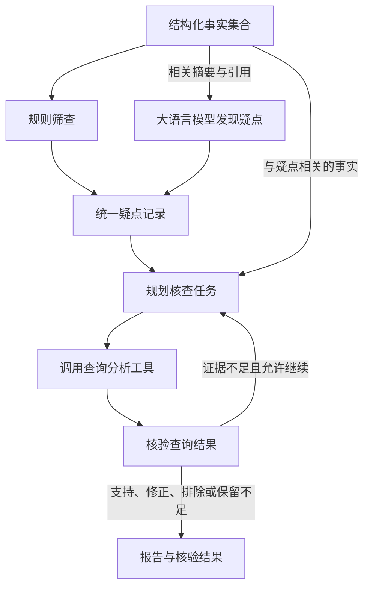

# 案件研判｜研判策略

## 统一术语

- **待核查疑点**（根据案件事实提出、涉及特定主体、时间范围和行为、需要进一步核验的涉嫌违规违纪风险问题；例如，A 与 B 在某段时间内的交易是否缺乏正常业务依据）。
- **核查任务**（为检验疑点而安排的具体查询与核对工作；例如，查询 A、B 的关系和交易明细，核对相关资金用途及业务背景）。
- **最终风险事件**（经补证和核验后，系统认为已有依据支持、因而保留在最终报告中的涉嫌违规违纪风险情形，包含相关主体、时间范围、行为及事实依据）。

疑点中的问题或暂定判断表达的是假设，核查任务是检验它的具体动作。疑点所指的风险情形经核验得到支持后，才可能作为最终风险事件输出；任务本身不会变成事件，被排除或证据不足的疑点也不能直接按得到支持的风险事件统计。

这里的“最终”指本次系统流程的输出阶段。它仍是系统作出的风险判断，可能存在误报和漏报，需要与专家事先标出的风险事件进行评测对照。

## 简历条目

> **研判策略：**按业务口径**预设参数化 SQL**，筛选聚合百万级案件记录，形成结构化事实；结合规则筛查与大语言模型分析发现疑点，以核验结果驱动**定向补证**；对照基线流程，最终风险事件：**精确率 81.0%→84.9%**，**召回率 85.0%→87.7%**。

> 本条理解状态：既有主线已确认。本轮按用户要求统一术语并明确数据流；下文记录结构是方案示例，具体字段名、模型调用拆分与上下文预算仍需对照实际代码核实。

## 第一阶段：本条理解

这条工作的核心是：从甲方已有平台提供的案件数据中整理事实，通过业务规则与大模型发现**待核查疑点**，再围绕疑点规划**核查任务**，通过查询、补证和核验判断疑点是否得到支持。

### 数据背景与统一称呼

我接入的是**甲方已有平台按业务主题组织并保存的案件数据**，涉及人员、资金、资产和通联等信息。各类数据的业务说明与字段信息，帮助我理解记录的含义、对象之间的关联，以及可以分析哪些问题。

这些数据仍保留大量细粒度记录，涉及人员较多、时间跨度较大，整体达到百万级。不能将全部记录直接放入大语言模型上下文，需要先围绕研判需求进行筛选、关联和统计，再将结果整理为结构化事实。

“按业务主题组织”说明数据的组织方式，不等于采用了机器学习聚类，也不说明上游只做过分类或筛选。现阶段确认的是仍保留大量细粒度记录，不把全部输入一概称为未经处理的原始明细。“人员、资金、资产和通联”概括数据领域，不代表平台恰好分成四个互斥类别；正式分类及其层级仍需核对原始配置。

### 事实、疑点、任务与最终输出的关系

同一个风险问题在核查前以疑点记录表达，核验后根据结果决定是否进入最终风险事件输出；核查任务始终是为判断该问题而安排的工作。

| 对象 | 回答什么 | 数据性质与主要内容 |
| --- | --- | --- |
| 结构化事实 | 已经查到或计算出了什么？ | 查询记录、统计结果、关系及来源引用；可按需要组织成事实包。 |
| 待核查疑点 | 根据这些事实，什么问题值得进一步核查？ | 结构化疑点记录，包含自然语言描述、相关主体与时间范围、事实引用、证据缺口和发现来源。 |
| 核查任务 | 为核查某个疑点，接下来具体做什么？ | 结构化任务记录，包含关联疑点、查询目标、对象与范围、需要完成的检查和完成条件。 |
| 核验结果 | 已取得的信息能否支持疑点？ | 支持、修正、排除或证据不足，并保留依据与仍未解决的问题。 |
| 最终风险事件 | 哪些风险判断经系统核验后被保留在最终输出中？ | 系统认为已有依据支持的具体风险情形；仍需与专家评测对照，不能将系统输出等同于客观上必然成立。 |

例如，仅用于说明对象区别：查询事实是“A 与 B 在某段时间内存在多笔资金往来，频次达到预设筛查条件”；待核查疑点是“这些交易是否缺乏正常业务依据”；核查任务是“查询双方关系与交易明细，核对金额、时间、对手及可获取的业务背景信息”。最终是否保留为风险事件，取决于补查信息与核验结果，不能仅凭存在资金往来作判断。

疑点的自然语言描述可以是一句问题，也可以是带有“可能、需核查”等限定的暂定陈述。它的作用是确定核查方向，不是预先断言某人存在违规交易。

### 关键做法与因果

1. **先理解数据，再用查询分析工具整理事实。**

   我先结合数据说明和实际样本，确认字段含义和关联关系，再针对不同业务数据的特点，通过预设的参数化 SQL 和相应程序逻辑完成筛选、关联和统计，形成结构化事实。

   例如，仅用于说明机制：按人员、账户和时间范围查找记录，统计交易次数、累计金额，或者整理资金往来关系。查到的记录和统计结果按明确字段组织，整理成结构化事实供后续分析。

   这些 SQL 和程序逻辑被封装为**可调用的查询分析工具**。工具是可调用的程序入口，内部执行预设 SQL 和相应程序逻辑（先把 SQL 和相关处理逻辑封装成一个函数，再让 Agent 通过工具调用机制使用这个函数）。SQL 是实现查询的代码，而工具是对外提供查询能力的程序接口。

   实际执行时，Agent 提出工具名和参数，由后端调用对应函数并返回结果。

   查询、关联和统计时采用的具体标准，就是简历中所说的“业务口径”。我结合案件数据结构与研判需求提出方案，涉及业务合理性的关联方式、统计口径和风险识别条件，在实际采用前与甲方领域专业人员确认。沟通确认是形成标准的过程，“口径”本身指确定后的标准。

2. **两条通道从共同的事实基础中发现疑点。**

   **业务规则筛查通道：**根据相关事实或查询结果检查明确条件是否达成。例如，单笔交易金额、一定时间内的累计交易金额或交易次数超过设定阈值。命中后形成疑点记录，写明命中了什么条件，并关联对应事实。

   **大模型分析通道：**结合研判目标、业务说明和相关事实摘要，提出待核查疑点。输入应包含当前分析范围内未触发规则但仍与研判相关的事实，而不是只接收规则命中结果。例如，仅用于说明机制：结合 A 经多个中间账户向 B 转款的路径、金额频次特征与相关人员关系，提出这些资金往来是否缺乏正常业务依据的疑点；

   中间人角色、实际受益人和交易背景等信息，往往需要结合多条事实进行关联分析。相比固定规则，大模型更适合辅助理解这些复杂关系，提出需要进一步核查的风险疑点。

   事实包是查询结果的组织方式，不要求先触发风险规则才能形成；规则未命中的相关事实也可以保留在共同事实集合中。

   “共同事实基础”也不等于把全部结构化事实一次性放入大模型上下文。大模型读取的是按当前分析范围和 Token 预算组织的事实摘要；内容较多时，可按业务主题或主体分批处理，并保留后续回查入口。

   两条通道都形成**结构化疑点记录**。疑点描述可以是自然语言，但外层应使用统一字段，记录主体、时间范围、已有事实、证据缺口与发现来源。不能把规则通道的事实包直接等同于疑点，也不能让大语言模型只返回无法关联事实的自由文本。

   开发时，我会借助 AI 辅助梳理可选的分析方法、处理策略和风险识别规则的设计思路，再结合需求与约束判断其前提和适用性，通过实际验证决定采用、修改还是舍弃。涉及业务标准的部分与甲方领域专业人员确认。

4. **统一疑点记录，再结合相关事实规划核查任务。**

   规划阶段的输入包括：待核查疑点、对应的事实摘要与引用、可用工具及执行约束。大模型据此提出核查任务，明确关联哪个疑点、要查谁、查什么、查哪个时间范围，以及怎样判断任务已经完成。一个疑点可以拆成多个核查任务。规划输出的是查询与检查安排，执行后才会产生新的查询事实；

   **规划时也需要相关结构化事实。**疑点记录帮助明确核查目标，事实帮助判断已有依据（未能形成完整证据链）和缺口，两者不能互相替代。规划阶段围绕已选疑点组织相关事实，不必重复装入本次分析范围内的全部事实。

   疑点发现回答“哪些问题值得查”，任务规划回答“具体怎样查”。两者的任务指令、输入重点和输出结构不同；同一个大模型可以承担这两个步骤。

   后端负责检查任务与工具参数，并按依赖、疑点数量上限和调用预算等约束执行。

5. **执行核查任务，围绕证据缺口复用工具补查。**

   核查任务调用查询分析工具获取相关记录与统计结果，再集中核验这些信息能否支持疑点。如果仍缺少关键依据，就根据具体缺口追加或调整核查任务，进一步限定人员、账户和时间范围等参数，补查后再次核验。

   例如，仅用于说明机制：已经查到双方资金往来，并在金额、频次等特征上存在可疑，但仅凭这些信息不能判断是正常往来还是存在违规违纪风险。因此，针对相关主体补查双方关系、交易时间、金额、对手等已有数据，结合资金用途或业务背景信息继续核验。查回结果可能支持正常往来的判断，也可能支持原疑点；信息不足时仍保留缺口。

   **核查同时关注支持和反驳疑点的信息。**补证的目的在于判断疑点是否得到支持，而不是为预先认定的违规结论寻找支撑。补回的信息可能支持、修正或排除疑点，也可能表明现有证据仍然不足。

   疑点发现和补证阶段统一使用“查询分析工具”这一称呼，不另设两套粗、细粒度工具的表述。补证时参数更具体，表示查询对象和范围更聚焦；前期查询和统计得到的仍然是明确结果，并非模糊估计。实际能否完成补查取决于现有数据与工具能力；新的需求可能需要补充或调整模板。

   核查任务完成，表示规定范围内的查询和检查已经执行并返回结果，不等于疑点成立。证据仍不足时，需要明确保留缺口，并按预算和终止规则决定是否继续，不能反复补查直到得到支持结论。

6. **分别评价疑点发现与核验后最终输出的质量。**

   “疑点阶段召回率”看专家事先标出的风险事件中，有多少在疑点发现阶段已经被系统注意到。“被注意到”指系统提出的疑点能按既定匹配规则对应到该事件，不表示此时已经完成核验，也不要求所有疑点最终都成立。它不是核查任务完成率。

   最终风险事件的评测对象，是补证、核验后由系统保留在最终输出中的风险事件，以专家事先标出的风险事件作对照。精确率从 81.0% 提升到 84.9%，表示系统最终报出的风险事件中，与专家标出的风险事件对应得上的比例提高；召回率从 85.0% 提升到 87.7%，表示专家标出的风险事件中，被系统最终正确找出的比例提高。这里的“对应得上”按同一套事件匹配规则判断。

   在统一评测标准和可比条件下，这说明整套流程相较基线改善了最终识别质量。疑点阶段与最终事件阶段的召回率不能互相替代，整体指标也不能单独证明某个环节的贡献。要判断某项策略的贡献，需要在其他条件一致时，比较加入或去掉这项策略后的结果。

理解主线：整理结构化事实 → 规则与大语言模型发现待核查疑点 → 汇总疑点并结合相关事实规划核查任务 → 调用工具核查 → 围绕缺口定向补证 → 形成核验结果并评测。涉及业务合理性的标准在实际采用前与甲方领域专业人员确认。



### 数据形态与上下文组织

下表明确本轮方案中的接口职责；具体字段名、分批策略、调用拆分和预算配置仍需核对实际实现。

| 环节 | 输入 | 输出 |
| --- | --- | --- |
| 查询与统计 | 人员、账户、时间范围等工具参数 | 结构化事实及来源引用。 |
| 业务规则筛查 | 对应事实或查询结果、已确认的规则条件 | 带命中条件和事实引用的疑点记录。 |
| 大模型分析发现疑点 | 研判目标、业务说明、当前分析范围内的相关事实摘要与引用，包括未触发规则的相关内容 | 同一格式的疑点记录，描述待核查问题、已有依据和缺口。 |
| 汇总与规划 | 合并后的疑点记录、对应事实、可用工具与执行约束 | 关联疑点的核查任务。 |
| 执行与核验 | 核查任务、工具返回的事实及来源 | 对疑点的核验结果，以及仍需补查的缺口。 |
| 报告输出 | 疑点、对应事实与核验结果 | 系统最终保留的风险事件；证据不足事项另行注明，不混作得到支持的风险事件。 |

自然语言和结构化数据不是二选一：**疑点描述用自然语言表达，外层用固定字段组织。**规则与大语言模型共用疑点记录格式，但它们都不等于事实包。后端需要核对字段、主体、时间范围及事实引用，格式正确本身不能证明疑点成立。

以下仅为结构示例，不是已核实的数据库或代码 Schema。假设 F1、F2 分别引用 A 向 C、C 向 B 的交易记录，一条疑点可以表示为：

```json
{
  "issue_id": "I1",
  "question": "A 经 C 向 B 的相关转账是否缺乏正常业务依据？",
  "subjects": ["A", "C", "B"],
  "time_range": "本次查询覆盖的时间范围",
  "fact_refs": ["F1", "F2"],
  "missing_evidence": [
    "C 在相关交易中的角色",
    "两笔转账是否对应同一事项",
    "相关交易的资金用途与业务背景"
  ],
  "origins": ["llm"]
}
```

如果规则也发现同一个问题，合并时保留两路来源与事实引用。同一疑点可以进一步拆出交易核对、人员关系核对等任务；其中一项任务可以表示为：

```json
{
  "task_id": "T1",
  "issue_id": "I1",
  "goal": "获取并核对相关交易明细",
  "scope": {
    "subjects": ["A", "C", "B"],
    "time_range": "围绕已知交易进一步限定的时间范围"
  },
  "checks": [
    "查询相关转账记录",
    "核对交易时间、金额和对手"
  ],
  "completion_criteria": "完成指定范围的查询，返回结果及来源；无数据时明确记录缺失"
}
```

疑点记录表达“什么有待核查”，任务记录表达“为此执行什么”。上例中的任务完成后，还可能需要另一项任务核对人员关系；即使各项查询均已执行，疑点也可能仍然证据不足。

### 工程用词与责任范围

“方案设计”是一项工作，“技术方案”通常指这项工作形成的内容；“技术路线”强调其中的主要实现路径，不等于代码实现。方案设计可以具体到架构、选型与实现设计，不限于大致的思想和策略。

| 表达 | 主要说明什么 |
| --- | --- |
| 需求与约束分析 | 要解决什么问题，目标、范围、输入输出和限制是什么。 |
| 方案设计 | 准备采用什么流程、方法和策略解决问题。 |
| 架构设计 | 各模块负责什么，怎样协作，数据怎样流转。 |
| 技术路线与选型 | 采用怎样的实现路径和技术组合；具体选择哪些框架、数据库等组件。 |
| 代码实现 | 编写 SQL、程序、接口和工具，将设计落实为可执行功能。 |
| 测试与效果验证 | 检查实现是否符合要求，以及效果是否达到预期。 |

这些工作会相互影响和调整，不必理解为严格串行的阶段。在自己承担的工作范围内，我负责需求与约束分析、方案设计、技术选型、代码实现和测试验证，并对最终的方案选择、实现质量和验证结果负责；涉及业务标准的内容由甲方领域专业人员确认。

工程术语参考：[使技术策略与业务需求保持一致](https://learn.microsoft.com/zh-cn/azure/well-architected/architect-role/design-business-requirements)、[开发体系结构设计规范](https://learn.microsoft.com/zh-cn/azure/well-architected/architect-role/architecture-design-specification)。

## 第二阶段：面试问答

```text
Q01. 你是怎样设计这套研判策略的？

答：我接入的是甲方已有平台按业务主题组织并保存的案件数据，涉及人员、资金、资产和通联等信息。各类数据有对应的业务说明等字段信息，帮助我理解记录的含义、对象之间的关联，以及可以分析哪些问题。

这些数据仍保留大量细粒度记录，涉及人员较多、时间跨度较大，整体达到百万级，不能全部直接放入大语言模型上下文。因此，需要先根据研判需求进行筛选、关联和统计，再将结果整理成供后续分析使用的结构化事实。

我先结合数据说明和实际样本，确认字段含义和关联关系，再针对不同业务数据的特点，通过预设的参数化 SQL 和相应程序逻辑完成筛选、关联和统计，形成结构化事实。这些 SQL 和程序逻辑被封装为可调用的查询分析工具。

在整理出的事实基础上，通过规则筛查和大语言模型分析两条通道发现待核查疑点。规则按明确条件筛查（例如，单笔交易金额、一定时间内的累计交易金额或交易次数超过设定阈值）；大语言模型读取相关事实摘要，综合资金往来、时间和人员关系提出疑点（例如，结合 A 经多个中间账户向 B 转款的路径、金额频次特征与相关人员关系，提出是否存在缺乏正常业务依据的资金往来）。

两路结果统一为带有事实引用和证据缺口的疑点记录，合并去重后，结合相关事实和可用工具，由大语言模型规划核查任务（例如，查询双方关系与交易明细，核对相关资金用途和业务背景）。随后调用工具获取信息并核验；如果仍缺少关键依据，就围绕具体缺口进一步限定人员、账户和时间范围等参数，补查后再次核验。核查结果可能支持、修正或排除疑点，也可能表明证据仍然不足；系统核验后保留的风险判断进入最终风险事件输出。

上述关联方式、统计口径和风险识别条件，都会在实际采用前与甲方领域专业人员确认其业务合理性。对照基线流程，最终风险事件的精确率从 81.0% 提升到 84.9%，召回率从 85.0% 提升到 87.7%。这是整套流程的对照结果。


Q01-1. 你处理的数据来自哪里，有什么特点？为什么需要先整理事实？

答：我接入的是甲方已有平台按业务主题组织并保存的案件数据，涉及人员、资金、资产和通联等信息，各类数据有对应的业务说明与字段信息。

这些数据仍保留大量细粒度记录，涉及人员较多、时间跨度较大，整体达到百万级。因此需要先根据研判需求筛选、关联和统计，再将结果组织成结构化事实，供后续规则筛查与大语言模型分析使用。

这里的“百万级”指项目处理的案件记录规模，不代表每个案件、每类数据都达到百万条，也不代表把全部记录直接交给大语言模型。


Q01-2. 人员、资金、资产和通联数据分别提供什么信息？它们怎样关联？

答：人员信息帮助确定分析主体及其与银行卡、电话号码等对象的对应关系；资金数据提供交易时间、金额、交易对手等信息；资产数据提供相关资产信息；通联数据反映号码之间的联系。

我结合数据说明和实际样本，确认可用的人员、账户、号码等标识和对应关系，再设计关联查询，并与甲方领域专业人员确认关联方式的业务合理性。

这四项概括数据领域，不代表平台恰好分成四个互斥类别。更细的分类、层级与代表字段需要以实际配置和数据为准。


Q01-3. 面试介绍时，需要先把数据类别、字段和规模全部讲清楚，才能讲设计吗？

答：先交代支撑方案的必要背景即可。开场说明系统处理什么数据、希望得到什么结果、我负责哪部分工作，就可以进入研判策略的主线。

被追问时，再展开数据类别、代表字段、规模和查询细节。

学习时，可以沿着“业务场景与数据基础 → 需求与约束分析 → 方案设计与技术选型 → 代码实现 → 测试与效果验证”理解完整逻辑。面试时根据当前问题选取相关内容，不必每次从头介绍整个系统。


Q01-4. 方案设计、技术方案、技术路线和代码实现有什么区别？

答：方案设计是根据需求与约束，安排解决问题的流程、方法和策略；技术方案通常指这些技术设计形成的具体内容，可以包含架构、选型和实现设计。

技术路线强调主要实现路径和关键技术组合；技术选型则比较收益、代价与适用条件，选择框架、数据库等组件。架构设计关注模块职责、协作与数据流。代码实现是把这些设计落实为 SQL、程序、接口和工具。

在这条工作中，安排事实整理、疑点发现、任务规划、补证和核验，属于方案设计；将查询和风险识别条件落实为 SQL 与程序，属于代码实现。使用 LangGraph 等框架只是实现的一部分。

这些工作会相互影响，不能把方案只理解为大致思想，也不能把技术路线等同于代码实现。


Q02. 简历里的“业务口径”是什么意思？你怎样据此设计 SQL？

答：业务口径就是查询、筛选和统计数据时采用的具体标准，通俗地说，就是明确要查什么、怎样关联、怎么算。

在项目中，我结合数据说明和实际样本，确认字段含义和关联关系，再根据研判需求设计取数范围、关联方式和统计口径。

这些涉及业务合理性的标准会在实际采用前与甲方领域专业人员确认，并落实到预设的参数化 SQL 和相应程序逻辑中。“口径”强调标准本身，沟通确认是形成标准的过程。


Q02-1. SQL 与查询分析工具是什么关系？怎样用于疑点发现和补证？

答：工具是可调用的程序入口，内部执行预设 SQL 和相应程序逻辑（先把 SQL 和相关处理逻辑封装成一个函数，再让 Agent 通过工具调用机制使用这个函数）。SQL 是实现查询的代码，而工具是对外提供查询能力的程序接口。

我预先写好查询结构和统计逻辑，执行时传入人员、账户和时间范围等参数，由后端调用对应函数完成筛选、关联与统计，大语言模型不需要临时生成 SQL。

疑点发现和补证阶段统一使用这类工具。补证时根据具体证据缺口进一步限定参数，使查询范围更聚焦；前期统计结果仍然是明确结果，不是模糊估计。

预设逻辑便于检查和复用，但查询能力受已有模板和数据约束，新的需求可能需要补充或调整模板。


Q03. 风险识别规则是什么？这些规则是怎样确定并实现的？

答：风险识别规则就是把业务上值得排查的情况写成明确条件，再用 SQL 或程序逻辑检查，并将命中情况及其对应事实组织为待核查疑点。

例如，单笔交易金额、一定时间内的累计交易金额或交易次数超过设定阈值。这些是机制示例，具体阈值需要结合实际业务确认，命中也不等于风险结论已经成立。

我根据可用数据和研判需求提出规则设计思路，借助 AI 辅助梳理可选方法，再结合需求与约束审查和验证这些建议。

涉及业务合理性与具体标准的部分，会与甲方领域专业人员确认，再由我落实为规则判断逻辑并验证结果。


Q03-1. 大语言模型怎样发现待核查疑点？输出是什么？

答：大语言模型读取相关结构化事实摘要，综合资金往来、时间和人员关系等信息，提出需要进一步核查的问题，并按统一字段输出疑点记录。

例如，仅用于说明机制：结合 A 经多个中间账户向 B 转款的路径、金额频次特征与相关人员关系，提出这些交易是否缺乏正常业务依据的疑点。中间人的角色、实际受益人和交易背景，则是后续需要核查的信息。路径由查询或程序计算得到，大语言模型在此基础上提出待验证的问题，不直接认定风险成立。

疑点描述用自然语言表达，外层仍是结构化记录，包含相关主体、时间范围、事实引用、证据缺口和发现来源，便于与规则输出合并并交给后续规划。

规则按明确条件筛查，大语言模型可以补充尚未被这些条件覆盖的疑点，但两路输出都需要后续核查。


Q03-2. “事实包”是什么？它与待核查疑点有什么区别？

答：事实包是把查询到的记录、统计结果和来源信息组织起来，供后续分析使用的数据；它不要求先触发风险规则才能形成。

事实包说明查到了什么，例如某个主体在一段时间内的交易次数、合计金额及对应来源。待核查疑点则说明根据这些事实，还有什么风险问题值得继续查，并引用已有事实和列出缺口。

两者都可以用结构化数据表示，但事实包保存查询与计算结果，疑点记录保存待验证的问题，不能互相替代。面试中可以把事实包称为“初步整理的案件事实”或“结构化事实”。


Q03-3. 两条疑点发现通道怎样互补？大语言模型会读取全部事实吗？

答：两条通道从共同的事实基础中取所需信息。规则按明确条件发现疑点，大语言模型则读取当前分析范围内的相关事实摘要，其中应包含未触发规则但仍与研判相关的内容。

规则命中决定规则通道输出什么，不应成为大语言模型获取事实的唯一筛选条件。如果大语言模型只读取规则命中结果，能够补充发现的范围就会受到限制。

也不是把全部结构化事实一次性输入上下文。需要按当前分析范围和 Token 预算组织摘要与引用，内容较多时按业务主题或主体分批，并保留回查入口。

这有助于扩大覆盖，但仍可能漏掉疑点，实际互补效果需要在相同疑点数量上限和调用预算下评测，并结合消融对照。


Q03-4. 这些方法和规则是你自己设计的吗？你怎样使用 AI 并对结果负责？

答：我负责结合实际数据和研判需求设计方案，过程中会借助 AI 辅助梳理可选的分析方法、处理策略和风险识别规则的设计思路。

对这些建议，我会结合需求与约束，判断其前提是否成立、推理是否合理，以及是否适用于当前问题，再通过实际验证决定采用、修改还是舍弃。涉及业务标准的部分，会与甲方领域专业人员确认。

在我承担的工作范围内，我负责需求与约束分析、方案设计、技术选型、代码实现和测试验证，并对最终的方案选择、实现质量和验证结果负责。

这里要区分开发时用 AI 辅助设计和实现，以及系统运行时用大语言模型分析案件，两者不是同一次调用。


Q03-5. 规则、大语言模型与任务规划环节怎样传递数据？规划时还要输入事实吗？

答：规则和大语言模型都输出统一格式的疑点记录，包含疑点描述、主体与时间范围、已有事实引用、证据缺口和发现来源。规则命中条件可以作为依据保留在记录中。

两路结果合并去重后，将选定疑点、对应事实摘要与引用、可用工具和执行约束交给规划环节，由大语言模型提出结构化核查任务。

规划时仍然需要相关事实，不能只给疑点描述。疑点明确要核查的问题，事实帮助判断已有依据和缺口；无需把所有疑点之外的事实再完整输入一次。

疑点发现回答“什么值得查”，任务规划回答“怎样查”，所以两步的任务指令和输出结构不同。同一个模型可以承担两项职责；具体拆成几次调用应以实际实现为准。


Q04. “以核验结果驱动定向补证”具体是什么意思？是给疑点找支撑证据吗？

答：就是把核验发现的证据缺口转成有明确对象和范围的核查任务，再复用查询分析工具获取所需信息。

例如，仅作机制说明：已经查到双方资金往来，并出现需要进一步核实的金额或频次特征，但还不能判断是正常往来还是存在违规违纪风险，就针对相关主体补查双方关系、交易明细，以及可获取的资金用途和业务背景信息。查谁、查什么、查哪个时间范围，都由当前缺口决定，并通过工具参数限定。

核查同时关注支持和反驳疑点的信息，目的是检验疑点中的假设，而不是为预先认定的违规结论寻找支撑。存在资金往来或未查到业务依据，都不能单独证明违规。

补回的信息可能支持、修正或排除疑点，也可能仍然不足。证据不足时保留缺口，按预算与终止规则决定是否继续。


Q04-1. 核查任务包含什么？完成任务是否说明疑点成立？

答：核查任务是为判断某个疑点而安排的具体工作，包含关联疑点、查询目标、对象和时间范围、需要完成的检查以及完成条件。规划时列出要获取的信息，工具执行后才得到实际查询事实。

例如，“A 经 C 向 B 的资金往来是否缺乏正常业务依据”是疑点中的假设；“查询相关转账明细，核对时间、金额和交易对手”是一项核查任务，“查询相关人员关系及可获取的业务背景，核对 C 的角色和交易用途”可以是另一项任务。

一个疑点可以对应多个任务。任务完成表示规定范围内的查询和检查已经执行并返回结果，不等于疑点成立。疑点经核验得到支持后，系统才可能将其涉及的风险情形保留为最终风险事件；被排除或证据不足时，记录相应状态。不是核查任务变成了风险事件。


Q05. 这些指标怎样评测？能说明哪些效果？

答：评测以专家事先标出的风险事件为对照，分别检查疑点发现阶段有没有注意到这些事件，以及最终输出有没有正确识别这些事件。两阶段按既定事件匹配规则判断是否对应。

疑点阶段召回率看专家标出的风险事件中，有多少在疑点发现阶段已经被系统注意到；最终精确率看系统最终报出的风险事件中，有多少与专家标出的事件对应得上；最终召回率看专家标出的风险事件中，有多少被系统最终正确找出。

我基于脱敏案件和专家标注构建事件级评测集，按案件划分开发集和测试集，在相同疑点数量上限和调用预算下比较基线与改进流程。

疑点阶段召回率从 86.5% 提升到 92.4%；最终风险事件的精确率从 81.0% 提升到 84.9%，召回率从 85.0% 提升到 87.7%。两阶段指标不能互相替代，也不能用任务完成率代替。

这些结果说明整套流程在这组评测条件下改善了识别质量，不能单独证明规则、大语言模型或定向补证各自的贡献，具体贡献还需要消融对照。
```

## 待补事实

以下内容仍需结合当时的材料或代码补充，不能把解释机制的示例当作真实经历：

- 基线流程的具体组成。
- 一条实际风险识别规则、判断条件及对应案例；阈值类型和资金路径例子只是机制说明。
- 一组实际事实、待核查疑点、核查任务及核验结果，核对记录字段、事实引用和疑点与任务的关联方式。
- 事实摘要的实际筛选与分批方式、是否覆盖规则未命中的相关内容、实际上下文预算与回查机制。
- 两路疑点实际怎样合并、去重和控制数量；疑点发现与任务规划实际拆成几次模型调用。
- 一个“核验缺口怎样转成补查任务”的实际过程，以及证据仍不足时的实际处理方式。
- 事件匹配规则、疑点与标注事件的具体匹配和去重方法，以及各项消融对照的实际结果。
- 平台实际业务分类及层级、代表字段、单案与各类数据的规模、各类数据的覆盖情况。
- 一个实际审查、修改或舍弃 AI 建议，并完成验证的例子，用于支撑自己判断和负责的表述。

## 第二阶段补充：精简面试表达版

以下沿用详细版题号，适合面试时先回答；被追问时再展开对应的详细版。示例用于解释机制，具体实现仍以实际材料为准，上面的“待补事实”继续适用。

```text
Q01. 你是怎样设计这套研判策略的？

答：甲方提供的是按业务主题整理的案件数据，仍有百万级细粒度记录，不能一次交给大模型。我先用预设的参数化 SQL 和程序筛选、关联、统计数据，整理出事实，再通过规则和大模型两条通道发现待核查疑点。

两路疑点合并后，大模型结合相关事实规划核查任务，再调用查询分析工具补查并核验。发现证据缺口，就有针对性地补查；仍无法判断的，保留缺口。系统核验后认为有依据支持的风险判断，才进入最终风险事件输出。

关联方式、统计口径和规则条件，会在采用前与甲方领域人员确认。对照基线，最终精确率从 81.0% 提升到 84.9%，召回率从 85.0% 提升到 87.7%。


Q01-1. 数据来自哪里？为什么要先整理事实？

答：数据来自甲方已有平台，按业务主题组织，涉及人员、资金、资产和通联。它们保留了大量细粒度记录，涉及人员多、时间跨度大，整体达到百万级。全部放进模型上下文不现实，所以先按研判需求筛选、关联和统计，再把结果和来源整理成结构化事实。


Q01-2. 这几类数据各有什么用？怎样关联？

答：人员数据用于识别主体以及对应的账户、号码；资金数据记录交易，资产数据反映相关资产，通联数据反映号码之间的联系。我先核对字段说明和样本，再根据已有标识和对应关系设计关联查询，请甲方领域人员确认是否合理。这些是数据领域的概括，具体分类以平台为准。


Q01-3. 面试开场需要把数据细节全部讲完吗？

答：先说明处理什么数据、解决什么问题、自己负责什么，就可以进入研判策略的主线：先整理事实，再发现疑点，最后补证核验。被追问时，再展开数据类别、代表字段和查询方法。


Q01-4. 方案设计、技术方案、技术路线和代码实现有什么区别？

答：方案设计是想清楚怎样解决问题，技术方案是形成的设计内容。技术路线说明主要实现路径，技术选型决定用哪些组件，代码实现则把设计变成能运行的功能。比如，安排事实整理、疑点发现和补证核验属于方案设计，编写 SQL 和工具函数属于代码实现。


Q02. “业务口径”是什么意思？怎样落实到 SQL？

答：业务口径就是查谁、查哪段时间、怎样关联、怎样计算。我结合数据说明、样本和研判需求提出这些标准，与甲方领域人员确认后，落实到参数化 SQL 和程序逻辑中。比如统计交易次数，要先明确统计对象、时间范围，以及哪些记录计入。


Q02-1. SQL 和查询分析工具是什么关系？补证时怎样复用？

答：我把预设 SQL 和相关处理逻辑封装成函数，供 Agent 通过工具调用使用。SQL 负责查询，工具则提供可调用的接口；执行时由后端接收人员、账户、时间范围等参数并返回结果。疑点发现和补证都使用这类工具，补证时围绕具体缺口调整参数。超出现有查询能力的需求，需要调整或补充工具。


Q03. 风险识别规则是怎样确定和实现的？

答：规则是把值得排查的情况写成明确条件，例如单笔金额、一定时间内的累计金额或交易次数超过阈值。我结合数据和需求提出规则思路，与甲方领域人员确认后，用 SQL 或程序实现并验证。命中只表示需要核查，不能直接认定违规。


Q03-1. 大模型怎样发现疑点？输出什么？

答：大模型结合已有事实提出需要核查的问题。比如，程序查出 A 经多个账户向 B 转款后，模型结合金额、时间和人员关系，提出“这些交易是否缺乏正常业务依据”的疑点。输出是一条结构化疑点记录：用自然语言说明问题，同时带上相关主体、时间、事实引用和证据缺口，方便后续核查。


Q03-2. 事实包和疑点有什么区别？

答：事实包是整理好的查询记录、统计结果和来源，说明已经查到了什么。疑点则说明还有什么问题需要核查。比如，“某段时间有多笔转账”是事实，“这些转账是否缺乏正常业务依据”是疑点。事实包不需要等规则命中后才生成。


Q03-3. 两条通道怎样互补？大模型会读取全部事实吗？

答：规则检查明确条件，大模型结合多条事实补充可能遗漏的疑点。要形成互补，模型需要看到相关但未触发规则的事实。模型输入还要受上下文容量限制，所以应按当前分析范围组织事实摘要，内容多时分批处理。实际能多发现多少疑点，需要在相同疑点数量上限和调用预算下评测。


Q03-4. 这些方案是你自己做的吗？怎样使用 AI？

答：方案由我负责设计，过程中会借助 AI 梳理可选方法和规则思路。对它的建议，我会检查前提是否成立、推理是否合理、是否适合当前需求，再通过实际验证决定采用、修改还是舍弃；涉及业务标准的，请甲方领域人员确认。在我承担的范围内，我负责分析需求、选定方案和技术、完成代码与测试，并对最终交付负责。


Q03-5. 发现疑点后怎样规划任务？规划时还要输入事实吗？

答：两路结果都整理成疑点记录，合并去重后，连同相关事实、可用工具和调用预算等限制交给规划环节。大模型据此输出结构化核查任务，写清针对哪个疑点、查谁、查什么、查哪段时间，以及怎样算完成。规划仍然需要相关事实，才能判断已经知道什么、还缺什么。


Q04. 定向补证具体怎么做？

答：就是核验时发现缺什么，再针对这个缺口补查。比如，双方资金往来的金额或频次值得关注，但还不能判断是否正常，就继续查双方关系、交易明细，以及能获取的资金用途或业务背景。

补查要同时关注支持和反驳疑点的信息，再据此更新判断；查不到业务依据，也不能直接认定违规。证据仍不足时保留缺口，并按调用预算和停止条件决定是否继续。


Q04-1. 核查任务是什么？完成任务就说明疑点成立吗？

答：核查任务是为检验疑点安排的具体工作。比如，“这笔转账是否缺乏正常业务依据”是疑点，“查询交易明细并核对双方关系”是核查任务。

一个疑点可以对应多个任务。任务完成只表示查询和检查做完了。系统核验后认为有依据支持的风险判断，才可能进入最终风险事件输出；证据不足或疑点被排除的，要分别记录。


Q05. 这些指标怎么评测？说明了什么？

答：我用脱敏案件和专家标注评测，按案件划分开发集和测试集，再按统一匹配规则，在相同疑点数量上限和调用预算下比较基线与改进流程。

疑点阶段召回率看专家标出的事件中，有多少在疑点阶段就被系统注意到，从 86.5% 提升到 92.4%。最终精确率看系统最终报出的事件中，多少与专家标注对应得上，从 81.0% 提升到 84.9%；最终召回率看专家标出的事件中，多少被最终找出，从 85.0% 提升到 87.7%。

这些是整套流程在这组评测条件下的结果。单个环节贡献多大，还要通过消融对比来判断。
```
