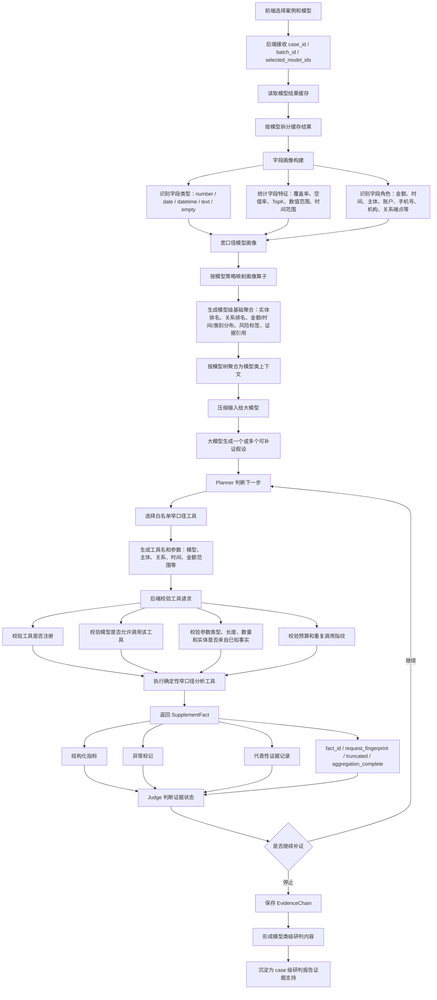
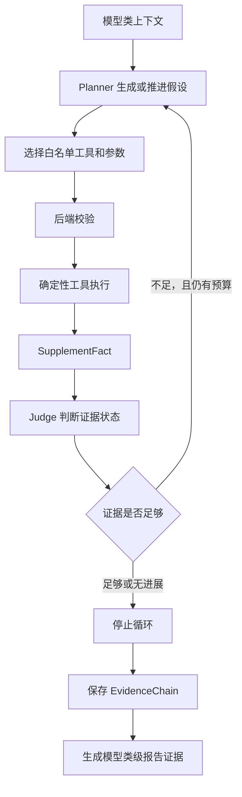

# 当前方案设计与交接说明

> 文档前半部分保留原型阶段的设计背景与未完成判断；当前可执行的质量候选、
> 严格验收和后续生产化边界以 [`docs/quality_pipeline.md`](docs/quality_pipeline.md)
> 与 [`docs/execution/final_roadmap_and_interview_plan.md`](docs/execution/final_roadmap_and_interview_plan.md)
> 为准，避免把历史 Demo 状态误读为当前发布状态。

本文将说明当前报告研判链路的最新设计思想、数据流转、已初步实现的能力和后续落地边界。

## 1. 核心目标

系统目标是把办案大数据分析平台中“已选案例 + 已选模型”的模型缓存结果，转化为可追溯、可复核、可继续补证的研判证据链，并最终服务 case 级研判报告。

这里的分析起点不是原始银行流水、话单或业务源表，而是前端建模后落入后端缓存表的模型结果。后端以这些模型缓存结果为初始事实来源，先做确定性的宽口径画像，再让大模型在受控上下文中提出假设、选择工具、阅读工具结果并判断证据状态。

一句话概括：

```text
模型缓存结果是事实起点，确定性画像是基础压缩，大模型负责提出和推进假设，白名单窄口径工具负责补证，证据链沉淀为模型类级和 case 级报告依据。
```

## 2. 这个方案是否已经实现

该方案已经有初步实现，但还不是完整生产形态。

已经初步实现的部分：

- 能按 case 和 model 读取模型缓存结果，作为分析输入。
- 能对模型结果中的字段做字段画像，识别字段类型、覆盖率、空值率、TopK 取值、数值范围、时间范围和字段角色。
- 能通过确定性配置和字段角色，把模型映射到宽口径画像逻辑，形成模型级事实包。
- 能按模型树中的模型类聚合同类模型上下文，形成模型类级输入。
- 已有模型类级 Planner、工具调用、Judge、证据链保存的循环。
- 已有白名单工具注册、参数校验、预算约束、重复调用控制和补证结果结构化返回。
- 已有模型 86 的专属窄口径工具 `transfer_structure_analyzer`，用于作为“重点复杂模型如何精细化、个性化配置分析算子”的样板。
- 已有 `ModelClaim` 的代码结构，用于承接模型级补证后的当前判断投影。

仍需继续建设的部分：

- 将“所有模型的宽口径字段画像 -> 模型类上下文 -> 假设生成 -> 工具补证 -> 证据链 -> 模型类报告 -> case 报告”固化为稳定运行入口。
- 完善更多重点模型的专属窄口径工具。
- 将模型级 `ModelClaim` 更稳定地接入模型类级 Agent 和最终 case 级报告。
- 建设更完整的跨模型调用边和证据复用机制。
- 把报告渲染、锚点校验、引用校验、截断语义校验固化为工程流程。

因此，当前状态可以表述为：总体架构已经验证可行，核心链路已有原型能力；后续工作重点是把模型 86 样板做深做稳，再扩展更多模型和跨模型证据链。

## 3. 数据流转链路

下面是当前方案的完整数据流。方向向下，表示数据和控制权逐层流转。



## 4. 关键设计思想

### 4.1 模型缓存结果是初始事实来源

前端选择案例并完成模型构建后，后端只读取该案例、该批次、该模型范围内的缓存结果。系统不让大模型直接读取全量原始数据，也不让大模型生成 SQL 或代码后执行。

缓存结果进入后端后，会按模型拆分，每个模型先独立形成自己的基础画像和事实包。这个设计保证每个事实都能追溯到模型、字段、记录范围和证据引用。

### 4.2 宽口径画像先压缩事实

每个模型的缓存结果可能包含不同字段。系统先检查字段名、字段取值和字段分布，生成字段画像：

- 字段是否为空，覆盖率是多少。
- 字段取值是否能解析为数字、日期、时间或文本。
- 字段 TopK 取值是什么。
- 数值字段的最大、最小、平均值是多少。
- 时间字段的最早、最晚时间是什么。
- 字段名是否像金额、次数、时间、人员、账户、手机号、机构、关系起点、关系终点等。

只要没有新增模型类型或新增完全陌生字段语义，这一层可以通过确定性规则程序完成，不需要大模型参与计算。

### 4.3 模型策略决定宽口径算子

字段画像只是识别“字段像什么”。真正生成模型事实包时，还需要结合模型配置：

- 模型属于哪个模型类。
- 模型业务含义是什么。
- 模型复杂度是 L0、L1 还是 L2。
- 哪些字段是人员、账户、对手方、金额、时间、关系起点和关系终点。
- 该模型允许调用哪些窄口径补证工具。
- 该模型有哪些异常规则和阈值。

宽口径画像输出的目标不是直接写报告，而是生成稳定、可压缩、可引用的模型级事实，包括模型概览、实体排名、关系排名、异常标签和证据引用。

### 4.4 模型树决定模型类上下文

前端已有模型树，后端应读取并尊重模型树，不自行重造分类。每个模型类下有哪些模型，由模型树决定。

模型类上下文由该类下各模型的基础事实包、重点实体、重点关系、风险标签和可补证线索组成。大模型不消费全量原始记录，而消费压缩后的模型类上下文。

### 4.5 大模型负责假设和工具选择，不负责事实计算

大模型在当前链路中主要承担三类任务：

- Planner：根据模型类上下文提出假设，并选择下一步调用哪个工具。
- Judge：阅读工具返回的结构化事实，判断证据增强、削弱还是仍待核查。
- Writer：在最终报告阶段，把已验证的 Claim 和证据链组织成中文表达。

金额、次数、TopK、时间分布、关系指标、集中度、异常标记等事实数字，只能由确定性工具生成。

### 4.6 窄口径工具负责补证

Planner 只能从白名单工具中选择。工具调用参数也必须来自已有事实上下文，例如某个模型中的人员、账户、关系起点、关系终点或候选对手方。

后端在执行工具前会校验：

- 工具是否存在。
- 该模型是否允许调用该工具。
- 参数名和参数类型是否合法。
- 主体或关系是否来自已有 FactPack。
- 是否超出预算。
- 是否重复调用。

工具返回 `SupplementFact`，其中包含结构化指标、异常标记、证据记录、稳定 ID、截断状态和聚合完整性。

### 4.7 证据链保存推理过程

每一轮假设、工具选择、工具参数、工具返回、Judge 判断和停止原因都应保存为证据链。证据链不是临时日志，而是后续模型类级报告和 case 级报告的事实支撑。

如果工具返回 `truncated=true` 或 `aggregation_complete=false`，该轮结果只能作为待核查信息，不能直接生成“增强”或“削弱”的结论。

## 5. 策略库与算子工具

当前策略库采用 YAML 配置，以模型为单位描述分析策略，包括：

- `model_id`：模型 ID。
- `root_category`：模型树中的模型类。
- `demo_level`：当前复杂度层级。
- `demo_role`：模型在研判中的业务角色。
- `model_kind`：模型类型，例如 `entity`、`relation`、`category`、`no_data`、`entity_dictionary`。
- `allowed_tools`：该模型允许调用的窄口径工具。
- `allowed_followup_models`：后续可补证的相关模型。
- `shared_entity_types`：可跨模型共享的实体类型。
- `person_fields`、`account_fields`、`counterparty_fields`、`amount_fields`、`time_fields`：字段角色配置。
- `relation`：关系模型中的起点、终点和金额字段。
- `anomaly_rules`：该模型启用的异常规则。
- `thresholds`：异常判断阈值。

### 5.1 字段画像规则

字段画像由 `src/field_profile.py` 实现，主要逻辑如下：

| 规则类别 | 当前能力 |
|---|---|
| JSON 解析 | 从模型缓存结果的 `json_data` 中解析字段和值。 |
| 空值识别 | 识别空字符串、`null`、`none`、`nan`、`未知`、`-` 等空值。 |
| 数值识别 | 去除逗号、人民币符号、元、百分号后判断是否为数字。 |
| 时间识别 | 通过日期解析器判断字段值是否为日期或时间。 |
| 字段角色识别 | 根据字段名中的关键词识别金额、比例、次数、时间、人员、账户、地点、机构、手机号、关系端点等角色。 |
| 取值特征 | 输出覆盖率、空值率、原始类型分布、TopK、数值范围、时间范围。 |

字段角色识别是确定性的字符串模式匹配。例如：

- 字段名包含“金额、余额、总额、净额、保费”时，优先识别为金额字段。
- 字段名包含“时间、日期”时，识别为时间字段。
- 字段名包含“姓名、主体、人员、对象、对手、客户、单位”时，识别为实体字段。
- 字段名包含“卡号、账号、账户、银行卡、手机号、电话、号码”时，识别为账户或号码字段。
- 字段名包含“转出、转入、起点、终点、发起、接收、流向、关系”时，识别为关系端点字段。

### 5.2 宽口径画像算子

宽口径算子主要由 `src/operators.py`、`src/entity_profile.py`、`src/anomaly_rules.py` 承担。它们用于把模型缓存结果压缩为模型级基础事实。

| 算子 | 类型 | 作用 | 映射方式 |
|---|---|---|---|
| `numeric_topk` | 宽口径 | 选择金额或数值字段，计算最大、最小、TopK 记录。 | 根据字段画像中的 `amount` 角色或 `number` 类型自动选择字段。 |
| `category_topk` | 宽口径 | 对类别、文本、地点、实体等字段做 TopK 分布。 | 根据字段角色选择类别字段。 |
| `entity_frequency` | 宽口径 | 对人员、主体、账户、号码等实体字段做出现频次排名。 | 根据字段角色中的 `entity` 或 `account` 选择字段。 |
| `time_bucket` | 宽口径 | 对时间字段按月份聚合，并输出时间范围。 | 根据字段角色中的 `time` 选择字段。 |
| `relation_edges` | 宽口径 | 对关系模型识别起点和终点，聚合关系边次数和金额。 | 优先使用已知字段对；其次使用 `relation_endpoint` 和 `entity` 字段。 |
| `evidence_samples` | 宽口径 | 抽取少量代表性记录作为证据样本。 | 对当前模型结果按顺序抽样。 |
| `detect_entity_anomalies` | 宽口径异常 | 识别压线金额、夜间交易、高频窗口、多对手方、同日同额等实体异常。 | 根据策略中的 `anomaly_rules` 和阈值执行。 |
| `detect_relation_anomalies` | 宽口径异常 | 识别自转账高密度、资金流向重点边等关系异常。 | 根据关系画像、模型类型和策略规则执行。 |
| `build_followup_hints` | 宽口径线索 | 为后续 Planner 提供可补证主体和关系。 | 从排名靠前或触发异常的实体、关系中生成。 |

宽口径算子命中的原则是：先由字段画像识别字段角色，再由模型策略约束字段含义，最后由确定性程序执行聚合。大模型不参与这一层事实计算。

### 5.3 窄口径补证工具

窄口径工具注册在 `src/tool_registry.py`，执行逻辑在 `src/supplement_tools.py` 和 `src/model_tools/model_86_tools.py`。

| 工具 | 适用模型 | 作用 | 主要参数 | 当前状态 |
|---|---|---|---|---|
| `entity_model_slice` | `entity`、`relation` | 围绕一个主体，在一个模型内重新读取窄范围记录并生成定向画像。 | `model_id`、`entity_name` | 已实现 |
| `relation_neighbor_subgraph` | `relation` | 围绕一个主体，统计其入边、出边、Top 关系邻域。 | `model_id`、`entity_name` | 已实现 |
| `fund_flow_path_probe` | `relation` | 从一个源主体出发，搜索有界两跳资金路径。 | `model_id`、`source`、可选 `target` | 已实现 |
| `same_amount_window_probe` | `entity` | 围绕主体识别同日同额转账模式。 | `model_id`、`entity_name` | 已实现 |
| `counterparty_overlap_probe` | `entity`、`relation` | 比较同一主体在多个模型中的 Top 对手方是否重合。 | `entity_name`、可选 `model_ids` | 已实现 |
| `transfer_structure_analyzer` | `relation`，当前专用于模型 86 | 分析模型 86 中某主体的转账结构，包括自转账、对手方集中度、夜间占比、账户轮转和资金循环。 | `model_id`、`entity_name` | 已实现模型 86 样板 |

#### 5.3.1 模型 86 样板的定位

模型 86 的 `transfer_structure_analyzer` 不只是一个孤立工具，而是当前方案中“如何为重点复杂模型设计专属分析算子”的样板。

通用工具能回答“某个主体在某个模型里命中了多少记录、有哪些 Top 入边和出边”，但对于重点复杂模型，这种结果仍然偏粗。模型 86 属于大规模转账关系模型，仅看命中条数或 Top 关系边，无法充分回答业务问题。因此当前以模型 86 为例，探索如何把一个重点模型拆成更贴合业务语义的专属窄口径分析：

- 从宽口径 Baseline 中选出值得调查的主体或关系。
- 让 Planner 判断是否需要进入模型 86 的专属分析。
- 调用 `transfer_structure_analyzer`，围绕单个主体重新读取窄范围转账关系。
- 输出自转账比例、对手方集中度、夜间占比、周末占比、账户轮转、资金循环模式等结构化指标。
- 通过 `anomaly_flags` 明确标记 `self_transfer_dominant`、`high_concentration`、`night_intensive`、`fund_cycle_detected` 等异常模式。
- 让 Judge 基于结构化指标和异常标记判断该假设是增强、削弱还是仍需核查。

这个样板说明了后续扩展重点模型时应遵循的做法：不是给所有模型套同一个通用切片工具，而是针对每个重点模型的业务语义设计适合它的问题、参数和结构化输出。例如：

- 对资金流向模型，应关注路径、承接、分散流出、回流和金额缺口。
- 对同日同额模型，应关注日期、金额、对端集合和批量拆分模式。
- 对大额存取现模型，应关注现金方向、时间窗口、账户承接和后续资金去向。
- 对关系模型，应关注入边、出边、中心主体、闭环路径和对手方集中度。

根目录下的 `专属工具详细设计.md` 就是专门说明这一层设计的文件。它解释了为什么通用补证工具不够、专属工具应该回答什么调查问题、工具输出为什么必须结构化，以及模型 86、模型 43、模型 70、模型 101 这类重点模型后续应如何扩展专属工具。

窄口径工具的命中方式与宽口径不同：

- 宽口径算子由确定性规则自动映射。
- 窄口径工具由大模型 Planner 在上下文中选择，但只能选择策略库允许的工具。
- Planner 负责决定“查哪个模型、围绕哪个主体、使用哪个工具、带什么参数”。
- 后端负责做白名单、参数、实体、预算和重复调用校验。
- 工具执行仍是确定性程序，不由大模型计算事实。

### 5.4 当前模型策略覆盖

当前策略库已经覆盖的代表模型包括：

| model_id | 模型类 | 模型类型 | 当前定位 | 允许工具 |
|---|---|---|---|---|
| 98 | 人员画像 | `entity_dictionary` | 人员、银行卡、手机号实体来源 | 无 |
| 5 | 人员画像 | `entity` | 账户余额事实 | `entity_model_slice`、`counterparty_overlap_probe` |
| 28 | 金融画像 | `category` | 消费类型分布统计 | 无 |
| 43 | 金融画像 | `entity` | 金额、时间、账户异常聚焦 | `entity_model_slice`、`counterparty_overlap_probe` |
| 101 | 金融画像 | `relation` | 资金流向关系摘要 | `entity_model_slice`、`relation_neighbor_subgraph`、`fund_flow_path_probe`、`counterparty_overlap_probe` |
| 14 | 电信画像 | `no_data` | 无话单数据分支 | 无 |
| 86 | 多维分析 | `relation` | 大规模转账关系边聚合，当前重点样板 | `entity_model_slice`、`relation_neighbor_subgraph`、`fund_flow_path_probe`、`counterparty_overlap_probe`、`transfer_structure_analyzer` |
| 70 | 多维分析 | `entity` | 时间窗口、同额异常 | `entity_model_slice`、`same_amount_window_probe`、`counterparty_overlap_probe` |

### 5.5 工具返回与证据状态

所有补证工具都应返回统一结构：

```text
summary                 工具结果摘要
structured              结构化指标，适用于专属工具
anomaly_flags           异常标记
evidence_records        代表性证据记录
evidence_refs           可引用证据 ID
fact_id                 稳定事实 ID
request_fingerprint     工具调用指纹
rows_read               实际读取行数
truncated               是否被预算截断
aggregation_complete    聚合是否完整
status_signal           enhanced / weakened / unresolved
```

其中 `truncated=true` 或 `aggregation_complete=false` 时，系统必须把 `status_signal` 维持为 `unresolved`，避免在证据不完整时形成过强结论。

## 6. Planner-Tool-Judge 循环

当前循环的职责划分如下：



Planner 的输入应包含：

- 当前模型类的压缩事实。
- 重点实体和关系。
- 已有异常标签。
- 已调用工具摘要。
- 已调用工具指纹。
- 剩余预算。
- 可调用工具 schema。
- 模型级 Claim 摘要。

Planner 的输出必须是结构化工具请求或停止理由。后端不能直接相信 Planner 输出，必须校验后再执行。

Judge 的输入应优先使用工具返回的结构化字段和异常标记。自然语言摘要可以辅助理解，但不作为唯一判断依据。

## 7. 特别注意的边界

1. 不要让大模型计算事实数字。
2. 不要让大模型生成 SQL 或 Python 后执行。
3. 不要把全量原始数据塞给大模型。
4. 不要绕过模型树自行重分模型类。
5. 不要绕过策略库随意调用工具。
6. 不要把截断或聚合不完整的结果写成增强或削弱结论。
7. 不要把模型级中间产物当作前端独立交付报告。
8. 不要平均展开所有模型，复杂重点模型优先做深，简单模型保持确定性表格和索引。

## 8. 当前方案一句话交接

当前方案是：以前端选定案例的模型缓存结果为事实起点，先用确定性字段画像和宽口径算子压缩每个模型，再按模型树聚合为模型类上下文；大模型在受控上下文中提出假设并选择白名单窄口径工具，后端校验并执行确定性补证工具，Judge 判断证据增强、削弱或待核查，循环结束后保存证据链和 Claim，最终为 case 级研判报告提供可追溯证据支持。
